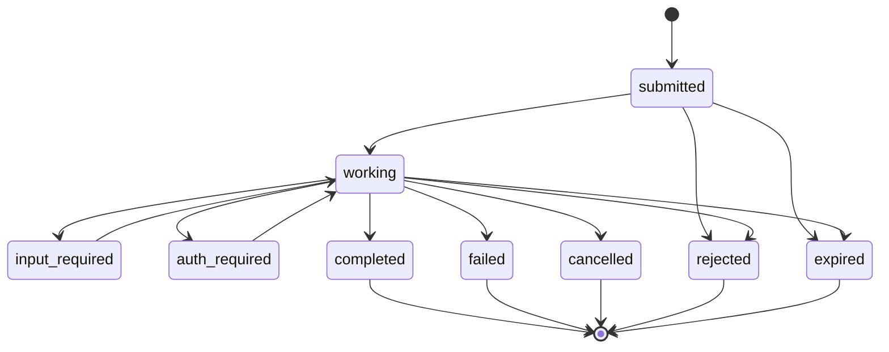
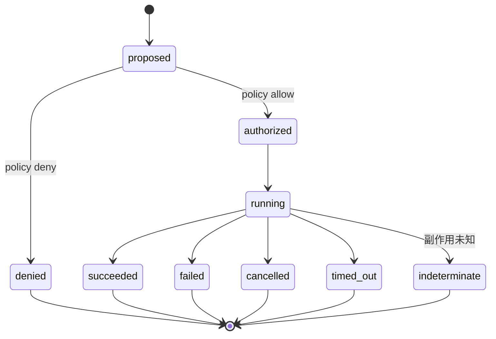
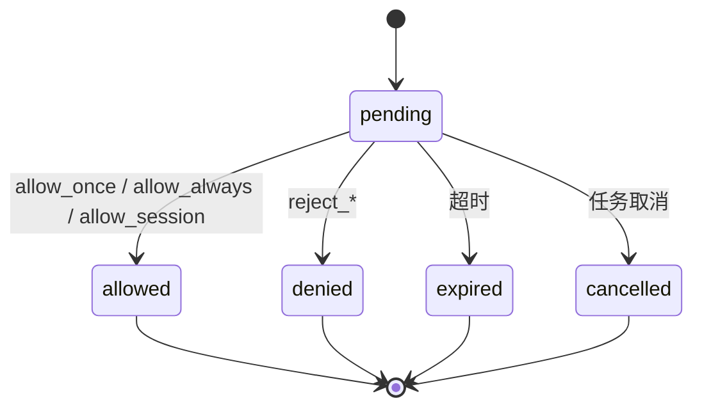
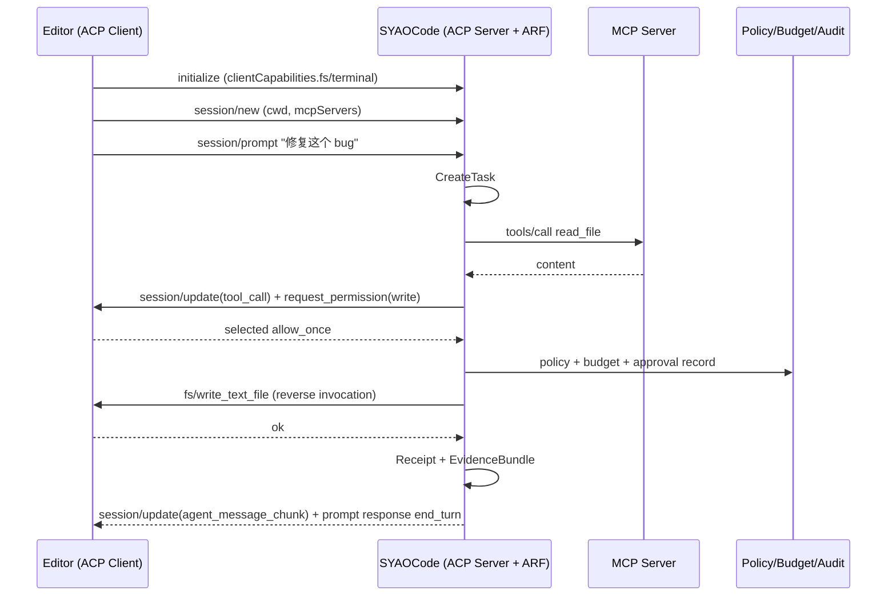
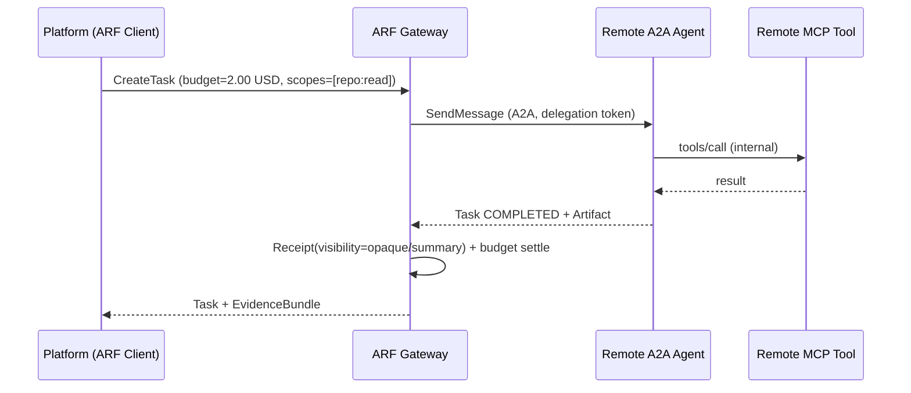
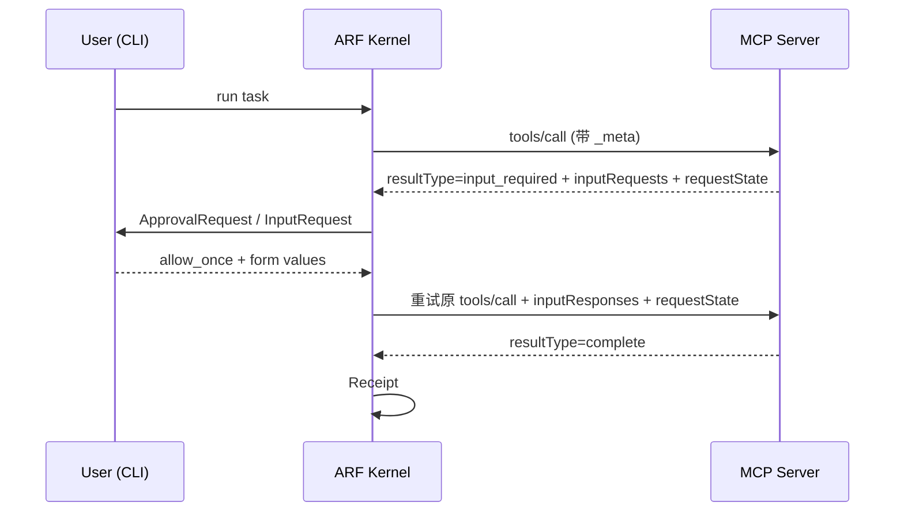

# 01 · 协议基线与统一模型

> 核验日期：2026-10-27 ~ 2026-10-28  
> 基线：MCP `2026-07-28`；A2A `1.0.0`；ACP（Agent Client Protocol）`v1` 稳定、`v2` 草案  
> 事实来源与 UNVERIFIED 项见 [04-外部事实核验记录.md](04-外部事实核验记录.md)

---

## 1. 为什么现在必须回答"统一"问题

### 1.1 三个协议已经同时进入产品视野

SYAOCode 的定位是"可嵌入的 coding agent runtime"，这意味着它迟早要同时面对三类集成：

- **工具/数据接入**：客户已有 MCP server（GitHub、Jira、数据库、内部系统），希望直接复用；
- **Agent 互操作**：客户的平台 Agent 要把任务委派给 SYAOCode，或 SYAOCode 要把子任务委派给远端 Agent；
- **编辑器/IDE 集成**：Zed、Neovim、VS Code 通过 ACP 驱动编码 Agent，并要求文件系统、终端、审批由客户端掌控。

如果每个协议各写一套权限、预算、审计、证据，最后会得到三套语义不一致的"治理方言"：同一个"允许写文件"的决策，在 MCP 里是一次 elicitation，在 ACP 里是一次 `session/request_permission`，在 A2A 里是一个 `TASK_STATE_AUTH_REQUIRED` 状态；三者的"批准一次/永久批准/拒绝"无法互相解释，审计也无法拼成一条链。

### 1.2 当前仓库的真实缺口

| 能力 | 现状（v0.2） | 缺口 |
| --- | --- | --- |
| MCP | 未实现 | 无 client/server、无能力发现、无 MRTR |
| A2A | 未实现 | 无 AgentCard、无 Task/Artifact、无 push |
| ACP | 未实现 | 无 session/permission/fs/terminal 桥 |
| 统一 `serve` | 仅 DD-17 设计稿 | 无协议无关的 Task/Approval API |
| 权限 | 本地 `PermissionEngine` 可用 | 只覆盖本地工具；无跨协议审批权威 |
| 预算 | 单次运行 `maxCostUsd` 粗略估算 | 无预留/结算/跨 Agent 传递 |
| 证据 | `ToolReceipt` + 工作区账本 | 只覆盖本地工具；无 Task 级 Evidence Bundle |
| 审计 | 会话 JSONL | 无哈希链、无跨协议事件、无导出规范 |

> 结论：**不是"再做一个协议适配器"，而是先把内核补齐**。否则三个适配器只会把已有的 P0 缺陷复制三遍（Redactor 未接线、路径围栏只覆盖写、危险命令 allow 规则忽略来源、core 入口泄漏 Node 内置模块等，见 `概览.md` §9）。

### 1.3 三种错误做法

| 做法 | 为什么错 |
| --- | --- |
| **做一个"超级协议"取代三者** | 三个标准各有治理机构、版本节奏与生态；新协议没有采用者，只会增加第四种碎片 |
| **做一个反向代理网关** | 网关只能做路由、鉴权、限流；无法表达 Task 状态、审批选项、产物哈希、证据链；价值会被云 API Gateway 吸收 |
| **取三者最小公分母** | 最小公分母 = 只有"发消息/收消息"，会丢掉 MCP 的结构化工具、A2A 的 Task/Artifact、ACP 的 client-owned fs/terminal |

---

## 2. 三个协议的事实基线

### 2.1 MCP 2026-07-28：无状态的能力协议

MCP 在 2026-07-28 做了一个**破坏性**修订，最重要的变化是"去会话化"：

- **没有 `initialize` 握手**，没有 `notifications/initialized`，没有 `Mcp-Session-Id`，没有 `ping`，没有 `logging/setLevel`。
- 每个请求在 `_meta` 中自带：
  - `io.modelcontextprotocol/protocolVersion`（必填，字符串）
  - `io.modelcontextprotocol/clientCapabilities`（必填，空对象表示无可选能力）
  - `io.modelcontextprotocol/clientInfo`（SHOULD）
- 服务端**必须**实现 `server/discover`，返回 `supportedVersions`、`capabilities`、`ttlMs`、`cacheScope`；客户端可先发现再发请求。
- 服务端**不得**主动发起 JSON-RPC 请求；需要用户输入时，返回 `InputRequiredResult`（`resultType: "input_required"`），客户端带 `inputResponses` 与**原样** `requestState` 重试原请求（MRTR，SEP-2322）。
- Tasks 已移出核心，变成官方扩展 `io.modelcontextprotocol/tasks`：`tasks/get`、`tasks/update`、`tasks/cancel`、`notifications/tasks`；状态 `working | input_required | completed | failed | cancelled`。
- 工具结果 `content` 必填，`structuredContent` 可为任意 JSON 值；`ToolAnnotations` 明确是**不可信提示**，宿主不得据此做权限决策。
- 传输只剩两类标准绑定：**stdio** 与 **Streamable HTTP**；HTTP+SSE（2024-11-05）已废弃，GET 流、`Last-Event-ID` 恢复均已删除。
- 授权是可选的，但 HTTP 场景应遵循 OAuth 2.1：MCP server 是资源服务器，必须提供 RFC 9728 PRM；客户端必须同时支持 `WWW-Authenticate` 与 well-known 两种发现方式；`resource` 参数必填；`iss` 必须校验；凭据按 issuer 绑定。

> 对内核的含义：**MCP 不再替你持有会话**。Session/Task/审批状态必须由 ARF 内核自己持有；MCP 只是一个"可被发现、可被调用、可能要求补输入"的能力端点。

### 2.2 A2A 1.0.0：以 Task 为中心的 Agent 互操作协议

A2A 1.0.0 的核心是"独立 Agent 之间通过消息发起任务，任务产生状态与产物"：

- **发现**：`AgentCard`（`supportedInterfaces`、`capabilities`、`skills`、`securitySchemes`、`securityRequirements`、`signatures`）。AgentCard 是**自述**，不是授权凭证。
- **任务模型**：`Task { id, contextId, status, artifacts[], history[], metadata }`；`TaskStatus { state, message, timestamp }`。
- **状态**：`TASK_STATE_SUBMITTED / WORKING / COMPLETED / FAILED / CANCELED / INPUT_REQUIRED / REJECTED / AUTH_REQUIRED`。
- **JSON-RPC 方法名是 PascalCase**（与 gRPC 对齐）：`SendMessage`、`SendStreamingMessage`、`GetTask`、`ListTasks`、`CancelTask`、`SubscribeToTask`、`CreateTaskPushNotificationConfig`、`GetTaskPushNotificationConfig`、`ListTaskPushNotificationConfigs`、`DeleteTaskPushNotificationConfig`、`GetExtendedAgentCard`。
- **三种绑定**：JSON-RPC 2.0（SSE 流）、gRPC、HTTP+JSON/REST；三者必须功能等价。
- **版本**：`A2A-Version` 头（或查询参数）标识 `Major.Minor`；空值按 0.3 处理；不支持时返回 `VersionNotSupportedError`。
- **人在环**：`TASK_STATE_INPUT_REQUIRED` 表示需要补充输入；`TASK_STATE_AUTH_REQUIRED` 表示需要授权/凭据，客户端可通过消息、带外凭据或扩展完成。
- **幂等**：Get/List 天然幂等；SendMessage **MAY** 幂等（服务端可用 `messageId` 去重）；CancelTask 幂等。
- **安全**：每个请求都要鉴权与授权；List/Get/Cancel/Subscribe 都必须按调用者可见范围过滤；webhook 要防 SSRF、校验来源、幂等处理。

### 2.3 ACP（Agent Client Protocol）v1：编辑器与编码 Agent 的会话协议

先澄清一个高频混淆：**ACP 有两个**。

| 名称 | 方向 | 状态（2026-10-27） | 本设计是否采用 |
| --- | --- | --- | --- |
| **Agent Client Protocol**（agentclientprotocol.com） | 编辑器/客户端 ↔ 编码 Agent | **v1 稳定**；v2 草案（2026-07-20 公布） | **采用**，作为"编辑器边缘" |
| **IBM/BeeAI Agent Communication Protocol** | Agent ↔ Agent，REST/OpenAPI | **已废弃并并入 A2A**；仓库 archived（最后 push 2025-08-25） | 不采用；仅作历史参考 |

Agent Client Protocol v1 的要点：

- JSON-RPC 2.0，stdio 为主；Streamable HTTP 仍是草案。
- 连接级 `initialize`：`protocolVersion` 是**单个整数 MAJOR**；客户端声明 `clientCapabilities.fs {readTextFile, writeTextFile}`、`terminal`、`elicitation` 等；Agent 声明 `agentCapabilities.loadSession`、`promptCapabilities`、`mcpCapabilities`、`sessionCapabilities`、`auth`。
- **Session** 是核心：`session/new`、`session/load`（必须重放历史）、`session/resume`（不重放）、`session/close`、`session/list`、`session/delete`。
- **Prompt turn**：`session/prompt` 传入 `ContentBlock[]`，Agent 通过 `session/update` 流式返回 `agent_message_chunk`、`agent_thought_chunk`、`tool_call`、`tool_call_update`、`plan`、`usage_update` 等；最终返回 `stopReason`（`end_turn | max_tokens | max_turn_requests | refusal | cancelled`）。
- **审批**：Agent → Client 的 `session/request_permission`，阻塞式请求；选项 `optionId + name + kind`，kind ∈ `allow_once | allow_always | reject_once | reject_always`；响应只有 `{outcome:"selected", optionId}` 或 `{outcome:"cancelled"}`。
- **反向能力**：Agent 可以调用 Client 提供的 `fs/read_text_file`、`fs/write_text_file`、`terminal/create|output|wait_for_exit|kill|release`、`elicitation/create`；`cwd + additionalDirectories` 是客户端声明的有效根集合。
- **取消**：`session/cancel` 是通知；客户端必须把所有 pending 的 permission 请求以 `cancelled` 回答；Agent 必须把原 `session/prompt` 以 `stopReason:"cancelled"` 回答。
- **模式**：`ask` / `architect` / `code` 是文档示例，模式 ID 由 Agent 自定义；v2 草案在 2026-07-20 公布，收紧版本协商（`-32022`）、引入统一 patch 语义与结构化 diff，但明确"不要默认上生产"。

> 对内核的含义：ACP 是**双向**协议。Agent 不只是"被调用方"，还会反向调用客户端的文件系统、终端和审批。**反向调用必须纳入治理**，否则 `fs/write_text_file` 会成为绕过本地路径围栏的后门。

### 2.4 三协议对比总表

| 维度 | MCP 2026-07-28 | A2A 1.0.0 | ACP v1 |
| --- | --- | --- | --- |
| 所在层 | Host ↔ Capability | Agent ↔ Agent | Client/Editor ↔ Agent |
| 基本单位 | 请求（无状态） | Task | Session + Prompt turn |
| 发现机制 | `server/discover` + list 方法 | `AgentCard` | `initialize` + Registry |
| 会话 | **无**（协议级） | `contextId`（弱会话） | `sessionId`（强会话） |
| 任务状态 | 仅 Tasks 扩展 | 原生 Task 状态机 | 无（prompt turn 隐式） |
| 流式 | 响应 SSE + `subscriptions/listen` | `SendStreamingMessage` / `SubscribeToTask` SSE + push webhook | `session/update` 通知 |
| 人工介入 | MRTR `input_required`（elicitation） | `INPUT_REQUIRED` / `AUTH_REQUIRED` | `session/request_permission`（阻塞） |
| 工具级调用 | 原生 `tools/call` | **不暴露**（Agent 内部） | `tool_call` 事件（可见） |
| 产物 | `content` / `structuredContent` / resource | `Artifact`（多 Part） | tool call content / diff / terminal |
| 鉴权 | OAuth 2.1（HTTP）；stdio 用环境凭据 | `securitySchemes`（OAuth2/OIDC/API Key/mTLS） | `authMethods` + `authenticate` |
| 扩展 | `extensions` map | `AgentExtension` URI | `_meta` + 自定义 method |
| 版本 | 每请求 `_meta` 字符串 | `A2A-Version` Major.Minor | 整数 MAJOR |

---

## 3. 差异的五个根因

所有表面差异都可以归因到五个根因。统一模型必须逐条给出"规范解"，否则适配器会变成一堆 if/else。

| # | 根因 | 表现 | 规范解 |
| --- | --- | --- | --- |
| R1 | **生命周期归属不同** | MCP 无会话；A2A 以 Task 为中心；ACP 以 Session 为中心 | 内核引入 **Session → Task → Invocation** 三层；协议只映射其中一层或两层 |
| R2 | **权威来源不同** | MCP 的 host 是权威；ACP 的 client 是权威；A2A 的远端 agent 是权威 | 引入 **Principal + ApprovalAuthority + DelegationChain**；权威可委派、可审计 |
| R3 | **可见性不同** | MCP 暴露工具级；ACP 暴露 tool_call；A2A 对调用方**不透明** | 引入 **Visibility** 标注：`full / summary / opaque`；证据按可见性分级 |
| R4 | **状态持久化不同** | MCP 无状态；A2A 服务端持久化 Task；ACP 会话可 load/resume | 内核 **TaskStore 自持有**；协议侧状态只作投影/缓存 |
| R5 | **失败语义不同** | MCP JSON-RPC 错误 + `isError`；A2A Task 状态 + 错误码；ACP stopReason + JSON-RPC 错误 | 统一 **Outcome** 枚举 + 错误分类；适配器负责双向映射 |

> 一句话：**协议负责"怎么传"，内核负责"算什么"**。

---

## 4. 统一原则：一个内核，三种边缘

### 4.1 四层统一，但只统一其中三层

| 层 | 是否统一 | 说明 |
| --- | --- | --- |
| **Wire / 编码** | ❌ 不统一 | 保留 MCP/A2A/ACP 原生 wire；不发明新帧格式，不要求对端升级 |
| **语义 / 对象** | ✅ 统一 | Canonical IR：Session/Task/Invocation/Approval/Receipt/Event |
| **治理 / 策略** | ✅ 统一 | 身份、策略、预算、审批、幂等、审计、证据只有一份实现 |
| **开发者接口** | ✅ 统一 | 一套 TS SDK 挂载/调用三种协议；协议细节藏在 adapter 后面 |

### 4.2 三层作用域

```text
Session（长期协作，绑定 principal / workspace / policyRevision / budget）
  └── Task（一个有状态、可中断、可恢复的工作单元）
        └── Invocation（一次具体能力调用，有输入/输出/回执）
              ├── Approval（0..n，可挂起/可热改/可委派）
              ├── Artifact（0..n，产物）
              └── Receipt（1，不可抵赖回执）
```

- **Session**：ACP 的 `sessionId` 直接映射；A2A 的 `contextId` 映射为"轻会话"；MCP 无会话，由内核生成。
- **Task**：A2A 的 `Task` 直接映射；MCP Tasks 扩展的 task 映射；ACP 的一个 prompt turn 映射为一个 Task。
- **Invocation**：MCP `tools/call`、ACP `tool_call`、A2A 远端任务内部的未知动作（默认 opaque）映射。
- **Approval**：可挂在 Invocation 上（工具审批），也可挂在 Task 上（任务级授权/凭据）。
- **Receipt**：每个 Invocation 一张；Task 结束时聚合为 Evidence Bundle。

### 4.3 统一对象模型

```ts
// 仅表达语义，完整 Zod schema 见 02 §3
interface Principal {
  id: string;                    // user:alice / agent:syao / service:ci
  kind: 'user' | 'agent' | 'service';
  tenantId: string;
  scopes: string[];              // 粗粒度权限
  trustTier: 'first_party' | 'verified' | 'untrusted';
}

interface Capability {
  id: string;                    // mcp://github/tool/create_issue
  kind: 'tool' | 'resource' | 'prompt' | 'agent_skill' | 'fs' | 'terminal';
  protocol: 'mcp' | 'a2a' | 'acp' | 'local';
  displayName: string;
  inputSchemaRef?: string;
  outputSchemaRef?: string;
  risk: 'read' | 'write' | 'execute' | 'network' | 'spend' | 'delegate';
  sideEffect: 'none' | 'idempotent' | 'non_idempotent';
  dataClass: 'public' | 'internal' | 'confidential' | 'secret';
  visibility: 'full' | 'summary' | 'opaque';
  provider: { id: string; version?: string; endpoint?: string };
}

interface Session {
  id: string;
  tenantId: string;
  principal: Principal;
  protocolBinding: 'mcp' | 'a2a' | 'acp' | 'native';
  workspaceRoots: string[];
  policyRevision: string;
  budgetId: string;
  createdAt: string;
  state: 'open' | 'suspended' | 'closed';
}

interface Task {
  id: string;
  sessionId: string;
  parentTaskId?: string;
  state: TaskState;
  input: ContentBlock[];
  artifacts: ArtifactRef[];
  createdAt: string;
  updatedAt: string;
  terminalReason?: string;
}

interface Invocation {
  id: string;
  taskId: string;
  capabilityId: string;
  principal: Principal;
  input: unknown;
  idempotencyKey?: string;
  deadlineAt?: string;
  state: InvocationState;
  output?: unknown;
  error?: CanonicalError;
}

type TaskState =
  | 'submitted' | 'working'
  | 'input_required' | 'auth_required'
  | 'completed' | 'failed' | 'cancelled' | 'rejected' | 'expired';

type InvocationState =
  | 'proposed' | 'authorized' | 'running'
  | 'succeeded' | 'failed' | 'denied' | 'cancelled' | 'timed_out' | 'indeterminate';

interface Approval {
  id: string;
  taskId: string;
  invocationId?: string;
  subject: ApprovalSubject;      // tool / fs / terminal / network / spend / delegate
  risk: Capability['risk'];
  options: ApprovalOption[];
  authority: 'local' | 'delegated' | 'chain';
  delegationChain?: string[];
  policyRevision: string;
  expiresAt: string;
  state: 'pending' | 'allowed' | 'denied' | 'expired' | 'cancelled';
}

interface Receipt {
  id: string;
  invocationId: string;
  taskId: string;
  protocol: 'mcp' | 'a2a' | 'acp' | 'local';
  capabilityId: string;
  principalId: string;
  outcome: InvocationState;
  inputHash: string;
  outputHash?: string;
  artifacts: ArtifactRef[];
  approvalRefs: string[];
  policy: { revision: string; decisionId: string; effect: 'allow' | 'deny' | 'ask' };
  cost?: CostBreakdown;
  timing: { queuedAt: string; startedAt: string; endedAt: string };
  visibility: 'full' | 'summary' | 'opaque';
  prevReceiptHash?: string;
  receiptHash: string;
}
```

### 4.4 状态机

#### Task



- `input_required` 对应 A2A `TASK_STATE_INPUT_REQUIRED`、MCP `input_required`；`auth_required` 对应 A2A `TASK_STATE_AUTH_REQUIRED`，MCP 无原生对应（用 `input_required` + 认证类 input request）。
- `expired` 是 ARF 扩展：A2A 映射为 `TASK_STATE_FAILED`（reason=`timeout`），MCP 映射为 `failed`（reason=`timeout`），ACP 映射为 `stopReason:"max_turn_requests"` 或错误。
- `rejected` 只用于"策略/远端明确拒绝执行"；普通失败用 `failed`。

#### Invocation



`indeterminate` 只在"请求已发出、但没收到可判定结果"时使用（例如写操作超时、连接在响应前断开）。它必须触发人工复核或补偿动作，不能当成 `failed` 静默重试。

#### Approval



### 4.5 能力模型

#### 4.5.1 命名空间

| 协议 | Capability ID 规则 | 示例 |
| --- | --- | --- |
| MCP | `mcp://<serverId>/tool/<toolName>` | `mcp://github/tool/create_issue` |
| MCP resource | `mcp://<serverId>/resource/<uri>` | `mcp://docs/resource/file:///spec.md` |
| A2A | `a2a://<agentId>/skill/<skillId>` | `a2a://researcher/skill/web-research` |
| ACP tool | `acp://<clientId>/tool/<toolName>` | `acp://zed/tool/read_file` |
| ACP reverse | `acp://<clientId>/fs/read_text_file` | `acp://zed/fs/write_text_file` |
| 本地工具 | `local://tools/<name>` | `local://tools/bash` |

规则：

- `serverId` / `agentId` 由注册表分配，不能由远端自述覆盖；
- 同名工具跨 server 不合并；
- Capability ID 是稳定标识，能力版本变化用 `provider.version` 与 `capabilityHash` 区分，不改变 ID。

#### 4.5.2 风险与副作用

| 字段 | 取值 | 用途 |
| --- | --- | --- |
| `risk` | `read / write / execute / network / spend / delegate` | 策略匹配、审批分级、UI 展示 |
| `sideEffect` | `none / idempotent / non_idempotent` | 决定是否允许自动重试、是否需要幂等键 |
| `dataClass` | `public / internal / confidential / secret` | 决定脱敏、外发限制、审计留存 |
| `visibility` | `full / summary / opaque` | 决定证据粒度与用户可见性 |
| `reversible` | `boolean` | 决定是否要求"可回滚"审批 |

> **不要信任协议自带的注解**。MCP 的 `ToolAnnotations` 明确是提示，A2A 的 `AgentSkill` 是自述，ACP 的 `tool_call.kind` 由 Agent 填写。风险等级必须来自**注册表配置 + 策略**，协议字段只作参考。

### 4.6 事件模型

#### 4.6.1 信封

```ts
interface CanonicalEvent<T = unknown> {
  schemaVersion: 1;
  eventId: string;
  seq: number;                 // 每个 Task 内单调递增
  taskId: string;
  invocationId?: string;
  causationId?: string;        // 触发该事件的上一事件
  correlationId: string;       // 跨协议追踪
  ts: string;                  // ISO 8601
  principalId: string;
  protocol: 'mcp' | 'a2a' | 'acp' | 'native';
  type: CanonicalEventType;
  payload: T;
}
```

#### 4.6.2 事件类型

| 类别 | 事件 |
| --- | --- |
| Task | `task.created`、`task.state_changed`、`task.completed`、`task.failed`、`task.cancelled` |
| Invocation | `invocation.started`、`invocation.output_delta`、`invocation.completed`、`invocation.failed`、`invocation.denied` |
| Approval | `approval.requested`、`approval.resolved`、`approval.expired` |
| Capability | `capability.discovered`、`capability.unavailable` |
| Artifact | `artifact.created`、`artifact.updated` |
| Governance | `policy.decision`、`budget.reserved`、`budget.settled`、`budget.exceeded` |
| Evidence | `receipt.issued`、`evidence.sealed`、`evidence.verified` |

#### 4.6.3 重放与恢复

- 每个 Task 的事件流是**只追加**的，`seq` 连续；消费者按 `eventId` 去重，按 `seq` 排序。
- `events.list(taskId, afterSeq)` 支持断线重连；`snapshot(taskId)` 返回状态快照 + 最后 `seq`。
- 投递语义：**at-least-once**；副作用型消费者必须幂等。
- 事件保留：默认 30 天；Evidence 相关事件与 Receipt 长期保留（可配置）。

### 4.7 审批模型

#### 4.7.1 统一审批请求

```ts
interface ApprovalSubject {
  kind: 'tool' | 'fs' | 'terminal' | 'network' | 'spend' | 'delegate';
  summary: string;             // 人类可读一句话
  detail?: string;             // 展开说明
  diff?: { path: string; before?: string; after: string };
  command?: { argv: string[]; cwd: string; timeoutMs?: number };
  resource?: { uri: string; operation: 'read' | 'write' | 'delete' };
  spend?: { amount: number; currency: string; budgetId: string };
  delegation?: { to: Principal; scopes: string[]; expiresAt: string };
}

interface ApprovalOption {
  id: string;
  label: string;
  kind: 'allow_once' | 'allow_session' | 'allow_always' | 'deny_once' | 'deny_always';
  scope?: { capabilityId?: string; pathPrefix?: string; expiresAt?: string };
}
```

#### 4.7.2 三种审批权威

| 权威 | 适用场景 | 行为 |
| --- | --- | --- |
| **local** | CLI、无 UI 的嵌入式 SDK | 内核按策略 + 本地交互（TUI/stdio）裁决；无交互时 fail-closed |
| **delegated** | ACP 编辑器、A2A 远端调用方 | 内核把 ApprovalRequest 翻译成对端协议请求；等待对端决定；超时/取消按 fail-closed 处理 |
| **chain** | A2A 多跳委派 | 每一跳记录 `delegationChain`；最终审批可回溯到原始 Principal；任一跳拒绝则整链拒绝 |

#### 4.7.3 关键规则

1. **默认拒绝**：审批超时、连接断开、响应格式非法 → `denied`（不是 allow）。
2. **单赢家**：同一 Approval 的并发决策用 CAS；后到者收到 `already_decided`。
3. **热更新重检**：审批等待期间策略版本变化 → 重新评估；若新策略拒绝 → 立即 `denied`（与仓库现有 `PermissionEngine` 的 recheck 语义一致）。
4. **范围最小化**：`allow_always` 必须绑定 `capabilityId + scope`，不能是全局开关。
5. **可追溯**：每个决策记录 `decidedBy`、`authority`、`policyRevision`、`delegationChain`、时间戳。
6. **不可欺骗**：UI 展示的 `subject` 由内核生成，不由远端 Agent 的文本直接透传；远端文本只作为 `detail` 并标记 `untrusted`。

#### 4.7.4 三协议映射

| Canonical | MCP 2026-07-28 | A2A 1.0.0 | ACP v1 |
| --- | --- | --- | --- |
| `ApprovalRequest` | `InputRequiredResult.inputRequests`（elicitation） | `TASK_STATE_AUTH_REQUIRED` + `TaskStatus.message` | `session/request_permission` |
| 选项 | elicitation schema 的 enum/oneOf | 无标准选项；用扩展 metadata 或消息文本 | `PermissionOption[]` |
| 决策 | 客户端重试原请求，带 `inputResponses` + `requestState` | 客户端发消息/带外凭据/扩展 | `{outcome:"selected", optionId}` 或 `cancelled` |
| 超时 | 客户端放弃重试；服务端任务保持 `input_required` | Task 保持 `AUTH_REQUIRED` | 客户端可取消；Agent 必须回答 `cancelled` |
| 永久允许 | 由宿主策略记录；MCP 无原生语义 | 由调用方策略记录；A2A 无原生语义 | `allow_always` 选项 |
| 拒绝 | 不重试；返回错误/取消 | `REJECTED`（终态）或消息拒绝 | `reject_*` 选项 |

> 注意：A2A 没有"审批选项"的标准结构，ACP 没有"任务状态"，MCP 没有"服务端主动请求"。**统一的是语义，不是 wire**；适配器必须显式标注"降级"。

### 4.8 证据模型

#### 4.8.1 回执链

```text
Invocation 1 ── receiptHash ──▶ Invocation 2 ── receiptHash ──▶ ... ──▶ EvidenceBundle.rootHash
       ▲                              ▲
       │                              │
   approvalRefs                  policySnapshot
```

- 每个 Receipt 的 `receiptHash = H(canonicalJSON(receipt 去掉 receiptHash) + prevReceiptHash)`。
- Task 结束时生成 `EvidenceBundle { taskId, receipts[], artifacts[], approvals[], policySnapshots[], rootHash, sealedAt }`。
- 可选签名：`Ed25519(sign(rootHash))`，用于跨组织交付；本地默认不签名，避免密钥管理负担。

#### 4.8.2 可见性分级

| 级别 | 含义 | 适用 |
| --- | --- | --- |
| `full` | 输入/输出/产物全部可验证 | 本地工具、MCP 工具、ACP tool call |
| `summary` | 只记录摘要、哈希、成本；不记录原始内容 | 含敏感数据的 A2A 远端任务 |
| `opaque` | 只知道"发生了、成功/失败、花了多少" | 远端黑盒 Agent |

`opaque` 不是缺陷，而是诚实：**不能假装验证了看不见的东西**。产品文案必须区分"已验证完成"与"远端声明完成"。

---

## 5. 映射总表

### 5.1 总览

| Canonical | MCP 2026-07-28 | A2A 1.0.0 | ACP v1 |
| --- | --- | --- | --- |
| Session | 无（内核自持有） | `contextId`（弱） | `sessionId`（强） |
| Task | Tasks 扩展 task | `Task` | prompt turn（隐式） |
| Invocation | `tools/call` | 不暴露（opaque） | `tool_call` |
| Capability discovery | `server/discover` + `tools/list` / `resources/list` / `prompts/list` | `AgentCard.skills` | `initialize` + `session/new` 的 modes/config |
| Streaming | 响应 SSE / `subscriptions/listen` | `SendStreamingMessage` / `SubscribeToTask` | `session/update` |
| Approval | MRTR `input_required` | `AUTH_REQUIRED` / `INPUT_REQUIRED` | `session/request_permission` |
| Cancel | `notifications/cancelled`（stdio）/ 关闭流（HTTP）；`tasks/cancel` | `CancelTask` | `session/cancel` |
| Artifact | `content` / `structuredContent` / resource | `Artifact` | tool call content / diff / terminal |
| Auth | OAuth 2.1 + PRM（HTTP） | `securitySchemes` + `securityRequirements` | `authMethods` + `authenticate` |
| Error | JSON-RPC 错误 + `isError` | JSON-RPC 错误 + A2A 错误码 | JSON-RPC 错误 + stopReason |
| Extension | `extensions` map | `AgentExtension` URI | `_meta` + 自定义 method |

### 5.2 MCP 方法级映射

| MCP 方法 | ARF 操作 | 备注 |
| --- | --- | --- |
| `server/discover` | `DiscoverCapabilities` | 返回 `supportedVersions`、`capabilities`、`ttlMs`、`cacheScope`；必须缓存并遵守 TTL |
| `tools/list` | `ListCapabilities(kind=tool)` | 分页 `cursor`；结果确定序 |
| `tools/call` | `Invoke` | `content` + `structuredContent`；`isError` 映射为 `failed` 但保留原始错误 |
| `resources/list` | `ListCapabilities(kind=resource)` | |
| `resources/read` | `Invoke(kind=resource)` | |
| `prompts/list` / `prompts/get` | `ListCapabilities(kind=prompt)` / `Invoke` | |
| `tasks/get` | `TaskGet` | Tasks 扩展 |
| `tasks/update` | `TaskInput` | 客户端→服务端补充输入 |
| `tasks/cancel` | `TaskCancel` | |
| `notifications/tasks` | `Event(task.*)` | |
| `notifications/progress` | `Event(progress)` | `progressToken` 在 `_meta` |
| `notifications/cancelled` | `Cancel(invocationId)` | stdio 语义；HTTP 关闭流 |
| `subscriptions/listen` | `EventSubscribe` | 资源/列表变更 |
| `elicitation/create` | `ApprovalRequest` 或 `InputRequest` | **只在** `InputRequiredResult.inputRequests` 内出现 |
| `initialize` / `notifications/initialized` / `ping` / `logging/setLevel` | **不映射（legacy only）** | 2026-07-28 已删除；legacy 适配器单独处理 |

### 5.3 A2A 方法级映射

| A2A 方法 | ARF 操作 | 备注 |
| --- | --- | --- |
| `SendMessage` | `CreateTask` / `ContinueTask` | 返回 `Task` 或 `Message`；`messageId` 作幂等键候选 |
| `SendStreamingMessage` | `CreateTask` + `stream` | SSE；首个事件是 Task 或 Message |
| `GetTask` | `TaskGet` | `historyLength` 控制历史 |
| `ListTasks` | `TaskList` | cursor 分页；按最后更新时间倒序 |
| `CancelTask` | `TaskCancel` | 幂等 |
| `SubscribeToTask` | `TaskSubscribe` | 首个事件必须是当前 Task |
| `CreateTaskPushNotificationConfig` | `TaskSubscribe(push)` | webhook；需 SSRF 防护 |
| `GetTaskPushNotificationConfig` | `TaskSubscriptionGet` | |
| `ListTaskPushNotificationConfigs` | `TaskSubscriptionList` | |
| `DeleteTaskPushNotificationConfig` | `TaskSubscriptionDelete` | 幂等 |
| `GetExtendedAgentCard` | `DiscoverCapabilities(extended)` | 需鉴权；`capabilities.extendedAgentCard: true` |

### 5.4 ACP 方法级映射

| ACP 方法 | ARF 操作 | 备注 |
| --- | --- | --- |
| `initialize` | `BindSessionCapabilities` | 协商客户端能力；不是 Session 创建 |
| `session/new` | `CreateSession` | `cwd` 必须绝对路径；`mcpServers` 可空 |
| `session/load` | `ResumeSession(replay=true)` | Agent 必须先重放全部历史再响应 |
| `session/resume` | `ResumeSession(replay=false)` | 能力 `sessionCapabilities.resume` |
| `session/close` | `CloseSession` | 取消进行中工作 |
| `session/list` / `session/delete` | `ListSessions` / `DeleteSession` | 能力门控 |
| `session/prompt` | `CreateTask` / `RunTurn` | `ContentBlock[]`；返回 `stopReason` |
| `session/cancel` | `Cancel(taskId)` | 通知；必须把 pending permission 置 `cancelled` |
| `session/update` | `Event` | 变体见 §5.5 |
| `session/request_permission` | `ApprovalRequest` | Agent→Client 阻塞请求 |
| `fs/read_text_file` / `fs/write_text_file` | `ReverseInvoke(kind=fs)` | **必须纳入治理** |
| `terminal/create\|output\|wait_for_exit\|kill\|release` | `ReverseInvoke(kind=terminal)` | 客户端能力门控 |
| `authenticate` / `logout` | `Authenticate` / `Logout` | `authMethods` |
| `elicitation/create` | `InputRequest` | 结构化表单/URL |
| `$/cancel_request` | `CancelRequest` | 通用请求级取消 |

### 5.5 ACP `session/update` 变体映射

| ACP `sessionUpdate` | Canonical 事件 | 备注 |
| --- | --- | --- |
| `user_message_chunk` | `message.delta(role=user)` | 主要用于 replay |
| `agent_message_chunk` | `message.delta(role=agent)` | `messageId` 可选 |
| `agent_thought_chunk` | `reasoning.delta` | 与正文分开，默认不进入证据正文 |
| `tool_call` | `invocation.proposed` / `invocation.started` | `toolCallId` 映射 Invocation ID |
| `tool_call_update` | `invocation.output_delta` / `invocation.completed` | 字段是 patch 语义 |
| `plan` | `task.plan` | 全量替换，不是增量 |
| `available_commands_update` | `capability.discovered` | |
| `current_mode_update` | `session.mode_changed` | |
| `config_option_update` | `session.config_changed` | |
| `session_info_update` | `session.metadata_changed` | |
| `usage_update` | `budget.updated` | `used/size/cost` |
| `notice` | `notice` | 非历史，不回放 |
| `compaction_update` | `context.compaction` | 需客户端能力 |
| `compaction_summary_chunk` | `context.compaction.delta` | |

### 5.6 反向映射：ARF → 协议

| ARF 操作 | MCP | A2A | ACP |
| --- | --- | --- | --- |
| `Invoke(tool)` | `tools/call` | 不适用（包在 Task 内） | `session/update(tool_call)` + 执行 |
| `ApprovalRequest` | `InputRequiredResult` | `AUTH_REQUIRED` + message | `session/request_permission` |
| `TaskCancel` | `tasks/cancel` | `CancelTask` | `session/cancel` |
| `Event` | `notifications/*` / SSE | `TaskStatusUpdateEvent` / `TaskArtifactUpdateEvent` | `session/update` |
| `Artifact` | `content` / `structuredContent` | `Artifact` | `diff` / `content` / `terminal` |

---

## 6. 语义缺口与降级规则

没有任何一个协议能完整表达 Canonical IR。**诚实标注缺口**比"假装无损"更重要。

| # | 缺口 | 影响 | 降级规则 |
| --- | --- | --- | --- |
| G1 | MCP 2026-07-28 无会话、无服务端主动请求 | 无法在 MCP 内表达"等待审批" | 内核持有 Task；MRTR 用 `input_required` 重试；不支持 MRTR 的 host → fail-closed |
| G2 | MCP 无 Task 生命周期（除扩展） | 长任务无法被 MCP 原生跟踪 | 内核 Task 包装多个 `tools/call`；或使用 Tasks 扩展；否则标 `visibility=summary` |
| G3 | A2A 不暴露工具级调用 | 无法审计远端内部步骤 | 远端 Task 作为单个 opaque Invocation；只有远端主动发扩展事件才记录 |
| G4 | A2A 无标准审批选项 | 无法表达 allow_once/always | 用扩展 metadata 传递选项；无扩展则退化为"消息文本 + 批准/拒绝" |
| G5 | ACP 无 Task 状态/Artifact | 无法表达长任务与产物 | prompt turn 映射 Task；`stopReason` 映射终态；diff/content 映射 Artifact |
| G6 | ACP fs/terminal 是 client-owned | 本地路径围栏可能被绕过 | 反向调用必须走治理流水线；客户端能力缺失 → `unsupported_capability`，不得偷偷用本地 fs |
| G7 | A2A AgentCard 自述 | 恶意 Agent 可夸大能力 | 注册表信任等级 + TLS + 可选签名；能力发现不等于授权 |
| G8 | MCP ToolAnnotations 不可信 | 不能据此放宽权限 | 风险元数据来自注册表/策略；注解只做 UI 提示 |
| G9 | 三协议版本节奏不同 | 适配器漂移 | 适配器按协议版本锁定 + 合规测试；见 04 的 re-verify triggers |
| G10 | 三协议错误模型不同 | 错误分类不一致 | 统一 `CanonicalError`；保留 `protocolError` 原始对象；映射表见 02 §5.6 |

### 6.1 降级标注

每个 Adapter 必须实现 `capabilities(): AdapterCapabilities`，声明：

```ts
interface AdapterCapabilities {
  protocol: 'mcp' | 'a2a' | 'acp';
  version: string;
  supports: {
    session: boolean;
    task: boolean;
    streaming: boolean;
    push: boolean;
    approvalOptions: boolean;
    artifacts: boolean;
    reverseCalls: boolean;
    cancellation: boolean;
  };
  lossy: string[];   // 明确列出无法表达/会被降级的语义
}
```

UI 与审计必须展示 `lossy`：例如"A2A 远端任务不暴露内部工具调用，本任务证据为 summary 级"。

---

## 7. 统一后能做什么：三个跨协议场景

### 场景 S1：IDE 里的"读 → 批 → 改 → 证据"



关键点：

- 审批发生在**编辑器**（delegated authority），但决策记录、预算扣减、回执在内核；
- `fs/write_text_file` 是反向调用，仍受路径围栏与策略约束；
- ACP 没有 Task 状态，但用户看到的进度与最终证据来自 ARF Task。

### 场景 S2：平台把任务委派给远端 Agent



关键点：

- 预算随 delegation token 传递；远端超支会被网关拒绝或降级；
- 远端内部工具不可见 → `visibility=opaque`，不能宣称"逐步验证"；
- 远端 Task 的 `Artifact` 进入统一 Artifact 存储，哈希进 Receipt。

### 场景 S3：CLI 调用一个会"要求补输入"的 MCP server



关键点：

- MCP 2026-07-28 没有服务端主动请求；内核必须**保存并原样回传** `requestState`；
- 不能用"新 request id 重发"来掩盖非幂等副作用；重试前必须检查 `sideEffect`；
- 若 `requestState` 丢失/被篡改 → fail-closed，不重试。

---

## 8. 统一带来的差异化

| # | 差异化 | 为什么别人难复制 | 对应产品能力 |
| --- | --- | --- | --- |
| D1 | **跨协议任务血缘** | 需要内核持有 Task/Invocation/Receipt，而不是做协议代理 | "这个改动是谁、经哪条链、在哪个 Agent 上做的" |
| D2 | **审批语义统一** | 三协议审批模型不同；统一需要 authority/delegation 抽象 | 一次审批策略，三端一致；审批负担可度量 |
| D3 | **预算随委派传递** | A2A/MCP 都不管预算；网关只能做事后统计 | 任务前冻结、任务后结算、跨 Agent 不超支 |
| D4 | **跨协议证据链** | 需要 Receipt + 哈希链 + 可见性分级 | Verified Completion 从 CLI 扩展到平台/编辑器 |
| D5 | **协议无损/可降级** | 需要显式 loss matrix 与 conformance 测试 | 客户知道"哪些能信、哪些只是远端声明" |
| D6 | **本地优先、可嵌入** | 多数方案要求部署网关/控制面 | SDK 嵌入、单机可用、企业再上控制面 |
| D7 | **TypeScript + Zod 单一 schema** | 与现有内核一致；无 Python 运行时 | 前端/Node 平台团队低门槛接入 |

> 竞品对比的详细论证见 `document/产品文档-详细版.md` §3；本文只保留与架构直接相关的差异点。

---

## 9. 非目标与边界

- **不做模型路由/推理服务**：ARF 只治理调用，不决定用哪个模型。
- **不做 Agent 编排 DSL**：多 Agent 编排交给上层框架；ARF 只保证每次调用可治理。
- **不做公开市场/插件交易**：能力注册表先内部使用。
- **不替代 MCP/A2A/ACP 的安全机制**：TLS、OAuth、AgentCard 签名仍由协议侧负责；ARF 做的是"之上的治理"，不是"之下的传输安全"。
- **不保证跨协议完全等价**：显式 loss matrix；不能表达的就标注，不伪装。

---

## 10. 结论

1. **三协议不在同一层，不能合并**；统一发生在语义与治理层。
2. **Canonical IR 的核心是三层作用域（Session/Task/Invocation）+ 六类对象（Principal/Capability/Approval/Receipt/Event/Artifact）**。
3. **治理流水线必须先于派发**，且只有一份实现；适配器只做翻译与降级标注。
4. **审批权威可委派、预算可传递、证据可分级**，这三点是跨协议治理与普通网关的分水岭。
5. **落地从 MCP + 内核开始**，ACP/A2A 依次接入；每一步都要有真实客户端/官方 SDK 的互通验证。

> 下一份文档 [02-治理底座架构设计.md](02-治理底座架构设计.md) 把上述模型落到服务、存储、策略、预算、审批、审计、威胁模型与 SLO。
