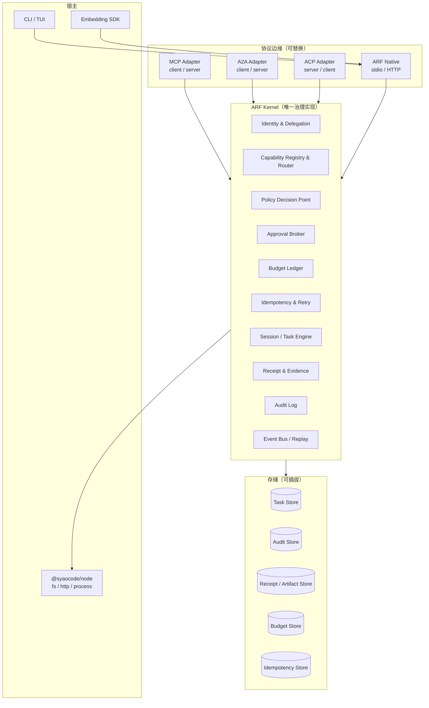
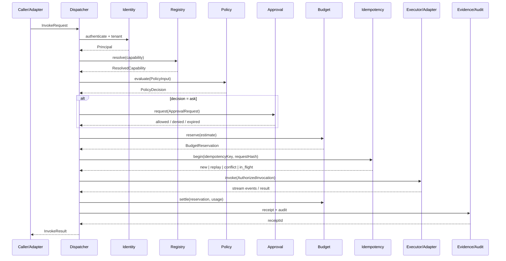
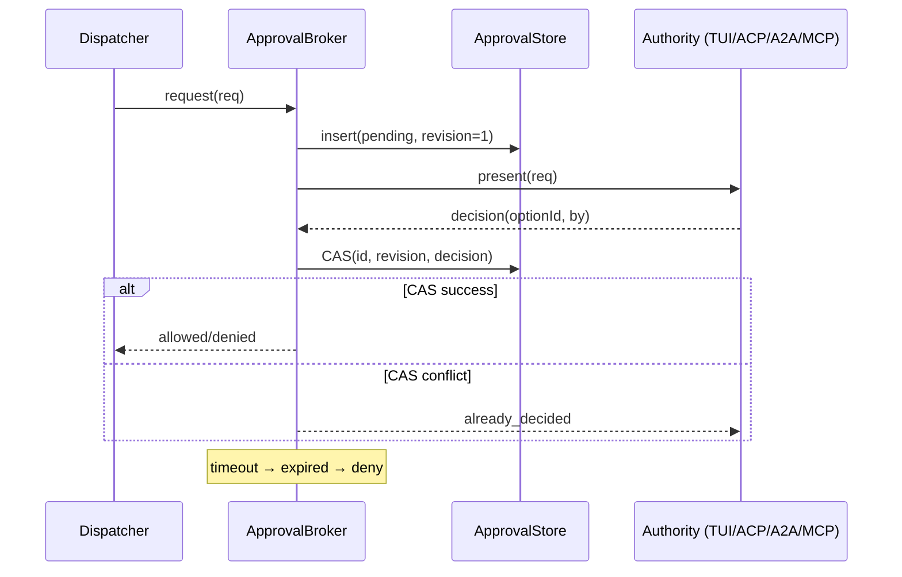
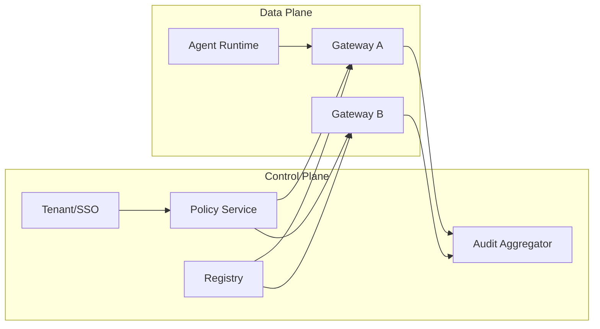

# 02 · Agent RPC 治理底座架构设计

> 本文回答"这套底座内部怎么设计"。协议事实与统一模型见 [01-协议基线与统一模型.md](01-协议基线与统一模型.md)；仓库落点与排期见 [03-工程实现与落地路线.md](03-工程实现与落地路线.md)。

---

## 1. 设计原则

| # | 原则 | 具体约束 |
| --- | --- | --- |
| P1 | **协议在边缘，治理在内核** | 适配器只能调用 `Dispatcher`，不能直接执行工具/任务 |
| P2 | **默认拒绝、失败关闭** | 策略/审批/预算/审计任一不可用，副作用操作一律拒绝 |
| P3 | **无环境权限（no ambient authority）** | 每个 Invocation 必须携带 Principal、Tenant、Capability、Budget、Deadline |
| P4 | **先预留、后执行、再结算** | 预算在派发前冻结；执行后按实际用量结算；不允许负余额 |
| P5 | **非幂等至多一次** | 副作用调用一旦发出且结果未知，标 `indeterminate`，不自动重试 |
| P6 | **证据先行** | 每个 Invocation 必须有回执；每个 Task 必须能生成 Evidence Bundle |
| P7 | **单赢家审批** | 同一审批请求只能被一个权威回答一次；并发用 CAS |
| P8 | **可降级但不静默** | 协议表达不了的语义必须写入 `lossy` 并展示 |
| P9 | **本地优先、中心可选** | 单机/嵌入零依赖；企业控制面是可选增强，不是运行前提 |
| P10 | **单一 schema 源** | Zod 定义 Canonical IR；JSON Schema 由 Zod 导出；native 协议用官方 schema 校验 |
| P11 | **可观测但不泄密** | 审计/遥测只记录哈希、引用、分类，不记录 secret 原文 |
| P12 | **版本化一切** | IR、策略包、事件、回执、适配器能力都有 schemaVersion |

---

## 2. 架构总览

### 2.1 分层



### 2.2 数据面 vs 控制面

| 面 | 职责 | 组件 |
| --- | --- | --- |
| **数据面** | 每次调用的翻译、派发、流式、取消 | Adapters、Dispatcher、Event Bus |
| **控制面** | 身份、策略、预算、审批、审计、证据、注册表 | Policy Engine、Approval Broker、Budget Ledger、Audit、Registry |
| **存储面** | Task/Audit/Receipt/Budget/Idempotency 的持久化 | 可插拔 Store（本地 JSONL / SQLite / Postgres） |
| **管理面** | 策略发布、租户管理、审计导出、健康检查 | CLI / HTTP Admin API（企业版） |

> 关键约束：**数据面不能绕过控制面**。适配器的 `invoke` 只拿到 Dispatcher 给的 `AuthorizedInvocation`，没有原始工具/端点句柄。

### 2.3 请求的两种入口

1. **Inbound（被调用）**：外部 MCP client / A2A agent / ACP editor 调用 SYAOCode。适配器把 native 请求翻译成 `InvokeRequest`，进入 Dispatcher；SYAOCode 作为服务端执行。
2. **Outbound（调用外部）**：SYAOCode 的 agent 调用外部 MCP server / A2A agent / ACP client capability。agent 通过 `CapabilityRegistry` 解析能力，Dispatcher 统一治理后由适配器发出。

两种入口共用同一条流水线；区别只在 `direction` 与 `ApprovalAuthority`。

---

## 3. 核心对象与不变量

### 3.1 对象清单

| 对象 | 作用域 | 关键字段 | 持久化 |
| --- | --- | --- | --- |
| `Tenant` | 全局 | id、name、policyBundleRef、budgetAccountId | 控制面 |
| `Principal` | 全局 | id、kind、tenantId、scopes、trustTier | 身份库/令牌 |
| `Capability` | 注册表 | id、kind、protocol、risk、sideEffect、schema、provider、trust | Registry |
| `Session` | 会话 | id、tenantId、principal、workspaceRoots、policyRevision、budgetAccountId | TaskStore |
| `Task` | 任务 | id、sessionId、parentTaskId、state、input、artifacts | TaskStore |
| `Invocation` | 调用 | id、taskId、capabilityId、state、inputHash、outputHash | TaskStore/EventLog |
| `Approval` | 审批 | id、taskId、invocationId、subject、options、authority、state | ApprovalStore |
| `PolicyDecision` | 决策 | id、effect、reason、revision、obligations | Audit/DecisionLog |
| `Receipt` | 回执 | id、invocationId、hashes、cost、outcome、prevHash | ReceiptStore |
| `Artifact` | 产物 | id、taskId、parts、hash、mediaType | ArtifactStore |
| `Event` | 事件 | eventId、seq、taskId、type、payload | EventLog |
| `Delegation` | 委派 | id、issuer、subject、audience、scopes、budgetRef、expiry | Token/DB |

### 3.2 全局不变量

| ID | 不变量 | 强制点 |
| --- | --- | --- |
| I1 | 每个 Invocation 有且只有一个已认证 Principal 与 Tenant | Dispatcher 入口 |
| I2 | 没有 PolicyDecision 的 Invocation 不得派发 | Dispatcher |
| I3 | `ask` 没有 Approval 不得派发 | Dispatcher |
| I4 | 协议注解、AgentCard、工具描述、模型文本不得提升策略结果 | Policy Engine（只读注册表/策略） |
| I5 | 每个 Invocation 恰好一个终态 + 一个 Receipt | Dispatcher/ReceiptStore |
| I6 | 预算先预留后派发；余额不得为负 | Budget Ledger |
| I7 | secret 不进入模型上下文、事件、审计、回执原文 | Redactor/Store |
| I8 | 所有查询按 tenantId 过滤 | Store 接口 |
| I9 | 审批单赢家；超时/取消 = deny | Approval Broker |
| I10 | 非幂等调用在结果未知时不得自动重试 | Idempotency/Retry |
| I11 | 反向调用（ACP fs/terminal）与正向调用同权治理 | Dispatcher |
| I12 | 审计链可重算；断链即告警 | Audit Store |
| I13 | 适配器不得直接执行工具/任务 | 架构测试 + 代码审查 |

> 这 13 条是测试与代码评审的硬门禁；任何一条被违反，版本不得发布。

---

## 4. 十步治理流水线

### 4.1 总流程



### 4.2 每一步的输入/输出/失败语义

| # | 步骤 | 输入 | 输出 | 失败时 |
| --- | --- | --- | --- | --- |
| 1 | **Normalize** | native 请求（MCP/A2A/ACP） | `InvokeRequest` | `invalid_request`，不派发 |
| 2 | **Authenticate** | transport credentials / local session | `Principal` + `tenantId` | `unauthenticated`，401/JSON-RPC 错误 |
| 3 | **Resolve** | capabilityId + constraints | `ResolvedCapability`（endpoint/schema/risk） | `capability_not_found` / `unavailable` |
| 4 | **Authorize** | Principal + Capability + input + context | `PolicyDecision` | `denied`，写审计，不派发 |
| 5 | **Approve** | `ask` 决策 + subject | `Approval` | `denied`/`expired`，写审计 |
| 6 | **Reserve budget** | estimate + account | `BudgetReservation` | `budget_exceeded`，不派发 |
| 7 | **Idempotency begin** | key + requestHash | `new` / `replay` / `conflict` / `in_flight` | `idempotency_conflict`，不派发 |
| 8 | **Dispatch** | `AuthorizedInvocation` | stream / result | `failed`/`timed_out`/`indeterminate` |
| 9 | **Settle** | actual usage | settlement record | 记录差异；必要时冻结账户 |
| 10 | **Receipt + Audit** | result + usage + approvals | `Receipt` + audit events | 高风险操作回滚/拒绝；只读操作缓冲重试 |

### 4.3 顺序上的三个关键决策

1. **Idempotency 在 Budget 之前还是之后？**
   - 先做幂等检查（步骤 7 在 6 之前更优），避免重复请求重复预留预算；但 `PolicyDecision` 仍应先于幂等（策略变化需要重新评估）。
   - 推荐顺序：Authenticate → Resolve → **Idempotency check** → Authorize → Approve → Reserve → Dispatch → Settle → Receipt。
   - 如果幂等命中已完成结果，直接返回缓存结果，不重新授权/扣费；但要在结果中带上原 `policyRevision` 与 `receiptId`。
   - 本文图中把 Idempotency 放在 Budget 之后是为了展示"预留-派发"的连续性；实现时采用上面的推荐顺序。

2. **Approval 在 Budget 之前还是之后？**
   - 先做**预算可用性检查**（不冻结），再审批；审批通过后**正式预留**。否则用户批准后发现预算不足，体验差。
   - 对长审批（>30s），预留一个短期 hold（TTL 2 分钟），超时释放。

3. **Receipt 在返回前还是异步？**
   - 高风险/副作用调用：**同步写 receipt** 后再返回；确保"返回即证据"。
   - 只读/低风险：可异步批量写，但返回中带 `receiptId` 与 `receiptHash` 的占位，最终一致。
   - 审计与回执分离：回执是给调用方的，审计是给合规的；两者都写，但存储可不同。

---

## 5. 策略引擎（PDP）

### 5.1 输入

```ts
interface PolicyInput {
  principal: Principal;
  session: Session;
  task?: Task;
  capability: Capability;
  input: unknown;
  inputHash: string;
  context: {
    protocol: 'mcp' | 'a2a' | 'acp' | 'native';
    direction: 'inbound' | 'outbound' | 'reverse';
    workspaceRoots: string[];
    cwd: string;
    now: string;
    trust: 'first_party' | 'verified' | 'untrusted';
    dataClass: Capability['dataClass'];
  };
  budget: { accountId: string; remainingUsd?: number; remainingTokens?: number };
  approvalHistory: { capabilityId: string; scope?: string; expiresAt?: string }[];
}
```

### 5.2 输出

```ts
type Effect = 'allow' | 'deny' | 'ask';

interface PolicyDecision {
  id: string;
  effect: Effect;
  reason: string;
  policyRevision: string;
  obligations: Obligation[];
  ttlMs?: number;
  explain?: PolicyTrace;   // 仅 policy.explain / 审计调试
}

type Obligation =
  | { type: 'require_approval'; options?: ApprovalOption[] }
  | { type: 'redact'; classes: ('secret' | 'confidential')[] }
  | { type: 'max_output_bytes'; bytes: number }
  | { type: 'sandbox'; level: 'none' | 'process' | 'container' }
  | { type: 'network_allowlist'; hosts: string[] }
  | { type: 'audit_level'; level: 'basic' | 'full' }
  | { type: 'no_retry' }
  | { type: 'ttl'; ms: number }
  | { type: 'delegation_limit'; maxHops: number; maxSpendUsd?: number };
```

**Obligation 是硬约束**：适配器/执行器必须实现；如果实现不了，必须拒绝（`unsupported_obligation`），不能忽略。

### 5.3 规则模型

```ts
interface PolicyRule {
  id: string;
  priority: number;              // 数值越小越先
  effect: Effect;
  match: {
    tenants?: string[];
    principals?: string[];       // glob
    capabilities?: string[];     // glob
    protocols?: ('mcp' | 'a2a' | 'acp' | 'native')[];
    directions?: ('inbound' | 'outbound' | 'reverse')[];
    risk?: Capability['risk'][];
    dataClasses?: Capability['dataClass'][];
    paths?: string[];            // glob，针对 fs/write
    commands?: string[];         // glob，针对 terminal
    urls?: string[];             // glob，针对 network
  };
  obligations?: Obligation[];
  source: 'org' | 'project' | 'user' | 'session';
  reason?: string;
}
```

### 5.4 组合算法

1. **收集**所有匹配规则（tenant/principal/capability/context）。
2. **显式 deny 一票否决**（不论来源与优先级）。
3. **ask 优先于 allow**（同一层级）。
4. 同 effect 内按 `priority` 升序，第一条决定 `reason` 与 `obligations`；后续匹配规则的 obligations 取**并集**（更严格）。
5. 没有匹配 → 按 `defaultEffect`（默认 `deny`；读类可配置为 `allow`）。
6. 生成 `policyRevision = H(canonical(bundle))`；决策记录进审计。
7. 结果缓存：仅缓存 `allow` 且无时间敏感 obligation 的决策，TTL ≤ 30s；`ask/deny` 不缓存。
8. 策略热更新：bundle revision 变化 → 清缓存；pending approval 触发 recheck。

### 5.5 策略包

```json
{
  "schemaVersion": 1,
  "revision": "sha256:...",
  "tenantId": "acme",
  "defaultEffect": "deny",
  "rules": [
    {
      "id": "org-read-repo",
      "priority": 10,
      "effect": "allow",
      "match": { "capabilities": ["mcp://github/tool/get_*"], "risk": ["read"] },
      "source": "org"
    },
    {
      "id": "org-write-ask",
      "priority": 20,
      "effect": "ask",
      "match": { "capabilities": ["mcp://github/tool/*"], "risk": ["write"] },
      "obligations": [{ "type": "require_approval" }],
      "source": "org"
    },
    {
      "id": "org-danger-deny",
      "priority": 1,
      "effect": "deny",
      "match": { "commands": ["rm -rf *", "mkfs*", "dd * of=/dev/*"] },
      "source": "org"
    }
  ]
}
```

- 企业版：策略包由控制面签名（Ed25519），本地只接受 `org` 签名包；项目/用户只能**加严**，不能放宽。
- 本地版：无签名，文件权限 0600；`--policy` 文件仍可用（与现有 CLI 一致）。

### 5.6 与现有 `PermissionEngine` 的关系

| 现有能力 | 在新架构中的位置 |
| --- | --- |
| `PermissionMode`（strict/default/acceptEdits/plan/bypass） | 作为 `PolicyEngine` 的 preset；映射为规则集 |
| `PermissionRule`（effect/tool/match/source） | 扩展为 `PolicyRule`（加 protocol/risk/dataClass/direction） |
| `classifyCommand` / 危险命令库 | 作为 `local` capability 的 `risk` 评估器；禁止被协议注解覆盖 |
| `resolveAsk` + `recheck` + `MAX_APPROVAL_ROUNDS` | 迁入 `ApprovalBroker`；保留 8 轮上限 |
| `workspaceRoots` / `insideWorkspace` | 作为 `PolicyInput.context.workspaceRoots`；fs 反向调用同样使用 |
| `Redactor` | 在 Dispatcher 的 `sanitize` 步骤统一调用 |

> 实现策略：**先包装，后替换**。`LocalPolicyEngine` 内部调用现有 `PermissionEngine`，把 `EngineOutcome` 转成 `PolicyDecision`；等新规则引擎稳定后，再让 `PermissionEngine` 成为它的一个 preset。这样 v0.2 的 339 项测试不会大规模重写。

### 5.7 策略解释

`policy.explain` 返回：

```ts
interface PolicyTrace {
  matchedRules: { id: string; effect: Effect; source: string }[];
  deniedBy?: string;
  askedBy?: string;
  obligations: Obligation[];
  effectiveMode: string;
  revision: string;
}
```

用途：审批 UI 展示"为什么问我"；审计复盘；客户排障。**不对外暴露其他租户的规则内容**。

---

## 6. 审批 Broker

### 6.1 状态与存储

```ts
interface ApprovalRecord {
  id: string;
  tenantId: string;
  taskId: string;
  invocationId?: string;
  subject: ApprovalSubject;
  options: ApprovalOption[];
  authority: 'local' | 'delegated' | 'chain';
  delegationChain: string[];
  policyRevision: string;
  revision: number;              // 每次 recheck/更新 +1
  state: 'pending' | 'allowed' | 'denied' | 'expired' | 'cancelled';
  createdAt: string;
  expiresAt: string;
  decidedAt?: string;
  decidedBy?: string;
  decisionOptionId?: string;
  decisionReason?: string;
}
```

存储：`ApprovalStore` 接口，本地 JSONL + 索引，企业 SQLite/Postgres；必须支持 `listPending(tenantId/taskId)`、`decide(id, expectedRevision, ...)` CAS。

### 6.2 生命周期



### 6.3 四种 Authority 实现

| Authority | 触发条件 | 呈现方式 | 决策回传 |
| --- | --- | --- | --- |
| `LocalApprovalAuthority` | CLI/TUI/嵌入式无远端 | TUI 面板 / stdio 行 | 直接调用 `decide` |
| `AcpApprovalAuthority` | ACP server 模式 | `session/request_permission`，选项映射 `allow_once/allow_always/reject_*` | `{outcome:"selected",optionId}` / `cancelled` |
| `A2aApprovalAuthority` | A2A server 模式 | `Task` → `TASK_STATE_AUTH_REQUIRED` + status message；扩展 metadata 携带选项 | 后续 `SendMessage` / 扩展 / 带外凭据 |
| `McpApprovalAuthority` | MCP server 模式 | 返回 `InputRequiredResult`，`inputRequests` 里放 elicitation | 客户端重试原请求 + `inputResponses` + `requestState` |

**Authority 选择**：由 `Session.protocolBinding` + `ApprovalPolicy` 决定；一个 Session 只能有一个 primary authority，避免多端争抢。多客户端只读订阅可以，决策必须走 primary 或显式 `approval.decide` token。

### 6.4 审批疲劳控制

| 手段 | 说明 |
| --- | --- |
| 计划级审批 | 一次批准一组步骤（仅限非敏感、可逆、同一 Task） |
| 风险分层 | read 自动放行（可配）；write/execute 逐条；spend/delegate 必须显式 |
| 会话级记忆 | `allow_session` 绑定 capability + pathPrefix/commandPrefix，TTL 默认 8h |
| 敏感路径例外 | `~/.ssh`、`~/.aws`、`.env*`、凭据目录：永远 one-shot，不可记忆 |
| 批量展示 | 同一批次的多个只读审批合并展示；写操作不合并 |
| 审批预算 | 每 Task 的审批次数上限（默认 20）；超过 → 暂停并请求"计划级批准" |

### 6.5 与 `PermissionEngine.recheck` 的兼容

现有语义：审批等待期间用户切换权限档位，`recheck` 让引擎按新策略重新评估，最多 8 轮。新 Broker 保留：

- `revision` 随策略/审批上下文变化递增；
- `recheck` 时重新调用 `PolicyEngine.evaluate`；
- 新决策 `allow` → 自动 `allowed`（记录 `by=policy-recheck`）；
- 新决策 `deny` → `denied`；
- 仍是 `ask` → 更新 `subject/reason/options`，`revision+1`，重新呈现；
- 超过 8 轮 → `denied`（`approval_loop_exceeded`）。

---

## 7. 预算 Ledger

### 7.1 账户层级

```text
Tenant Account
  └── Project Account
        └── Session Account
              └── Task Account
                    └── Invocation Reservation
```

每个账户记录：

```ts
interface BudgetAccount {
  id: string;
  tenantId: string;
  parentId?: string;
  currency: 'USD';
  limitUsd?: number;
  reservedUsd: number;
  spentUsd: number;
  tokenLimit?: number;
  tokensUsed: number;
  timeLimitMs?: number;
  timeUsedMs: number;
  toolCallLimit?: number;
  toolCallsUsed: number;
  state: 'active' | 'frozen' | 'closed';
}
```

### 7.2 预留/结算算法

```ts
async function reserve(req: ReserveRequest): Promise<Reservation> {
  const estimate = req.estimate ?? await estimator.estimate(req); // 输入 token + 输出上限 + 工具调用
  const accounts = await ledger.ancestors(req.accountId);          // tenant→...→task
  for (const a of accounts) assertCanReserve(a, estimate);
  const reservation = await ledger.atomicReserve(accounts, estimate, ttlMs=120_000);
  return reservation;
}

async function settle(reservation: Reservation, usage: Usage): Promise<void> {
  const actual = costOf(usage);          // 网关直报优先；否则 pricing 表
  await ledger.atomicSettle(reservation, actual); // 释放差额；记录 receiptId
}
```

规则：

- **估算不确定时**：使用 `maxPerInvocationUsd`（默认 0.50）作为上限；无定价的 provider 使用 token 上限估算。
- **实际 > 预留**：允许在账户 `limit` 内补扣；若超过 `limit`，账户 `frozen`，后续调用拒绝，并发出 `budget.exceeded`。
- **结算幂等**：以 `receiptId` 为幂等键；重复 settle 不重复扣。
- **崩溃恢复**：预留有 TTL；启动时扫描过期预留，按 receipt 状态释放或补扣。
- **跨 Agent**：DelegationToken 携带 `budgetAccountId + maxSpendUsd`；远端每次调用向网关回传 usage；网关在父账户结算。

### 7.3 计量单位

| 单位 | 来源 | 用途 |
| --- | --- | --- |
| USD | provider `usage.costUsd` 或 pricing 表 | 硬预算、账单 |
| tokens (input/output/cache) | provider usage | 无定价时的兜底 |
| wall-clock ms | Dispatcher | 超时/慢任务 |
| tool calls | Dispatcher | 防循环/防滥用 |
| approval count | Broker | 防审批疲劳 |

### 7.4 与现有 `maxBudgetUsd` / `maxTotalTokens` 的关系

- 现有 `Limits` 是**单次 run** 的硬上限；新 Ledger 是**多 run、多 Task、多 Agent** 的层级账户。
- 兼容方式：`AgentConfig.limits` 继续生效；`run()` 的每次 provider 调用向 Ledger 报 usage；`maxBudgetUsd` 作为 Task 账户的 `limitUsd` 下界。
- 现有 `costOf` 的缺陷（无 pricing 时预算不触发）由 Ledger 的 token/time/toolCall 兜底覆盖；不依赖单一 USD。

---

## 8. 身份、凭据与委派

### 8.1 Principal 类型

| 类型 | 认证方式 | 典型场景 | 默认信任 |
| --- | --- | --- | --- |
| `user` | OIDC / 本地 OS 用户 | CLI、编辑器 | verified |
| `agent` | AgentCard 签名 + mTLS/OAuth | A2A 调用方 | verified/untrusted |
| `service` | mTLS / SPIFFE / API key | CI、平台后端 | verified |
| `anonymous` | 仅本地 loopback + 一次性 token | 本地试用 | untrusted，只读 |

### 8.2 委派令牌

```ts
interface DelegationToken {
  id: string;
  issuer: string;          // principal id
  subject: string;         // delegate principal id
  audience: string;        // target agent/gateway id
  scopes: string[];        // capability globs
  constraints: {
    tenantId: string;
    workspaceRoots?: string[];
    maxSpendUsd?: number;
    maxHops?: number;
    expiresAt: string;
    approvalsRequired?: boolean;
  };
  budgetAccountId?: string;
  parentTokenId?: string;
  signature: string;       // JWS (EdDSA/ES256) 或本地 HMAC
}
```

规则：

- **audience 绑定**：令牌只能给指定目标；禁止"万能 token"。
- **不透明传递**：不把调用方的 access token 直接传给下游；网关做 token exchange（RFC 8693 风格）或重新签发。
- **逐跳衰减**：每跳只能缩小 scopes/budget/expiry，不能扩大。
- **链可审计**：`parentTokenId` 形成链；Receipt 记录 `delegationChain`。
- **撤销**：本地短 TTL（≤15min）+ 版本号；企业控制面可撤销。

### 8.3 凭据 Broker

```ts
type SecretRef =
  | { kind: 'env'; name: string }
  | { kind: 'file'; path: string; field?: string }
  | { kind: 'keychain'; service: string; account: string }
  | { kind: 'vault'; path: string; key: string };

interface CredentialBroker {
  resolve(ref: SecretRef, ctx: { tenantId: string; principalId: string; purpose: string }): Promise<string>;
  registerForRedaction(value: string, label: string): void;
}
```

- 解析发生在**派发前一刻**；不进入模型上下文、事件、审计。
- 解析后的值注册到 `Redactor`；所有日志/事件/回执写入前脱敏。
- MCP OAuth token 按 issuer 存储；A2A in-task credential 走带外/扩展；ACP `authenticate` 结果只保存在内存。
- 凭据访问本身是一条审计事件（记录 ref，不记录值）。

---

## 9. 幂等、重试、取消、超时

### 9.1 幂等键

```ts
interface IdempotencyRecord {
  key: string;                 // tenantId + principalId + capabilityId + clientKey
  requestHash: string;         // H(canonical(input) + capabilityId + policyRevision)
  state: 'in_flight' | 'completed' | 'failed';
  resultRef?: string;          // Receipt/结果存储引用
  error?: CanonicalError;
  createdAt: string;
  expiresAt: string;           // 默认 24h
}
```

| 情况 | 行为 |
| --- | --- |
| 同 key + 同 hash + `completed` | 直接返回原结果（不扣费、不重复副作用） |
| 同 key + 同 hash + `in_flight` | 返回 `409 in_flight` 或等待（≤2s） |
| 同 key + 不同 hash | `409 idempotency_conflict` |
| 同 key + `failed`（可重试错误） | 允许重试，更新记录 |
| 无 key + 非幂等能力 | 由 Dispatcher 生成 key（基于 taskId+invocationId），禁止自动重试 |

### 9.2 重试矩阵

| 错误类别 | 可重试 | 条件 |
| --- | --- | --- |
| 网络连接失败（未发出） | ✅ | `sideEffect != non_idempotent` |
| 超时（已发出，结果未知） | ❌ | 标 `indeterminate`；人工复核 |
| 429 / 503 | ✅ | 有 `Retry-After` 或指数退避；幂等能力 |
| 策略拒绝 / 审批拒绝 | ❌ | 不重试 |
| 预算不足 | ❌ | 不重试；提示充值/调整 |
| 参数校验失败 | ❌ | 不重试 |
| 协议版本不兼容 | ❌ | 降级或升级，不重试 |

### 9.3 取消传播

```text
Caller cancel
  → Dispatcher marks Task cancel_requested
  → Adapter sends protocol cancel:
       MCP: notifications/cancelled (stdio) / close response stream (HTTP) / tasks/cancel
       A2A: CancelTask
       ACP: session/cancel
  → grace period (default 5s)
  → if adapter acknowledges: state=cancelled, receipt.outcome=cancelled
  → if no ack and side effect may have occurred: state=indeterminate, receipt.outcome=indeterminate
```

- 取消是**协作式**的；协议不保证立即停止。
- 取消后仍必须写 receipt（不能"取消了就没有记录"）。
- 取消 pending approval：ACP 客户端必须回 `cancelled`；MCP MRTR 客户端放弃重试；A2A 任务保持 `AUTH_REQUIRED` 直到超时/拒绝。

### 9.4 超时层级

| 层级 | 默认 | 行为 |
| --- | --- | --- |
| 连接超时 | 10s | 未建立连接 → 可重试 |
| 单次 Invocation | 120s | 可配置；超时 → `timed_out`/`indeterminate` |
| Task | 30min | 超时 → `expired`；取消子调用 |
| Session idle | 8h | 关闭会话；保留证据 |
| Approval | 5min | 超时 → `expired` → deny |

---

## 10. 审计与证据

### 10.1 审计事件

```ts
interface AuditEvent {
  id: string;
  ts: string;
  tenantId: string;
  actor: { type: 'user' | 'agent' | 'service' | 'system'; id: string };
  action: string;               // policy.decide / approval.decide / invocation.start / ...
  subject: { type: string; id: string };
  outcome: 'success' | 'failure' | 'denied';
  policyRevision?: string;
  detailHash?: string;          // 细节的哈希，原文另存受控存储
  prevHash: string;
  hash: string;
}
```

- 每个租户独立链；`hash = H(prevHash + canonical(event))`。
- 每 1000 条或 5 分钟生成 checkpoint（`checkpointHash` + 签名可选）。
- `audit.verify(fromCheckpoint)` 重算链；断链 → `audit_broken` 告警，高风险操作暂停。
- 存储：JSONL 追加 + 租约（**当前实现尚未加锁，见 [`06`](06-多进程写入与审计留存设计.md)**）；企业版 SQLite/Postgres；导出 JSONL/OTel。
- **多进程边界（2026-10-30 补）**：同一租户目录同一时刻只允许一个写者；写者拿锁后必须重读文件再写；审计链不得分叉。完整协议（租约/epoch/票据/重读/顺序）见 06；在 06 的 WP-1 完成前，审计链只保证单进程正确。

### 10.2 回执

```ts
interface Receipt {
  id: string;
  tenantId: string;
  taskId: string;
  invocationId: string;
  protocol: 'mcp' | 'a2a' | 'acp' | 'native' | 'local';
  capabilityId: string;
  principalId: string;
  delegationChain: string[];
  outcome: 'succeeded' | 'failed' | 'denied' | 'cancelled' | 'timed_out' | 'indeterminate';
  inputHash: string;
  outputHash?: string;
  artifacts: { id: string; hash: string; mediaType?: string; ref?: string }[];
  approvals: string[];
  policy: { revision: string; decisionId: string; effect: Effect; obligations: string[] };
  usage?: { inputTokens?: number; outputTokens?: number; cacheReadTokens?: number; cacheWriteTokens?: number; costUsd?: number };
  timing: { queuedAt: string; startedAt: string; endedAt: string };
  visibility: 'full' | 'summary' | 'opaque';
  lossy?: string[];
  prevHash?: string;
  hash: string;
}
```

- `hash` 覆盖除自身外的所有字段 + `prevHash`。
- `outputHash` 对结构化输出用 canonical JSON；对文本用 UTF-8；对二进制用 SHA-256。
- `artifacts[].ref` 是内容寻址存储引用；`hash` 校验内容。
- `visibility=summary/opaque` 时，`outputHash` 仍记录，但原文不入回执。

### 10.3 Evidence Bundle

```ts
interface EvidenceBundle {
  schemaVersion: 1;
  taskId: string;
  tenantId: string;
  createdAt: string;
  receipts: Receipt[];
  approvals: ApprovalRecord[];
  policySnapshots: { revision: string; rulesHash: string; bundleRef?: string }[];
  artifacts: { id: string; hash: string; ref: string; mediaType?: string }[];
  verification: {
    verdict: 'verified' | 'unverified' | 'failed';
    checks: { name: string; ok: boolean; detail?: string }[];
  };
  rootHash: string;
  signature?: string;
}
```

校验项：

- 每个 receipt hash 重算正确；
- `prevHash` 链完整；
- 每个 `ask` 都有 approval，且 approval 的 `policyRevision` 与 receipt 匹配；
- 每个 artifact hash 与存储内容匹配；
- 预算已结算（有 settlement 记录）；
- 任务终态与 receipt outcome 一致。

### 10.4 可见性与文案

| 可见性 | 可以说 | 不可以说 |
| --- | --- | --- |
| `full` | "已验证：命令 X 退出码 0，测试 42/42 通过" | — |
| `summary` | "远端返回成功，产物哈希 Y；内部步骤未验证" | "所有测试通过" |
| `opaque` | "远端声明完成；未获得可验证证据" | "已验证完成" |

> 这是产品诚信的一部分：不能把 `opaque` 包装成 `verified`。

---

## 11. 能力注册与路由

### 11.1 注册表条目

```ts
interface RegistryEntry {
  capability: Capability;
  provider: {
    id: string;
    protocol: 'mcp' | 'a2a' | 'acp' | 'local';
    endpoint: string;          // 内部地址；不暴露给模型
    version?: string;
    trust: 'first_party' | 'verified' | 'untrusted';
    health: 'healthy' | 'degraded' | 'down';
    ttlMs: number;
    lastSeenAt: string;
  };
  labels: Record<string, string>;
}
```

### 11.2 发现与刷新

| 协议 | 发现 | 刷新 |
| --- | --- | --- |
| MCP | `server/discover` + `tools/list` / `resources/list` / `prompts/list` | `ttlMs`/`cacheScope`；`subscriptions/listen`；`list_changed` |
| A2A | `AgentCard`（well-known 或注册表） | AgentCard 版本/缓存头；`GetExtendedAgentCard` |
| ACP | `initialize` + `session/new` 的 modes/config | `session/update` 的 `available_commands_update` / `config_option_update` |
| Local | `ToolRegistry` | 启动时/热加载 |

发现结果必须经过**信任评估**：

- MCP server 的 `serverInfo`/`instructions` 是自述；不能作为授权依据；
- A2A AgentCard 的 `skills` 是自述；授权看 `securityRequirements` + 注册表信任；
- ACP Agent 的 `agentInfo` 是自述；客户端能力由 `initialize` 协商。

### 11.3 路由

```ts
interface RouteConstraints {
  tenantId: string;
  protocolPreference?: ('mcp' | 'a2a' | 'acp')[];
  maxCostUsd?: number;
  dataResidency?: string;
  requireTrust?: 'first_party' | 'verified';
  requireVersion?: string;
  excludeProviders?: string[];
}

interface Router {
  resolve(capabilityId: string, c: RouteConstraints): Promise<ResolvedCapability>;
  list(filter?: { kind?: Capability['kind']; protocol?: string; q?: string }): Promise<Capability[]>;
}
```

规则：

- 只接受**注册表中的 capabilityId**；模型不能提供任意 URL/命令作为端点。
- 多 provider 时按 `trust → health → cost → latency` 排序；支持 canary 与 fallback。
- fallback 不得跨信任等级（untrusted 不能顶替 verified）。
- 路由决策写审计（选中 provider、原因）。
- 熔断：连续失败 N 次 → `degraded`；半开探测。

---

## 12. 协议适配器契约

### 12.1 接口

```ts
interface ProtocolAdapter {
  readonly protocol: 'mcp' | 'a2a' | 'acp';
  readonly version: string;

  capabilities(): AdapterCapabilities;

  discover(ctx: AdapterContext): Promise<DiscoveredCapability[]>;

  invoke(req: AuthorizedInvocation, ctx: AdapterContext): Promise<InvokeResult>;

  subscribe?(taskId: string, afterSeq: number, ctx: AdapterContext): AsyncIterable<CanonicalEvent>;

  cancel?(taskId: string, reason: string, ctx: AdapterContext): Promise<void>;

  respondApproval?(approvalId: string, decision: ApprovalDecision, ctx: AdapterContext): Promise<void>;

  health(): Promise<HealthStatus>;

  close(): Promise<void>;
}

interface AdapterContext {
  runtime: Runtime;
  signal: AbortSignal;
  deadlineAt: string;
  emit(event: CanonicalEvent): void;
  approval: ApprovalBroker;
  redactor: Redactor;
  logger: Logger;
}
```

### 12.2 适配器禁止事项

- 不得直接调用 `Tool.execute` / `Agent.run`；只能通过 Dispatcher。
- 不得自行决定 allow/deny；只能使用 `AuthorizedInvocation`。
- 不得把 native 错误吞掉；必须映射为 `CanonicalError` 并保留 `protocolError`。
- 不得把远端文本当作策略输入；只能作为 `untrusted` 内容展示。
- 不得在未声明 `lossy` 的情况下丢弃字段；未知字段进 `extensions` 或 `nativeMeta`（脱敏后）。

### 12.3 能力声明

每个适配器在 `capabilities()` 中声明支持矩阵，并在 `discover()` 中返回实际能力。示例：

```ts
const mcp2026: AdapterCapabilities = {
  protocol: 'mcp',
  version: '2026-07-28',
  supports: {
    session: false,
    task: true,          // 仅当 server 声明 tasks extension
    streaming: true,
    push: false,
    approvalOptions: false,
    artifacts: true,     // resources/structuredContent
    reverseCalls: false,
    cancellation: true,
  },
  lossy: ['no protocol session', 'no server-initiated requests', 'approval via MRTR only'],
};
```

### 12.4 版本策略

| 协议 | 主版本 | 兼容策略 |
| --- | --- | --- |
| MCP | 2026-07-28 | **双形态**：modern（stateless）+ legacy（initialize，≤2025-11-25）；按 `server/discover` 探测，不默认 modern |
| A2A | 1.0 | 只支持 1.0；0.3 通过独立 legacy adapter（可选） |
| ACP | v1 | 只支持 v1；v2 草案不默认启用，按 `protocolVersion` 协商 |

> MCP 的 SDK v2 默认仍走 2025 `initialize`，必须显式 `versionNegotiation: 'auto'` 或 `{pin:'2026-07-28'}` 才会发 modern 字节；适配器必须处理这个"时代陷阱"。

---

## 13. 部署拓扑

| 拓扑 | 形态 | 适用 | 信任边界 | 存储 |
| --- | --- | --- | --- | --- |
| **Embedded** | CLI/TUI/SDK 进程内 | 个人、CI、嵌入式产品 | 单进程 | 本地 JSONL/内存 |
| **Sidecar** | `syao serve --stdio` 或本地 HTTP | 编辑器、Desktop | 本机用户 | 本地 JSONL/SQLite |
| **Gateway** | 团队 HTTP 服务 | 多项目、多客户端 | 网络 + 租户 | Postgres/SQLite + 对象存储 |
| **Federated** | 跨组织 A2A | 供应链、合作伙伴 | 跨组织 | 各自存储 + Evidence Bundle 交换 |

### 13.1 本地优先

- 默认只监听 `127.0.0.1` / Unix socket；远程监听必须显式 `--host` + TLS + token。
- 无控制面也可完整运行；控制面只提供策略分发、审计聚合、租户管理、配额。
- 断网时使用 last-known-good 策略包（带过期时间）；过期后 fail-closed。

### 13.2 企业控制面（可选）



- 控制面不可用时，数据面继续用缓存策略；高风险操作要求"策略新鲜度 < 24h"。
- 审计可异步聚合，但本地必须先写 WAL；不能因控制面不可用而丢审计。

---

## 14. 威胁模型

### 14.1 资产与信任边界

| 资产 | 说明 |
| --- | --- |
| 源代码/工作区 | 最核心的客户数据 |
| 凭据 | API key、OAuth token、SSH key、云凭据 |
| 资金 | 模型/工具调用费用 |
| 外部系统 | GitHub、Jira、数据库、生产环境 |
| 审计/证据 | 合规与追责依据 |

信任边界：

```text
User/Editor ──(1)── Agent Runtime ──(2)── Tool/MCP Server
                    │
                    ├──(3)── Remote A2A Agent
                    │
                    └──(4)── Model Provider
```

### 14.2 威胁与缓解

| 威胁 | 场景 | 缓解 |
| --- | --- | --- |
| **Confused deputy** | MCP server 让 host 用更高权限执行 | 每个调用按 Principal + Capability 重新授权；不继承 server 权限 |
| **Token passthrough** | 把用户 token 原样转给下游 | audience 绑定 + token exchange；禁止透传 |
| **Prompt injection** | 工具结果/网页诱导模型越权 | 内容标 `untrusted`；策略不读模型文本；审批展示来源 |
| **Tool poisoning** | 恶意 MCP 工具描述/注解 | 注解不可信；工具描述标 `untrusted`；注册表信任等级 |
| **Approval phishing** | 伪造审批 UI/夸大权限 | subject 由内核生成；展示 command/path/diff；敏感路径 one-shot |
| **SSRF** | A2A webhook / MCP URL 指向内网 | URL allowlist + 私网 IP 拒绝 + DNS rebinding 防护 |
| **Replay** | 重放非幂等请求 | Idempotency-Key + requestHash + nonce + 短期时间窗 |
| **Cross-tenant** | 查询/任务越权 | 所有 store key 带 tenantId；查询强制过滤；测试覆盖 |
| **Malicious AgentCard** | 夸大 skills/权限 | 注册表信任 + TLS + 可选签名；能力不等于授权 |
| **ACP fs escape** | `fs/write_text_file` 写工作区外 | 反向调用过策略/路径围栏；客户端根集合校验 |
| **MCP legacy downgrade** | 强制降级到旧协议绕过新安全 | 版本白名单；禁止静默降级；记录 `protocolVersion` |
| **Audit tampering** | 删改审计 | 哈希链 + checkpoint + 可选签名 + 异地备份 |
| **DoS** | 大量并发/大 payload | 限流、并发上限、payload 上限、超时、熔断 |
| **Supply chain** | 恶意 SDK/依赖 | 锁定版本 + lockfile + 依赖审计；官方 SDK 最小权限 |

### 14.3 安全测试用例（必须进 CI）

1. 恶意 MCP server 返回 `ToolAnnotations { readOnly: true }` 但实际写文件 → 仍按 `write` 审批。
2. A2A AgentCard 声明 `admin` skill，但调用未授权 → 403，不因 card 放行。
3. ACP 客户端声明 `fs.writeTextFile: true`，Agent 请求写 `/etc/passwd` → 策略拒绝；客户端根集合外拒绝。
4. 审批并发：两个客户端同时点 allow/deny → 只有一个成功，另一个 `already_decided`。
5. 非幂等 `bash` 超时 → `indeterminate`，不自动重试；第二次调用需人工确认。
6. MCP MRTR：篡改 `requestState` → 拒绝重试。
7. A2A webhook 指向 `127.0.0.1` → 拒绝配置。
8. 跨租户 `GetTask` → 404（不泄露存在性）。
9. 审计链删一条 → `audit.verify` 失败。
10. 策略包降级（org allow 被 project deny 覆盖？）→ deny 一票否决。

---

## 15. 性能与 SLO

| 指标 | 目标 | 说明 |
| --- | --- | --- |
| 治理开销 p95 | ≤ 5ms/Invocation | 不含审批等待与网络 |
| 策略决策 p95 | ≤ 2ms（缓存）/ ≤ 20ms（冷） | 本地规则引擎 |
| 事件投递 p95 | ≤ 100ms（本地） | at-least-once |
| 审批呈现 p95 | ≤ 300ms | TUI/ACP |
| 审计写 p95 | ≤ 10ms | 批量 fsync |
| Task 恢复 | ≤ 5s | 崩溃后从事件日志重建 |
| 证据校验 | ≤ 1s / 1000 receipts | 哈希重算 |
| 单进程吞吐 | ≥ 200 Invocation/s（只读、缓存命中） | 目标，不是承诺 |
| Gateway 吞吐 | ≥ 50 req/s / 实例 | 含策略/审计 |
| 可用性 | 99.9%（本地/单机） | 企业版另定 |

性能设计：

- 策略缓存 + 预编译 glob；
- 事件批量写 + 背压；
- Receipt 异步批量（高风险同步）；
- 审计 WAL + 后台 flush；
- Registry TTL 缓存；
- 连接池/HTTP keep-alive；
- 大输出走内容寻址存储，事件只传引用。

---

## 16. 失败模式与降级

| 故障 | 行为 | 用户可见 |
| --- | --- | --- |
| Policy Engine 不可用 | 副作用 deny；只读可用 last-known-good（≤5min） | "策略服务不可用，已阻止写操作" |
| Approval 通道不可用 | 等待超时 → deny | "审批超时，操作未执行" |
| Budget Store 不可用 | 拒绝新的 spend；只读允许 | "预算服务不可用" |
| Audit Store 不可用 | 高风险 deny；低风险内存缓冲（有上限） | "审计不可用，高风险操作已阻止" |
| Registry 不可用 | 用 last-known-good（TTL 内）；禁止新能力 | "能力目录过期" |
| Adapter 不可用 | 任务失败/可重试；熔断 | "工具服务不可用" |
| 事件流断开 | 从 `afterSeq` 恢复；副作用未知 → `indeterminate` | "连接中断，结果待确认" |
| 进程崩溃 | 启动时重建 Task；预留释放/补扣 | "任务已恢复/需确认" |
| 时钟漂移 | 用 monotonic 计时；过期判断留 skew 容忍 | 无感 |

---

## 17. 与现有代码的映射

| 现有资产 | 复用方式 | 需要新增/修改 |
| --- | --- | --- |
| `AgentEvent` / `EventBus` | 作为 CanonicalEvent 的基础信封；保留 `seq/runId/causationId` | 增加 `taskId/correlationId/protocol`；新增 `TaskEventLog` |
| `PermissionEngine` | 包装为 `LocalPolicyEngine`；保留模式/规则/危险命令/recheck | 新增 `PolicyEngine` 接口、`PolicyDecision`、obligations |
| `PermissionRequest` / `PermissionHandler` | 作为 `LocalApprovalAuthority` 的底层 | 新增 `ApprovalBroker`、CAS、持久化 |
| `ToolReceipt` / `ReceiptStore` | 扩展为跨协议 `Receipt`；字段向后兼容 | 增加 `taskId/protocol/approvalRefs/policy/visibility/hash chain` |
| `Redactor` | Dispatcher 统一调用；工具结果/事件/日志/回执 | 增加 `SecretRef`/CredentialBroker 注册 |
| `FileSessionStore` | 复用 append+lock 模式实现 `TaskStore`/`AuditStore` | 新增 snapshot/index/retention |
| `Runtime` | 所有新包继续注入 Runtime，保持 host-agnostic | `@syaocode/node` 增加 stdio/HTTP transport、credential store |
| `withRetry` | Provider 重试保留 | 新增 Invocation 级重试（幂等矩阵） |
| `estimateTokens` | 预算估算 | 增加输出上限/工具调用估算 |
| `configSchema` | 扩展 `rpc` 段；保持 user→project→env→flags 优先级 | 新增 policy bundle/budget/registry 配置 |
| `AgentConfig` | 增加可选 `rpc?: RpcConfig`；默认关闭 | 不破坏现有嵌入方 |

> 详细包结构、文件路径、任务拆解见 [03-工程实现与落地路线.md](03-工程实现与落地路线.md)。

---

## 18. 关键 ADR（本设计的"不可逆选择"）

| ADR | 决策 | 替代方案 | 后果 |
| --- | --- | --- | --- |
| **ADR-R1** | 协议在边缘，治理在内核；不发明超级协议 | 统一 wire / 网关代理 | 保留生态兼容；内核复杂度上升 |
| **ADR-R2** | Canonical IR 采用 Session→Task→Invocation 三层 | 只有 Task / 只有 Invocation | 能同时映射三者；对象更多 |
| **ADR-R3** | 策略先于派发；适配器不可绕过 | 适配器自行鉴权 | 安全一致；适配器性能略降 |
| **ADR-R4** | 审批权威可委派（local/delegated/chain） | 全部本地审批 / 全部远端审批 | 适配 ACP/A2A；需要 authority 抽象 |
| **ADR-R5** | 预算预留-结算，跨委派传递 | 事后统计 | 不超支；需要 Ledger 与恢复逻辑 |
| **ADR-R6** | 非幂等至多一次；未知结果标 indeterminate | 自动重试 | 防重复副作用；需要人工复核流程 |
| **ADR-R7** | 跨协议 Receipt + Evidence Bundle + 哈希链 | 仅本地 ToolReceipt | 可信完成可跨协议；存储成本上升 |
| **ADR-R8** | 本地优先，控制面可选 | 先做中心控制面 | 可采用性高；企业功能后置 |
| **ADR-R9** | 适配器**优先包装官方 SDK/schema**（A2A/ACP 直接使用；MCP 隔离使用 v2 并可回退自研），但不重写 wire | 三协议一律自研协议栈 | 降低兼容风险；受 SDK 版本约束，需要版本锁定与边界检查（见 04 §5） |
| **ADR-R10** | 语义缺口显式 `lossy`，不静默降级 | 尽力映射 | 诚实；UI/文档要展示限制 |
| **ADR-R11** | 新包保持 host-agnostic；Node 能力进 `@syaocode/node` | 直接在 rpc 包用 node: | 可嵌入浏览器/Worker；多一层注入 |
| **ADR-R12** | ARF 不对外争标准，只公开 schema/适配器规范 | 做公开标准 | 避免标准战；生态影响力较弱 |

> 这些 ADR 与 `document/SYAOCode/07-概要设计说明书.md` 的 ADR-01~14 并列；建议在 M0 评审后把 R1/R2/R3/R7 补进正式 ADR 列表。
