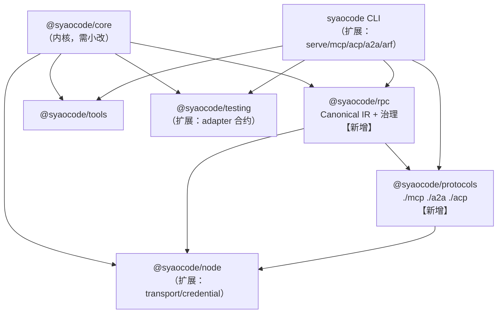

# 03 · 工程实现与落地路线

> 本文把 [02-治理底座架构设计.md](02-治理底座架构设计.md) 落到本仓库的具体文件、命令、测试与排期。  
> 代码基线：`code/` @ `0ba2a35`（`0.2.0-dev`）；本机复核 `typecheck` 通过、`pnpm test` **339 项全过**（core 104 / node 3 / providers 20 / tools 18 / testing 9 / cli 185）。

---

## 1. 约束继承：先认清仓库的既有规矩

新设计必须遵守这些已存在的约定，否则会在合并期付出额外代价。

| 约定 | 事实 | 对本设计的约束 |
| --- | --- | --- |
| **无 TS project references** | 只有 `code/tsconfig.base.json`，构建顺序在根 `package.json:20` 手写：core → node → (providers/tools/testing) → cli | 新包必须**手动**插入 build 链与各包 `tsconfig.build.json` 的 `paths` |
| **开发态 exports 指向源码** | 每个包 `exports: { ".": "./src/index.ts" }`，发布态 `publishConfig` 切到 `./dist/*` | 新包照抄该模式；workspace 内直接吃 TS 源码 |
| **core 纯度门禁** | `scripts/check-core-purity.ts` 只扫 `packages/core/src`，只禁 `node:` 导入 | 需要把脚本扩展到新包（见 §3.4） |
| **错误码治理** | `scripts/check-error-registry.ts`：唯一性、`SY-<DOMAIN>-<3位>`、**每个码必须有 zh-CN 文案**、固定 retryable/fatal 集合、`SY-DEC-007` 故意留空 | 新增错误码必须同时改 `registry.ts`、`messages-zh.ts`，必要时改 lint 脚本 |
| **错误域是封闭联合** | `ErrorDomain = CFG\|PRV\|LOOP\|TOOL\|PERM\|FS\|CTX\|SES\|SEC\|MCP\|ACP\|PLG\|HOOK\|DEC\|AGT\|RUN\|SRV\|CLI\|INT` | **A2A 没有域**，需要新增 `'A2A'`（4 字母，符合正则 `^SY-[A-Z]{2,4}-\d{3}$`） |
| **已预留未使用的错误码** | `SY-MCP-001..005`、`SY-ACP-001..002`、`SY-SRV-001..003` 从未被抛出 | 新实现应复用它们，而不是新造码 |
| **zod 3.24** | 全仓 `zod: ^3.24.0`（core/cli/testing/tools） | MCP SDK v2 要求 `zod ^4.2.0` → **不引入官方 SDK**（见 §3.2） |
| **自研协议适配风格** | `providers` 自研 SSE 解析，不用官方 SDK；一切 IO 走注入的 `Runtime` | 新协议适配器同样自研最小 JSON-RPC 层，不引入 SDK 运行时依赖 |
| **严格 TS** | `strict` + `exactOptionalPropertyTypes` + `noUncheckedIndexedAccess` + `verbatimModuleSyntax` | 所有可选字段用 `prop?: T` 且**不能显式赋 undefined**；数组下标需判空 |
| **测试无配置文件** | 无 `vitest.config.*`，每包 `vitest run`，测试放 `packages/<pkg>/test/*.test.ts` | 新包测试同目录；根 `pnpm test` 自动纳入 |
| **CLI 手写参数解析** | `packages/cli/src/args.ts` 手写 switch，无框架 | 新命令沿用同一风格 |
| **配置分层** | `code > env > project > user > base > defaults`（`core/src/config.ts`），BR-002 禁 project bypass，BR-024 禁 project 放宽 user deny | ARF 策略包沿用该优先级与两条硬规则 |

---

## 2. 目标形态

### 2.1 对外能力

```bash
# 1) 把 SYAOCode 作为 MCP server 暴露（现代 2026-07-28 形态 + legacy 回退）
syao serve --mcp --stdio

# 2) 把 SYAOCode 作为 ACP agent 暴露给编辑器
syao serve --acp --stdio

# 3) 作为 A2A agent 暴露（HTTP+JSON / JSON-RPC）
syao serve --a2a --http --port 8931

# 4) 调用远端能力（走同一治理流水线）
syao call mcp://github/tool/get_issue --input '{"number":42}'
syao call a2a://researcher/skill/web-research --input '{"q":"agent rpc governance"}'

# 5) 治理运维
syao arf tasks --json
syao arf task <id> --watch
syao arf approvals --pending
syao arf approve <id> --allow-once
syao arf policy explain --capability mcp://github/tool/create_issue --input @req.json
syao arf audit verify
syao arf budget show
```

### 2.2 嵌入形态（SDK）

```ts
import { createFabric } from '@syaocode/rpc';
import { mcpAdapter, a2aAdapter, acpAdapter } from '@syaocode/protocols';
import { nodeRuntime } from '@syaocode/node';

const fabric = createFabric({
  runtime: nodeRuntime(),
  policy: { bundle: policyBundle },          // org/project/user 分层
  budget: { limitUsd: 2 },
  receipts: fileReceiptStore,
});

// 挂载能力来源
fabric.mount(mcpAdapter({ servers: [{ name: 'github', transport: 'stdio', command: '...' }] }));
fabric.mount(a2aAdapter({ agents: [{ id: 'researcher', url: 'https://...' }] }));
fabric.mount(acpAdapter({ client: myEditorClient }));

// 发起一次受治理的任务
const task = await fabric.tasks.create({
  capability: 'mcp://github/tool/get_issue',
  input: { number: 42 },
  budget: { usd: 0.2 },
});
for await (const ev of fabric.tasks.events(task.id)) {
  if (ev.type === 'invocation.completed') console.log(ev.payload.receiptId);
}
```

---

## 3. 包结构

### 3.1 目标依赖图



> `@syaocode/rpc` **只依赖** `@syaocode/core`（+ zod），保持 host-agnostic；`@syaocode/protocols` 依赖 `@syaocode/rpc`；Node 专属能力（stdio 子进程、HTTP server、keychain）全部在 `@syaocode/node`。

### 3.2 新增 `@syaocode/rpc`（目标 ~2,600 行 src）

```
packages/rpc/
  package.json                 # 照抄 core/package.json 结构；deps: @syaocode/core workspace:*, zod ^3.24.0
  tsconfig.json                # extends ../../tsconfig.base.json；paths 指向 ../core/src/index.ts
  tsconfig.build.json          # paths → ../core/dist/index.d.ts
  LICENSE
  src/
    index.ts                   # 公开 API（对标 core/index.ts 的分组风格）
    ir/
      types.ts                 # Principal/Capability/Session/Task/Invocation/Approval/Receipt/Event/Artifact
      schemas.ts               # Zod schema（唯一 schema 源，ADR-07）
      states.ts                # TaskState/InvocationState/ApprovalState + 状态机转移表
      errors.ts                # CanonicalError + 协议错误映射表
      ids.ts                   # ID 生成与格式约束（task_/inv_/apr_/rcpt_）
    governance/
      dispatcher.ts            # 十步流水线编排
      policy.ts                # PolicyEngine 接口 + RuleEngine + LocalPolicyEngine(包装 PermissionEngine)
      policy-bundle.ts         # 策略包 schema/加载/签名校验/revision 计算
      approval.ts              # ApprovalBroker + ApprovalStore 接口 + CAS
      budget.ts                # BudgetLedger + 账户层级 + reserve/settle
      idempotency.ts           # IdempotencyStore + requestHash
      receipts.ts              # Receipt 构造 + 哈希链 + EvidenceBundle
      audit.ts                 # AuditEvent + 哈希链 + checkpoint + verify
      identity.ts              # Principal / DelegationToken / 签发与校验
      credentials.ts           # SecretRef / CredentialBroker 接口（实现放 node）
      registry.ts              # CapabilityRegistry + Router + 健康与熔断
      redactor-bridge.ts       # 复用 core Redactor 的统一脱敏入口
    runtime/
      stores.ts                # TaskStore/AuditStore/BudgetStore/IdempotencyStore/ApprovalStore 接口 + 内存实现
      eventlog.ts              # 事件日志（append-only，seq 连续，重放）
      projection.ts            # Task 状态投影器（事件 → 状态）
    adapters/
      contract.ts              # ProtocolAdapter 接口 + AdapterCapabilities + 校验器
      native.ts                # ARF 原生 JSON-RPC 绑定（stdio/HTTP）
      mapping.ts               # Canonical ↔ 协议 的公共映射工具
  test/
    states.test.ts             # 状态机性质测试
    policy.test.ts             # 规则组合、obligation、deny 一票否决
    approval.test.ts           # CAS 单赢家、recheck 8 轮、超时 deny
    budget.test.ts             # 预留/结算/并发/崩溃恢复
    idempotency.test.ts        # 冲突/in_flight/重放
    receipt.test.ts            # 哈希链、Evidence Bundle 校验
    dispatcher.test.ts         # 十步流水线顺序与失败语义
    stores.test.ts             # 内存实现 + 事件重放
```

关键接口（TS 风格与仓库一致）：

```ts
// packages/rpc/src/governance/dispatcher.ts
export interface DispatcherDeps {
  runtime: Runtime;
  policy: PolicyEngine;
  approvals: ApprovalBroker;
  budget: BudgetLedger;
  idempotency: IdempotencyStore;
  receipts: ReceiptStore;
  audit: AuditStore;
  registry: CapabilityRegistry;
  redactor?: Redactor;
  events: EventLog;
}

export interface Dispatcher {
  invoke(req: InvokeRequest, ctx: DispatchContext): Promise<InvokeResult>;
}

export interface InvokeRequest {
  principal: Principal;
  capabilityId: string;
  input: unknown;
  protocol: 'mcp' | 'a2a' | 'acp' | 'native' | 'local';
  direction: 'inbound' | 'outbound' | 'reverse';
  taskId?: string;
  sessionId?: string;
  idempotencyKey?: string;
  deadlineAt?: string;
  approvalAuthority?: ApprovalAuthority;
}
```

```ts
// packages/rpc/src/adapters/contract.ts
export interface ProtocolAdapter {
  readonly protocol: 'mcp' | 'a2a' | 'acp';
  readonly version: string;
  capabilities(): AdapterCapabilities;
  discover(ctx: AdapterContext): Promise<DiscoveredCapability[]>;
  invoke(req: AuthorizedInvocation, ctx: AdapterContext): Promise<InvokeResult>;
  subscribe?(taskId: string, afterSeq: number, ctx: AdapterContext): AsyncIterable<CanonicalEvent>;
  cancel?(taskId: string, reason: string, ctx: AdapterContext): Promise<void>;
  health(): Promise<HealthStatus>;
  close(): Promise<void>;
}
```

### 3.3 新增 `@syaocode/protocols`（目标 ~2,200 行 src）

```
packages/protocols/
  package.json                 # 无运行时依赖（仅 workspace:@syaocode/rpc + zod）
  src/
    index.ts                   # 只导出工厂与类型；子路径导出避免加载未用适配器
    mcp/
      index.ts                 # mcpAdapter()
      jsonrpc.ts               # 最小 JSON-RPC 2.0 编解码（stdio/HTTP 通用）
      client.ts                # MCP client：server/discover + tools/list + tools/call + MRTR 重试
      server.ts                # MCP server：现代形态（_meta 信封 + resultType）+ legacy 兼容
      meta.ts                  # io.modelcontextprotocol/* _meta 常量与构造
      mrtr.ts                  # InputRequiredResult ↔ Approval/Input 映射 + requestState 保管
      tasks.ts                 # io.modelcontextprotocol/tasks 扩展（tasks/get|update|cancel）
      errors.ts                # MCP 错误码 ↔ CanonicalError
    a2a/
      index.ts
      jsonrpc.ts               # 复用 mcp/jsonrpc 的通用实现（同一 wire 格式）
      client.ts                # SendMessage/SendStreamingMessage/GetTask/ListTasks/CancelTask/SubscribeToTask
      server.ts                # 对外提供上述方法 + AgentCard 生成 + A2A-Version 处理
      card.ts                  # AgentCard 生成/解析/签名（Ed25519，可选）
      artifacts.ts             # Artifact ↔ Canonical Artifact
    acp/
      index.ts
      server.ts                # ACP agent：initialize/session/*/prompt/cancel/update
      client.ts                # ACP client（后置，M3+）
      permissions.ts           # session/request_permission ↔ Approval 映射
      fs.ts                    # fs/read_text_file|write_text_file 反向调用桥
      terminal.ts              # terminal/* 反向调用桥
      content.ts               # ContentBlock ↔ core ContentBlock 映射
  test/
    mcp.contract.test.ts
    a2a.contract.test.ts
    acp.contract.test.ts
    fixtures/                  # 录制的真实 wire 报文（脱敏）
```

> `exports` 采用子路径：`"." → ./src/index.ts`、`"./mcp" → ./src/mcp/index.ts`、`"./a2a"`、`"./acp"`；发布态对应 `./dist/*`。这样使用者只加载自己需要的适配器。

### 3.4 不引入官方 SDK 的理由（重要决策）

| 选项 | 评估 |
| --- | --- |
| **A. 用 MCP TypeScript SDK v2** | 要求 `zod ^4.2.0`，与全仓 `zod ^3.24.0` 冲突；v2 默认仍走 2025 `initialize`，需显式 `versionNegotiation`；包从 1 个裂成 9 个；我们只需要 `tools/list` + `tools/call` + MRTR + discover 子集 |
| **B. 自研最小 MCP 客户端/服务端**（推荐） | 只需实现 JSON-RPC 2.0 + `_meta` 信封 + 6 个方法 + MRTR 重试；零新依赖；沿用仓库"自研适配器"既有风格（`providers` 亦然）；wire 面窄，版本漂移可控；代价是协议演进要自己跟进（用 §7.4 的核验触发器控制） |
| C. 只做 client 或只做 server | 需求两端都有：客户要接 MCP server，我们也要能调 MCP server |

结论：**B**。A2A/ACP 同样自研最小 JSON-RPC 层（`jsonrpc.ts` 三处共用一份实现）。

### 3.5 扩展既有包

| 包 | 改动 | 规模 |
| --- | --- | --- |
| `@syaocode/core` | 见 §4 | ~300 行改动 |
| `@syaocode/node` | 新增 `stdioTransport`、HTTP server/client（含 SSE）、`createFileAuditStore`、`createFileTaskStore`、`keychainCredentialStore`、`sha256` 提升为通用 `hash` 工具 | ~600 行 |
| `@syaocode/testing` | 新增 `defineAdapterContract`（仿 `defineProviderContract`）、`MemoryTaskStore`、`MemoryAuditStore`、`FakeApprovalChannel` | ~350 行 |
| `@syaocode/tools` | 工具补 `meta.trust`（MCP/web 来源标 `untrusted`）；补 `jsonSchema` 覆盖字段（MCP 工具直接透传原始 JSON Schema） | ~60 行 |
| CLI | 新增 `serve`/`mcp`/`acp`/`a2a`/`call`/`arf` 子命令；`args.ts` 手写解析扩展 | ~1,200 行 |
| 根 `package.json` | `build` 链插入 `rpc` → `protocols`；新增 `lint:rpc` | 3 行 |
| `scripts/` | `check-core-purity.ts` 扩展为多包扫描；新增 `check-rpc-boundaries.ts` | ~120 行 |

---

## 4. 内核改造清单（必须先做）

以下 9 项是治理底座的**前置条件**：不先修，三个适配器会把缺陷复制三遍。

| # | 改造 | 现状（证据） | 目标 | 影响面 | 预估 |
| --- | --- | --- | --- | --- | --- |
| C1 | **审批事件即时可见** | 事件在批次结束后才 yield（`core/src/agent.ts:478-481`），实测 `permission.request` 在被回答后才出现在流里 | 审批事件**不进批次缓冲**，立即 yield；或提供独立 `EventSink` 通道 | `agent.ts` 缓冲逻辑 | 1.5 人天 |
| C2 | **事件信封补齐** | `EventEnvelope` 只有 `{seq, runId, turnId?, causationId?}`（`core/src/events.ts:40-48`），无 `schemaVersion/ts/sessionId` | 新增**可选**字段（不破坏兼容）：`schemaVersion`、`ts`、`sessionId`；`sessionId` 从 `session.start` 提升到信封 | `events.ts` | 0.5 人天 |
| C3 | **事件持久化 sink** | 只写 `type:'message'`（`agent.ts:618-627`）；`LogEntry.type` 已预留 `permission/usage/checkpoint/meta` | 新增 `EventSink` 接口 + `FileEventSink`；把 `permission.*`/`tool.receipt`/`verification.*`/`usage` 落盘 | `core` + `node` | 2 人天 |
| C4 | **trust 标注可用** | `ToolResultBlock.trust` 从未赋值（`pipeline.ts:98-103`）；`ToolReceipt.trust` 固定 `'workspace'`、`sandbox` 固定 `'none'`（`pipeline.ts:94-95`） | MCP/web 来源的工具结果标 `untrusted`；回执写真实 trust/sandbox | `pipeline.ts`、`tools` | 1 人天 |
| C5 | **审批记忆与 requestId** | `remember:'project'` 只在内存（`permissions.ts:516-525`）；`remember:'once'` 被忽略；`PermissionRequest.id` 每轮重新生成（`permissions.ts:465`） | `once` 生效；`project` 落盘；审批请求 ID 在 recheck 轮次间保持稳定 | `permissions.ts` + 存储 | 1.5 人天 |
| C6 | **审计用密码学哈希** | `contentHash` 是 4 车道 FNV-1a（`core/src/hash.ts:1-20`），非密码学；SHA-256 只在 `@syaocode/node` | 审计链/证据链**必须** SHA-256；`Runtime` 增加可选 `hash` 注入，或规定治理面哈希只在 node 包实现 | `core/src/hash.ts`、`node` | 1 人天 |
| C7 | **错误域与错误码** | `ErrorDomain` 无 `'A2A'`（`registry.ts:12-13`）；`SY-MCP-001..005`、`SY-ACP-001..002`、`SY-SRV-001..003` 从未抛出 | 新增 `'A2A'` 域与码；复用 MCP/ACP/SRV 预留码；同步 `messages-zh.ts` 与 lint 脚本固定集合 | `registry.ts`、`messages-zh.ts`、`scripts/check-error-registry.ts` | 1 人天 |
| C8 | **P0 安全洞** | v0.2 已修复读路径围栏与危险命令规则来源（`core/test/security-v2.test.ts` 7 条用例） | 把三协议的路径围栏/危险命令规则**共用**同一判定函数，避免两套语义 | `permissions.ts` | 1 人天 |
| C9 | **配置扩展** | `configSchema` 无 `rpc` 段（`core/src/config.ts:26-49`） | 新增 `rpc: { policy?, budget?, registry?, server?, audit? }`，沿用分层优先级与 BR-002/BR-024 | `config.ts`、`cli/src/effective-config.ts` | 1 人天 |

合计 **约 11.5 人天**。C1、C3 是 M0 的硬前置。

---

## 5. 关键实现要点

### 5.1 MCP 适配器（现代 2026-07-28 形态）

**请求信封**（每个请求都要带，缺一即视为非法）：

```ts
// packages/protocols/src/mcp/meta.ts
export const MCP_META_VERSION = 'io.modelcontextprotocol/protocolVersion';
export const MCP_META_CLIENT_CAPS = 'io.modelcontextprotocol/clientCapabilities';
export const MCP_META_CLIENT_INFO = 'io.modelcontextprotocol/clientInfo';
export const MCP_META_LOG_LEVEL = 'io.modelcontextprotocol/logLevel';

export function withMcpMeta(params: Record<string, unknown>, caps: ClientCapabilities): Record<string, unknown> {
  return {
    ...params,
    _meta: {
      [MCP_META_VERSION]: '2026-07-28',
      [MCP_META_CLIENT_CAPS]: caps,
      [MCP_META_CLIENT_INFO]: { name: 'syaocode', version: VERSION },
    },
  };
}
```

**时代探测（Era detection）**：

```ts
// 1) 首选：直接 server/discover
const discover = await rpc('server/discover', withMcpMeta({}, caps));
if (discover.ok) {
  // DiscoverResult: { resultType:'complete', supportedVersions[], capabilities, ttlMs, cacheScope }
  return { era: 'modern', supported: discover.result.supportedVersions, capabilities: discover.result.capabilities };
}
// 2) 回退：发一个现代请求，看是否返回 -32022 UnsupportedProtocolVersionError
const probe = await rpc('tools/list', withMcpMeta({}, caps));
if (!probe.ok && probe.error.code === -32022) {
  return { era: 'legacy', supported: probe.error.data?.supported ?? ['2025-11-25'] };
}
// 3) 仍失败：按 legacy 走 initialize 流程
const init = await rpc('initialize', { protocolVersion: '2025-11-25', capabilities: legacyCaps, clientInfo });
await notify('notifications/initialized');
```

**MRTR 重试**（审批的落点）：

```ts
// 收到 InputRequiredResult
if (result.resultType === 'input_required') {
  const approval = await approvals.request({
    taskId, subject: subjectFromInputRequests(result.inputRequests),
    options: optionsFromElicitation(result.inputRequests),
  });
  if (approval.state !== 'allowed') throw new CanonicalError('denied');
  // 原样回传 requestState + 本轮 inputResponses；重试"同一个逻辑请求"
  const retried = await rpc(original.method, {
    ...original.params,
    _meta: { ...original.params._meta, [MCP_META_STATE]: result.requestState },
    inputResponses: responses,
  });
}
```

规则：

- `requestState` **不透明保管**，不得改写；篡改 → fail-closed；
- 重试必须使用**同一个逻辑请求**的幂等键，否则本地幂等层会当成新调用；
- `resultType` 缺失时按 `'complete'` 处理（兼容老服务端）。

**MCP server 侧**（把 SYAOCode 暴露为 MCP server）：

- 每个请求回 `resultType`（`'complete'` / `'input_required'` / `'task'`）；
- 需要审批时返回 `InputRequiredResult`（elicitation 承载选项），**不主动发请求**；
- 工具名 `mcp__<server>__<tool>` 规则沿用 DD-8；风险默认 `network`/`exec` → 走 `ask`；
- 外部工具结果一律标 `trust:'untrusted'`，并禁止其内容影响策略。

### 5.2 A2A 适配器

**AgentCard 生成**（把 SYAOCode 暴露为 A2A agent）：

```ts
const card: AgentCard = {
  name: 'SYAOCode',
  description: 'Evidence-first coding agent runtime',
  version: '0.2.0-dev',
  supportedInterfaces: [{ url: 'http://127.0.0.1:8931', protocolBinding: 'JSONRPC', protocolVersion: '1.0' }],
  capabilities: { streaming: true, pushNotifications: false, extensions: [] },
  defaultInputModes: ['text/plain'],
  defaultOutputModes: ['text/plain'],
  skills: [{ id: 'fix-code', name: 'Fix code', description: '修复缺陷并给出可核验证据', tags: ['coding'], examples: [] }],
  securitySchemes: { bearer: { type: 'http', scheme: 'bearer' } },
  securityRequirements: [{ bearer: [] }],
};
```

**方法实现要点**：

| 方法 | 实现 |
| --- | --- |
| `SendMessage` | 建 Task（ARF TaskStore），首条消息作为 input，立即返回 Task（state=`submitted`→`working`） |
| `SendStreamingMessage` | 同上 + SSE；事件从 ARF 事件日志转 `TaskStatusUpdateEvent` / `TaskArtifactUpdateEvent` |
| `GetTask` | 读投影；`historyLength` 支持 `-5`（最近 N 条）语义 |
| `ListTasks` | cursor 分页，按最后更新时间倒序；**必须**按 tenant 过滤 |
| `CancelTask` | 置 `cancel_requested` → 适配器取消 → 终态；幂等 |
| `SubscribeToTask` | 首个事件必须是当前 Task 快照；终态自动关闭流 |
| Push config | v1.0 可只实现"拒绝"（返回 `PushNotificationNotSupportedError`），或实现带 SSRF 防护的 webhook |

**状态映射**：

```text
ARF submitted   → TASK_STATE_SUBMITTED
ARF working     → TASK_STATE_WORKING
ARF input_required → TASK_STATE_INPUT_REQUIRED
ARF auth_required  → TASK_STATE_AUTH_REQUIRED
ARF completed   → TASK_STATE_COMPLETED
ARF failed      → TASK_STATE_FAILED
ARF cancelled   → TASK_STATE_CANCELED
ARF rejected    → TASK_STATE_REJECTED
ARF expired     → TASK_STATE_FAILED（reason=timeout）
```

**JSON 枚举名**必须是 `TASK_STATE_*`（规范 §5.6 的 ProtoJSON 约定），不是 `input-required` 之类。

### 5.3 ACP 适配器（server 优先）

**会话映射**：

| ACP | ARF |
| --- | --- |
| `initialize` | 绑定客户端能力（fs/terminal/elicitation）；**不是**会话创建 |
| `session/new` | 建 Session + 首个 Task 占位；返回 `sessionId` |
| `session/load` | 载入 Session；**必须先重放历史**（`session/update` 变体），再返回 `{}` |
| `session/resume` | 载入但不重放 |
| `session/prompt` | 建 Task；把 prompt 内容块映射为 Task.input；返回 `stopReason` |
| `session/cancel` | 取消 Task；把 pending 审批置 `cancelled` |
| `session/update` | ARF 事件 → ACP 变体（见 01 §5.5） |
| `session/request_permission` | 审批桥（见下） |
| `fs/*`、`terminal/*` | **反向调用**：走同一条治理流水线 |

**审批桥**：

```ts
// ACP → ARF
const approval = await approvals.request({
  taskId,
  subject: { kind: 'tool', summary: toolCall.title, detail: toolCall.rawInput },
  options: request.options.map((o) => ({
    id: o.optionId,
    label: o.name,
    kind: o.kind,                 // allow_once | allow_always | reject_once | reject_always
    scope: o.kind === 'allow_always' ? { capabilityId, expiresAt } : undefined,
  })),
});
// ARF → ACP
return { outcome: approval.state === 'allowed'
  ? { outcome: 'selected', optionId: approval.decisionOptionId }
  : { outcome: 'cancelled' } };
```

注意：ACP 没有 `denied` 结果，拒绝必须表达为 `selected` + `reject_*` 选项。

**反向 fs 调用**（关键安全点）：

```ts
// Agent 请求写文件 → 客户端执行前，先过策略与路径围栏
const verdict = await policy.evaluate({
  principal, capability: { id: `acp://${clientId}/fs/write_text_file`, kind: 'fs', risk: 'write', sideEffect: 'non_idempotent', ... },
  input: { path, content },
  context: { direction: 'reverse', workspaceRoots: session.workspaceRoots, ... },
});
if (verdict.effect === 'deny') return errorToAcp(verdict);
// 客户端没声明能力 → unsupported_capability，绝不回退到本地 fs
```

### 5.4 存储实现

| Store | 接口（放 `@syaocode/rpc/runtime/stores.ts`） | 本地实现 | 企业实现（后续） |
| --- | --- | --- | --- |
| `TaskStore` | `create/get/append/list/fork/delete` | JSONL：`~/.syaocode/arf/tasks/<tenant>/<taskId>.jsonl` + 内存索引 | Postgres |
| `EventLog` | `append(taskId, event)/list(taskId, afterSeq)/snapshot` | 同上文件，追加写 + 目录锁（复用 `FileSessionStore` 的 `mkdir` 锁模式） | Postgres |
| `AuditStore` | `append(event)/list(from)/verify` | `~/.syaocode/arf/audit/<tenant>/<date>.jsonl`，哈希链 | 远端聚合 |
| `ApprovalStore` | `insert/get/listPending/decide(CAS)/expire` | 同目录 `approvals.jsonl` | Postgres（强一致 CAS） |
| `BudgetStore` | `accounts/reserve/settle/release/list` | `budget.json`（原子 tmp+rename，仿 `cli/src/usage-store.ts`） | Postgres + 行锁 |
| `IdempotencyStore` | `begin(key, hash)/get/complete/fail` | `idem.jsonl` + 索引 | Redis/Postgres |
| `ReceiptStore` | 复用 core 的 `ReceiptStore`（`put/get`），追加 hash 字段 | `~/.syaocode/evidence`（已存在，`cli/src/run.ts:69`） | 对象存储 |

**崩溃恢复**：启动时扫描未终结 Task，用事件日志重放投影；对未结算的预算预留按 TTL 释放或按 receipt 补扣。

### 5.5 CLI 新增

| 命令 | 形态 | 说明 |
| --- | --- | --- |
| `syao serve` | `--mcp/--acp/--a2a` + `--stdio/--http` + `--port` + `--host` | 启动服务；默认只监听 `127.0.0.1`；远程监听需 `--host` + token，否则 `SY-SRV-002 UnsafeListenAddress` |
| `syao mcp add/list/get/remove/login/logout` | — | MCP server 配置管理；项目级首次使用需信任确认（`SY-CFG-003`） |
| `syao acp` | `--stdio` | ACP agent 入口（等价 `serve --acp --stdio`） |
| `syao a2a` | `--http --port` | A2A agent 入口 |
| `syao call` | `<capabilityId> --input @file` | 发起一次受治理调用，输出 JSON 结果 + 回执 ID |
| `syao arf tasks/task/approvals/approve/policy/audit/budget` | 子命令组 | 治理运维；`--json` 机读输出 |

参数解析沿用 `packages/cli/src/args.ts` 的手写 switch 风格；新增 `command` 联合类型成员。

**退出码**（沿用 `cli/src/run.ts:24-31`）：

| 码 | 含义 |
| --- | --- |
| 0 | 成功 |
| 1 | 一般错误 |
| 2 | 参数/配置/协议格式错误 |
| 3 | 权限拒绝（含审批被拒） |
| 4 | 限额（预算/轮次/时长） |
| 5 | 未验证（`unverified`） |
| 6 | 验证失败 |
| 7 | **新增**：能力/协议不可用（`unsupported_capability`、`version_mismatch`） |
| 130 | 中断 |

### 5.6 配置

在 `core/src/config.ts` 的 `configSchema` 上扩展（保持分层优先级）：

```ts
rpc: z.object({
  policy: z.object({ bundle: z.string().optional(), mode: z.enum(['strict','default','acceptEdits','plan','bypass']).optional() }).default({}),
  budget: z.object({ limitUsd: z.number().positive().optional(), limitTokens: z.number().int().positive().optional() }).default({}),
  server: z.object({ host: z.string().optional(), port: z.number().int().optional(), token: z.string().optional() }).default({}),
  audit: z.object({ enabled: z.boolean(), retentionDays: z.number().int().positive() }).default({}),
  registry: z.array(z.object({ id: z.string(), protocol: z.enum(['mcp','a2a','acp','local']), endpoint: z.string() })).default([]),
}).default({}),
```

约束：

- 项目级配置**不得**开启 `bypass`（沿用 BR-002）；
- 项目级策略**不得**放宽用户级 deny（沿用 BR-024）；
- `server.token` 只能来自环境变量引用，不落盘明文。

---

## 6. 里程碑与任务拆解

> 人天为**单人估算**（含测试与文档），不含产品化 UI 与企业控制面。实际周期受兼职投入影响，见 §6.6。

### M0 · 内核与契约（11.5 + 8 人天 ≈ 20 人天 / 2.5 周）

| 任务 | 人天 | 产出 | 验收 |
| --- | --- | --- | --- |
| T0.1 C1 审批事件即时可见 | 1.5 | 审批事件不进批次缓冲 | 新测试：审批 handler 未回答前，`permission.request` 已出现在事件流 |
| T0.2 C2/C3 事件信封 + sink | 2.5 | `schemaVersion/ts/sessionId` + `EventSink` | 事件可持久化并重放；`events-v2.test.ts` 不回归 |
| T0.3 C4 trust 标注 | 1 | 工具结果/回执真实 trust | 外部来源结果标 `untrusted`；新增断言 |
| T0.4 C5 审批记忆与稳定 requestId | 1.5 | `once` 生效、`project` 落盘、recheck 轮次 ID 稳定 | 新测试覆盖三点 |
| T0.5 C6 密码学哈希 | 1 | `Runtime.hash` 注入 / node 实现 | 审计链用 SHA-256 |
| T0.6 C7 错误域与码 | 1 | `'A2A'` 域 + 复用预留码 | `lint:registry` 通过且文案齐全 |
| T0.7 C9 配置扩展 | 1 | `rpc` 配置段 + 分层 | 分层优先级测试 |
| T0.8 Canonical IR + 状态机 | 4 | Zod schema + 转移表 | 状态机性质测试（随机路径不出现非法转移） |
| T0.9 治理接口骨架 | 4 | Policy/Approval/Budget/Idempotency/Receipt/Audit 接口 + 内存实现 | 接口单测 + 黄金样例 |
| T0.10 黄金样例与文档 | 3 | 3 个跨协议场景的期望事件序列（`fixtures/`） | 样例被后续实现当断言用 |

**退出条件**：IR schema 冻结 v1；十步流水线以内存实现跑通；`lint:registry`、`typecheck`、339 项测试仍全绿。

### M1 · 治理流水线与 MCP（≈ 22 人天 / 3 周）

| 任务 | 人天 | 验收 |
| --- | --- | --- |
| T1.1 Dispatcher 十步流水线 | 5 | 顺序与失败语义单测；策略/预算/幂等任一不可用 → 拒绝 |
| T1.2 PolicyEngine + LocalPolicyEngine（包装 `PermissionEngine`） | 4 | 现有权限测试全部复用；`policy explain` 输出决策轨迹 |
| T1.3 ApprovalBroker + CAS + 4 种 Authority 骨架 | 4 | 并发双答只成功一次；超时 deny；recheck 8 轮 |
| T1.4 BudgetLedger（预留/结算/恢复） | 3 | 并发不超支；崩溃后预留回收正确 |
| T1.5 Receipt/Evidence/Audit 链 | 3 | 哈希链可重算；`audit verify` 能发现篡改 |
| T1.6 MCP client（modern + legacy） | 5 | 对真实 MCP server 完成 tools/list + tools/call；legacy 回落可用 |
| T1.7 MCP server（`syao serve --mcp --stdio`） | 4 | 第三方 MCP client 能发现并调用本地工具；审批经 MRTR |
| T1.8 CLI `serve`/`mcp`/`call`/`arf` | 4 | 命令可用；退出码表完整 |

**退出条件**：真实 MCP server 端到端；治理开销 p95 < 5ms；10 条红队用例全过。

### M2 · ACP（≈ 18 人天 / 2.5 周）

| 任务 | 人天 | 验收 |
| --- | --- | --- |
| T2.1 ACP server 骨架（initialize/session/*） | 5 | 会话创建/载入/恢复/关闭正确；load 必须重放 |
| T2.2 ACP 事件映射（15 种 `session/update`） | 3 | 变体全覆盖；`plan` 全量替换语义正确 |
| T2.3 审批桥 + 取消语义 | 3 | pending 权限在 cancel 后必须回 `cancelled`；stopReason=`cancelled` |
| T2.4 反向 fs/terminal 桥（含治理） | 4 | 越界路径被拒；客户端无能力时报 `unsupported_capability` |
| T2.5 Zed/Neovim 真实客户端联调 | 3 | 至少一个真实编辑器跑通"读→批→改→证据" |

**退出条件**：真实编辑器联调通过；反向调用无法绕过路径围栏。

### M3 · A2A（≈ 20 人天 / 3 周）

| 任务 | 人天 | 验收 |
| --- | --- | --- |
| T3.1 AgentCard 生成/解析/签名 | 3 | 卡片可导出；签名可选并可验 |
| T3.2 A2A server（11 个方法） | 7 | 与官方 SDK 互通；状态映射正确 |
| T3.3 A2A client + 委派令牌 | 5 | 预算随委派传递；`TASK_STATE_AUTH_REQUIRED` 可处理 |
| T3.4 Artifact/证据聚合 | 3 | 远端产物进入统一存储并进 Evidence Bundle |
| T3.5 跨协议黄金 trace 3 例 | 2 | S1/S2/S3 三场景事件序列稳定 |

**退出条件**：与官方 A2A SDK 互通；跨协议血缘可见。

### M4 · 加固与合规（≈ 12 人天 / 2 周）

| 任务 | 人天 | 验收 |
| --- | --- | --- |
| T4.1 `defineAdapterContract` 合约套件 | 3 | 每个适配器共享 8 条通用用例 + 协议专有用例 |
| T4.2 故障注入（断流/超时/半开/重复） | 2 | 非幂等不自动重试；`indeterminate` 有人工复核入口 |
| T4.3 红队 10 用例入 CI | 2 | 0 critical/high |
| T4.4 性能基准 | 2 | p95 治理开销 < 5ms；吞吐 ≥ 200 inv/s（只读） |
| T4.5 文档（协议矩阵、接入指南、运维） | 3 | `code/docs/` 落地 |

### 6.6 总量与现实校准

| 阶段 | 人天 | 兼职 2.5 人天/周 → 周数 |
| --- | --- | --- |
| M0 | 20 | ~8 周 |
| M1 | 22 | ~9 周 |
| M2 | 18 | ~7 周 |
| M3 | 20 | ~8 周 |
| M4 | 12 | ~5 周 |
| **合计** | **92 人天** | **~37 周（兼职）** |

> 与 `document/SYAOCode/10-WBS` 的 v1.0 P0 约 127 人日口径一致：Agent RPC 治理底座整体约等于 v1.0 的一个半版本体量。**建议不要一次全上**：先做 M0+M1（42 人天，~17 周兼职），拿到"统一治理 + MCP 生态"这一最小可售闭环；ACP/A2A 按真实需求排期。

---

## 7. 测试与质量门禁

### 7.1 测试分层

| 层 | 位置 | 内容 | 目标 |
| --- | --- | --- | --- |
| 单元 | `packages/rpc/test/*` | 状态机、策略组合、预算、幂等、哈希链 | 行覆盖 ≥ 85% |
| 合约 | `packages/protocols/test/*.contract.test.ts` | 仿 `defineProviderContract` 的 `defineAdapterContract` | 每适配器 8 条通用用例 |
| 黄金 | `packages/testing/src/fixtures/` | 录制的真实 wire 报文 + 期望事件序列 | 跨协议场景 3 例 |
| 集成 | `code/evals/` | 新增 `evals/arp/*.json`：跨协议任务 | ≥ 10 条，端到端 |
| 红队 | `packages/rpc/test/redteam.test.ts` | 02 §14.3 的 10 条 | 0 critical/high |
| 性能 | `packages/rpc/test/bench.test.ts` | 治理开销 | p95 < 5ms |

### 7.2 `defineAdapterContract` 通用用例

1. 能力发现返回正确的 `capabilityId` 与风险元数据；
2. 调用被策略拒绝 → 返回 `denied`，**未触达**远端（用计数断言）；
3. `ask` → 审批放行后才触达远端；
4. 审批拒绝 → 远端未被调用；
5. 超时 → `timed_out`/`indeterminate`，无自动重试；
6. 幂等：同 key 两次 → 远端只被调用一次；
7. 回执字段完整（hash 链、policy、approvals、成本）；
8. 取消 → 远端收到取消，远端状态可判定。

### 7.3 CI 门禁（在现有 `lint:registry → typecheck → test → test:evals` 之外新增）

| 门禁 | 脚本 | 判定 |
| --- | --- | --- |
| 纯度 | `scripts/check-core-purity.ts`（扩展到 `packages/rpc`） | 禁止 `node:` 导入 |
| 边界 | `scripts/check-rpc-boundaries.ts`（新） | `packages/rpc` 不得 import `@syaocode/node`；适配器不得 import `core/src/agent.ts`；适配器不得直接调用 `Tool.execute` |
| 协议漂移 | `packages/protocols/test/drift.test.ts` | 内置"期望的方法名/字段"清单与实现比对；升级规范后必须同步 |
| 契约 | `pnpm test` | 合约套件全绿 |
| 红队 | `pnpm --filter @syaocode/rpc test:redteam` | 0 critical/high |

### 7.4 协议漂移控制

| 触发 | 动作 | 时限 |
| --- | --- | --- |
| 上游发布新规范版本 | 按 `document/SYAOCode/14-附录B` 流程核验 → 更新 `04-外部事实核验记录.md` → 更新适配器与黄金样例 | 2 周内评估，1 个月内落地或明确不支持 |
| 上游废弃能力 | 在适配器中标注 `deprecated`，给出替代路径 | 同上 |
| SDK/规范变更导致 wire 不兼容 | 触发 `drift.test.ts` 失败 | 立即修复 |

> 本设计的所有外部事实都带核验日期（见 04）；**任何协议断言在引用前必须先查 04**。

---

## 8. 风险与回退

| 风险 | 概率 | 影响 | 缓解 | 回退 |
| --- | --- | --- | --- | --- |
| 协议演进快于实现 | 高 | 中 | 版本锁定 + 黄金样例 + drift 测试 | 只声明支持的具体版本，不支持就显式报错 |
| 范围蔓延（想做通用 Agent 平台） | 高 | 高 | 明确 anti-roadmap（README §0.6）；每阶段有退出条件 | 砍到 M0+M1 交付 |
| 治理开销拖慢本地 CLI | 中 | 中 | 缓存 + 异步审计 + 批写 | 提供 `--no-arf` 降级模式（仅本地、不治理） |
| 审批体验变差（多协议多弹窗） | 中 | 高 | 统一审批通道 + 计划级审批 + 批量只读 | 默认只读自动放行 |
| 安全回归 | 低 | 高 | 红队用例入 CI；C8 回归 | 关闭对应适配器开关 |
| 双实现漂移（core 权限 vs rpc 策略） | 中 | 高 | C8 共用判定函数；`LocalPolicyEngine` 包装而非复制 | 策略引擎只保留一处 |
| zod 版本冲突 | 低 | 中 | 不引入官方 SDK | — |
| 企业需求提前（SSO/多租户） | 中 | 中 | 控制面接口先行 | 先做本地多租户字段隔离 |

---

## 9. 对既有基线文档的修改建议

> 本设计**不直接改** `document/SYAOCode/` 下的基线文档；以下是建议的修改清单，供后续单独提交。

| 文件 | 建议 |
| --- | --- |
| `04-软件需求规格说明书-SRS.md` | FR-070~082 需要按 2026-07-28 的**无状态** MCP 重写（当前仍假定 `initialize` 协商与 `Mcp-Session-Id`）；新增 FR-09x 段（ARF IR、治理流水线、跨协议证据）；`术语`中补 ARF/Principal/Capability |
| `05-业务规则-BR` | 新增 BR-04x：治理先于派发、审批单赢家、预算预留-结算、非幂等至多一次、证据哈希链、跨协议可见性分级 |
| `07-概要设计说明书.md` | ADR-15~18（见 02 §18 的 R1/R2/R3/R7 等）；包结构表加入 `@syaocode/rpc`、`@syaocode/protocols` |
| `08-详细设计说明书.md` | DD-9 重写为"协议适配层与治理底座"；DD-17 与新的 ARF 合并（避免两套服务协议）；新增 DD-20（ARF 内核）、DD-21（跨协议证据） |
| `09-错误体系` | 新增 `A2A` 域；补 `SY-MCP-006`（MRTR 状态损坏）、`SY-SRV-004`（能力不支持）等 |
| `10-WBS` | 把 Agent RPC 底座作为独立工作包（约 92 人天）写入 v1.1/v2.0 区间，而不是塞进 v1.0 P0 |
| `14-附录B` | 把 [04-外部事实核验记录.md](../Agent-RPC/04-外部事实核验记录.md) 作为 2026-10-27 的核验记录并入 |
| `概览.md` / `document/产品文档-详细版.md` | v0.3/v1.0 路线图中增加"Agent RPC 治理底座"条目；在 §0.8 承诺 vs 现状表中补"跨协议治理"一行 |

---

## 10. 与产品路线的关系（建议）

| 版本 | 建议内容 | 与既有路线的关系 |
| --- | --- | --- |
| **v0.3「成本与缓存」** | 不变（上下文预算、自动压缩、缓存指标） | ARF 不与之冲突；ARF 的预算账本依赖定价表，v0.3 的 `pricing.json` 会让 ARF 预算更准 |
| **v0.4「Agent RPC 内核」**（新增） | M0 + M1：IR、治理流水线、MCP client/server、`serve` | 填补 v0.3 与 v1.0 之间的空白；也是 `serve/attach`（原 v1.1）的前置 |
| **v1.0「可验证的 coding agent」** | Evidence/Goal + MCP tools（已有）；把 Evidence Bundle 接到 ARF 回执 | 差异化主线不变 |
| **v1.1「团队与服务化」** | M2（ACP）+ M3（A2A）+ 企业控制面 | 与原 `serve/attach`、多客户端、策略/审计/OTel 合并 |
| **v2.0 Desktop** | 只做客户端，消费 ARF 协议 | 不变 |

**产品叙事建议**：把"支持 MCP/A2A/ACP"从**功能清单**升级为**能力主张**：

> "SYAOCode 不只是接得上这些协议，而是让它们**可治理**：一次授权、跨协议通用；一份预算、跨 Agent 不超支；一条证据链，跨客户端可核验。"

这句话能直接落到 M0~M3 的交付物上，也与产品文档 §0.4 的"可治理"支柱对齐。

---

## 11. 立即可执行的第一步（本周）

1. 读本文 §4 的 C1~C9，把它们拆成 issue，**先做 C1/C3**（审批事件即时可见 + 事件持久化）——这是所有后续工作的前提。
2. 在 `document/SYAOCode/14-附录B` 补记 2026-10-27 的核验结果（直接引用本目录的 04）。
3. 写 `packages/rpc` 的 `ir/` 四个文件（types/schemas/states/ids）并冻结 v1 schema；补状态机性质测试。
4. 写 `packages/rpc/test/fixtures/` 的三个黄金场景（先只写期望事件序列，实现随后补）。
5. 在 `document/Agent-RPC/` 记录 M0 的退出条件与排期，纳入周会。

> 目标：**两周内**拿到"内核 IR 冻结 + 事件持久化 + 审批事件即时可见"，这是后面 70 人天工作的地基。
