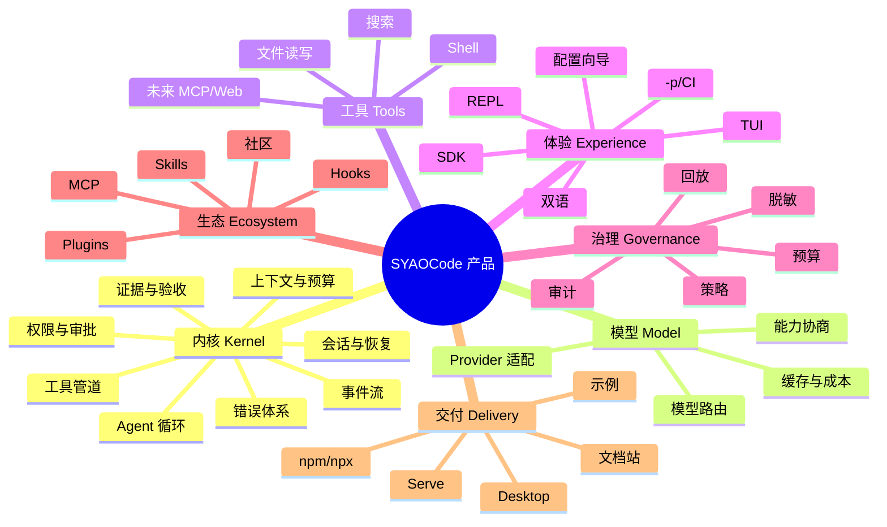
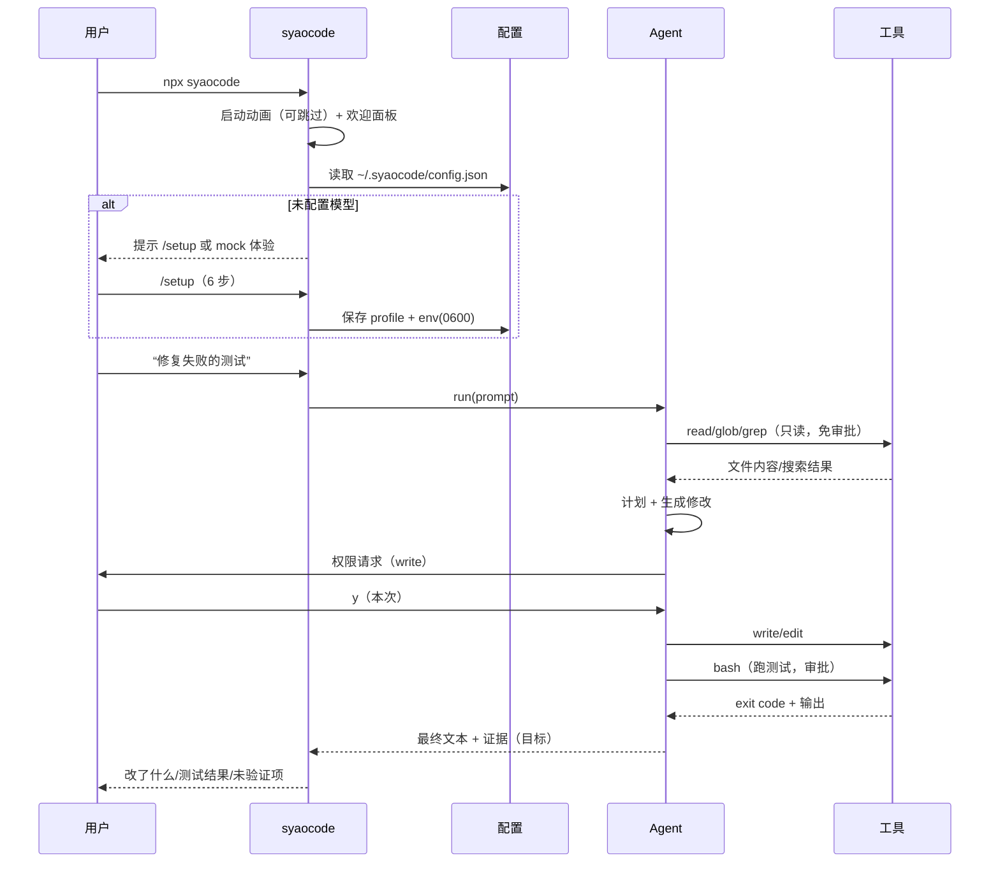
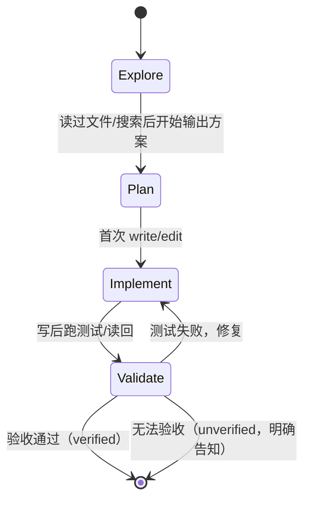
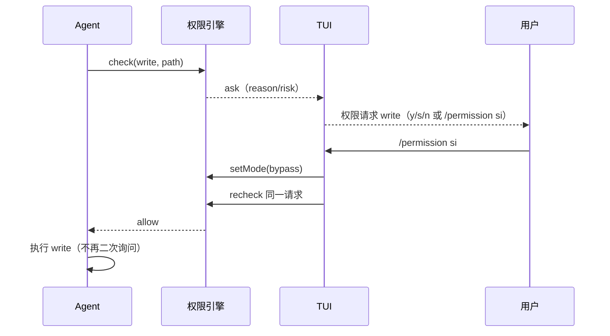

# SYAOCode 产品文档（详细版）

> **文档目的**：把 SYAOCode 从"一个已经写出来的 agent harness"整理成"一个有明确用户、场景、价值主张、功能边界、指标与路线图的产品"，供产品决策、对外沟通、招聘、融资/合作与研发排期参考。
>
> **文档性质**：**产品设计文档（PRD + 产品战略）**，不是需求规格说明书（SRS）、不是架构文档、不是营销文案。规范性的 FR/NFR/BR 仍以 `document/SYAOCode/` 为准；代码事实以 `概览.md` 与仓库为准。
>
> **基线**：v0.1 内部版（M0+M1，未发布），代码 `main` @ `0252d4c`（文档提交），实现基线 `0a05341`；本机复核 302 项测试全过、10/10 评测、79 个错误码治理通过。
>
> **状态标记**：✅ 已实现且已接线｜🟡 部分实现/未接线｜⬜ 规划｜💡 产品假设（待验证，不是承诺）。
>
> **阅读建议**：如果只看一页，读 §0；如果要做决策，读 §1、§4、§6、§13、§14；如果要做设计/研发，读 §7、§8、§9、§10。

---

## 目录

- [0. 一页纸产品摘要](#0-一页纸产品摘要)
- [1. 产品命题：为什么是 SYAOCode](#1-产品命题为什么是-syaocode)
- [2. 背景与问题](#2-背景与问题)
- [3. 市场与竞争](#3-市场与竞争)
- [4. 定位、价值主张与战略](#4-定位价值主张与战略)
- [5. 用户、JTBD 与核心场景](#5-用户jtbd-与核心场景)
- [6. 产品能力架构与优先级](#6-产品能力架构与优先级)
- [7. 详细功能规格](#7-详细功能规格)
- [8. 关键用户流程](#8-关键用户流程)
- [9. 信息架构与交互规范](#9-信息架构与交互规范)
- [10. 非功能需求](#10-非功能需求)
- [11. 指标体系](#11-指标体系)
- [12. 商业模式与生态](#12-商业模式与生态)
- [13. 路线图与版本策略](#13-路线图与版本策略)
- [14. 风险、开放问题与停止条件](#14-风险开放问题与停止条件)
- [15. 附录](#15-附录)

---

## 0. 一页纸产品摘要

### 0.1 一句话

**SYAOCode 是一个"先证据、再宣称完成"的可嵌入 TypeScript coding-agent 内核；CLI 是它的参考实现，不是它的边界。**

### 0.2 三句话

1. **对开发者**：`npx syaocode` 就能在终端里让 agent 读代码、改文件、跑测试，并且每次"完成"都给出可核验的证据，而不是一句"已修复"。
2. **对产品团队**：`@syaocode/*` 是 TypeScript 原生、模型中立、全 IO 注入的 agent harness，可以直接嵌进 IDE 插件、CI 机器人、SaaS 产品，不必自己重写循环、权限、会话和错误体系。
3. **对企业**：权限、预算、审计、回放是一等公民；模型可以换、供应商可以换，控制面始终在确定性代码手里。

### 0.3 电梯演讲（30 秒）

> 现在做 coding agent 的人面临一个两难：用 Claude Code / Codex CLI 这样的成品，能力和体验好，但不可嵌入、不可审计、绑定厂商；用 LangChain / 通用 agent 框架，能嵌入，但离"真正能改代码"还差权限、工具、会话、验证这一整套。SYAOCode 填的是中间这层：一个 TypeScript 原生、模型中立的 coding-agent 内核，把**权限、预算、证据、回放**做成库的原语，让任何产品都能装上一个"可信的 coding agent"。CLI 是我们自己用的第一个客户端，也是获客入口。

### 0.4 四个价值支柱

| 支柱 | 一句话 | 用户感知 | 当前状态 |
| --- | --- | --- | --- |
| **可信（Trust）** | 确定性权限 + 证据账本 + 可回放 | "它说改好了，我能验证；它不能偷偷越权" | 🟡 权限主体有，证据账本 ⬜ |
| **可嵌入（Embeddable）** | 纯 TS 内核、无 UI/Node 绑定、全 IO 注入 | "我能把它装进我的产品，而不是让用户换一个 App" | 🟡 设计成立，入口有 Node 泄漏 |
| **可负担（Affordable）** | 缓存感知上下文 + 三角色路由 + 硬预算 | "同样任务，token 更少；预算说停就停" | 🟡 有账本，缓存/预算未闭环 |
| **可治理（Governable）** | 统一人机请求 + 热改策略 + 审计 | "我能随时接管，不用重启任务" | 🟡 热改已有，协议未统一 |

### 0.5 目标用户（按优先级）

1. **Primary：AI 平台/工具团队**（要把 coding agent 嵌进自己产品的工程团队）——买的是内核与可信度。
2. **Secondary：独立开发者/小团队**（CLI 日活用户）——买的是效率与成本，也是口碑与反馈来源。
3. **Tertiary：企业平台/安全团队**（私有化、审计、合规）——买的是治理与支持。
4. **Community：Provider/Tool/Plugin 作者**——买的是稳定契约与生态。

### 0.6 当前阶段的关键判断

- **v0.1 是"技术骨架验证"，不是"产品市场验证"**。它证明了这个内核能跑通"读仓库—改文件—跑测试—报告"的闭环，但还没有证明有人愿意为它付费或嵌入。
- **未来 6 个月最重要的不是加功能，而是把"可信"做实**：修掉路径围栏/脱敏/危险规则三个安全洞，补事件生命周期与配置一致性，再做 Evidence Ledger。否则"可审计"就是营销话术。
- **CLI 是获客与 dogfooding，不是终局**。终局是"库 + 协议 + 多客户端（CLI/serve/Desktop）"。
- **不要用"多 Agent"当卖点**，除非能用同一批任务证明成本下降 ≥25% 且成功率不降（G7）。在那之前，三角色只是可选配置。

### 0.7 建议的下一步（按顺序）

1. **v0.2「可信地基」**（4-6 周）：修 P0 安全/可嵌入/配置/事件/会话问题；补 15 项回归；把"不可宣称"的承诺从文档里拿掉。
2. **v0.3「成本与缓存」**（4-6 周）：上下文预算、自动压缩、缓存命中率、`syao cache analyze`、硬预算。
3. **v1.0「可验证的 coding agent」**（8-12 周）：Evidence Ledger + Goal 验收 + 最小三角色 + MCP tools + CLI 打磨。
4. **v1.1「团队与服务化」**：serve/attach、多客户端、策略/审计、OTel、插件/Hooks。

### 0.8 承诺 vs 现状（必须先修的产品级差距）

产品文档里所有"可嵌入/可审计/可预算"的承诺，都要先过下面这张表。技术细节与证据见 `概览.md` §5。

| 产品承诺 | 当前现实 | 影响 | 所属版本 |
| --- | --- | --- | --- |
| "可嵌入、无 Node 绑定" | `@syaocode/core` 主入口 re-export `nodeRuntime`，把 `node:fs/child_process` 拖进消费者 | 浏览器/Worker/边缘无法嵌入 | v0.2 |
| "路径围栏、工作区安全" | 路径围栏只覆盖写；`read`/`grep`/只读 `bash` 可读工作区外任意路径 | 数据外泄；安全评审不通过 | v0.2 |
| "危险命令默认拒绝、仅用户级可放行" | 规则匹配不校验来源，project/plugin 的 allow 规则即可放行 | 权限承诺失效 | v0.2 |
| "密钥绝不进日志/会话/错误" | `Redactor` 只有注册，没有调用点 | 合规承诺失效 | v0.2 |
| "项目级策略生效" | CLI 只用用户配置；项目 config/环境变量权限未接线 | 团队策略形同虚设 | v0.2 |
| "事件流是唯一出口" | `session.start/end`、`permission.*` 只发内部 bus，不 yield | 嵌入方无法只靠事件渲染审批 | v0.2 |
| "预算说停就停" | 无 provider 定价/直报费用时，成本预算永不触发 | 成本不可控 | v0.3 |
| "会话可恢复/可审计" | JSONL 读改写、无锁；只恢复 message | 长会话慢、并发风险 | v0.2 |
| "完成 = 已验证" | 目前只有模型自述 + 文本总结 | **核心差异化未落地** | v1.0 |

> **产品判断（诚实）**：在这张表清空之前，"可审计""可嵌入"只能作为**目标**，不能作为**卖点**。对外沟通必须区分"今天能做什么"和"路线图里要做什么"。

> **产品判断 #0**：SYAOCode 最稀缺的不是"又一个能改代码的 CLI"，而是**把"完成"变成可验证事实**的能力。所有资源应优先流向这个命题；TUI 动画、Provider 数量、MCP 市场都应排在它后面。

---

## 1. 产品命题：为什么是 SYAOCode

### 1.1 我们真正解决的问题

Coding agent 的竞争已经从"能不能改代码"进入"**敢不敢让它改、改完敢不敢信、成本能不能控**"的阶段。

三个结构性痛点：

1. **信任缺口**：模型说"已修复"，但可能没跑测试、改了不该改的文件、把错误吞掉。现有产品大多只给一段总结，不给可核验的证据链。
2. **嵌入缺口**：主流产品是 App/CLI，不是库。想把 agent 装进 IDE、CI、SaaS 的团队，只能自己重写循环、工具、权限、会话、错误处理。
3. **成本缺口**：上下文重复、缓存命中率低、多 Agent 重复读文件，导致 token 成本不可预测；现有工具很少把"缓存命中率/每次验证成本"做成运行时指标。

SYAOCode 的产品命题是：**把这三个缺口合成一个产品——一个可嵌入的、以证据为中心的、成本可治理的 coding-agent 内核。**

### 1.2 为什么是我们（而不是别人）

| 我们的资产 | 为什么难复制 | 当前成熟度 |
| --- | --- | --- |
| TypeScript 原生 + 五包分层 + 全 IO 注入 | TS 生态的嵌入方最多，但现有 harness 多为 Python/Rust 或与 UI 深绑 | ✅ 骨架成立，入口需拆 |
| 确定性权限引擎 + 审批热改 | 大多数产品把权限做在 UI/应用层；我们把权限放进工具管道，且支持挂起时改策略重评 | ✅ 主体成立，有安全洞 |
| ContentBlock 内核 + Provider 合约 | 换模型不改内核；同一套合约跑 Mock/OpenAI/Anthropic | ✅ 成立 |
| 纯 ANSI TUI + 零 UI 依赖 | 说明内核与界面解耦；TUI 是参考客户端不是内核 | ✅ 成立，非护城河 |
| 工作区级成本账本 + 缓存字段 | 成本可视化是刚需；但门槛不高，需要继续做深 | 🟡 有账本，无定价/缓存闭环 |
| 79 码错误体系 + 双语 + 确定性评测 | 工程可信度；但属于"基本功"，不是差异化 | ✅ 成立 |

**诚实结论**：今天真正稀缺的资产只有两个——**"权限在管道内 + 审批热改"** 和 **"TypeScript 可嵌入内核"**。Evidence Ledger、缓存闭环、统一人机协议都还是设计资产，必须尽快变成代码。

### 1.3 产品边界：我们做什么，不做什么

| 做 | 不做 |
| --- | --- |
| Coding-agent harness 内核（循环/工具/权限/会话/错误/上下文） | 基础模型/推理服务 |
| 参考 CLI（TUI + `-p` + CI） | 通用低代码/无代码 agent 搭建器 |
| Provider 适配与模型路由 | 绑定某一家模型厂商 |
| 证据、验收、预算、审计 | 只做"聊天式编程助手" |
| MCP/插件/Hooks 等扩展契约 | 早期做插件市场/应用商店 |
| 未来 serve/Desktop 客户端 | v1.0 同时做 Desktop/云端集群 |

### 1.4 产品叙事（对外）

**旧叙事（不要用）**："又一个开源 Claude Code 替代品，支持多模型、有炫酷 TUI。"
→ 这会把自己扔进红海，且用户会用"功能数量"比较我们。

**新叙事（建议）**："给正在构建 AI 编码产品的团队，一个可嵌入、可验证、成本可控的 TypeScript agent 内核。"
→ 受众是 builder，不是只看 demo 的消费者；比较维度是可信度、嵌入成本、单位任务成本。

### 1.5 产品判断 #1

> **如果 SYAOCode 只能在一个方向上做到最好，选"Verified Completion"（可验证完成），不要选"最强 CLI"。**
>
> 理由：CLI 的体验可以被复制，模型能力会被商品化；"完成"的信任基础设施一旦成为团队标准，迁移成本极高。Evidence Ledger 是唯一能同时服务 CLI、SDK、企业审计和成本优化的内核原语。

---

## 2. 背景与问题

### 2.1 开发者工作流的迁移

- **2023-2024**：补全（Copilot）→ 对话（Chat）→ 多文件编辑（Cursor/Claude Code）。
- **2025-2026**：从"生成代码"转向"执行任务"：读仓库、跑命令、改多文件、跑测试、提 PR。
- 结果：**agent 的瓶颈从"生成质量"转向"运行治理"**——权限、上下文、成本、失败恢复、可审计。

### 2.2 三类现有方案及其局限

| 类型 | 代表 | 优势 | 局限 |
| --- | --- | --- | --- |
| **厂商成品 CLI/IDE** | Claude Code、Codex CLI、Cursor、Copilot | 体验完整、模型强、迭代快 | 绑定厂商/模型；难嵌入；难审计；企业数据边界受限 |
| **通用 agent 框架** | LangChain/LangGraph、AutoGen、CrewAI | 灵活、可编排 | 离 coding 场景远；缺工具/权限/文件围栏/会话；需要大量二次开发 |
| **垂直 coding 平台/开源 harness** | OpenHands、ZCode、goose、opencode、dsh、DeerFlow | 场景贴近、可自托管 | 多为应用/平台；权限与审计深浅不一；嵌入成本高；部分绑定 Python/特定运行时 |

### 2.3 五个未被满足的需求（按痛感排序）

1. **"改完敢不敢信"**：缺少工具回执、diff、测试退出码、验收结论组成的证据链。
2. **"能不能装进我的产品"**：缺少 TS 原生、无 UI 依赖、事件/权限/会话都稳定的内核。
3. **"预算会不会爆"**：缺少运行时缓存指标、硬预算、按角色/子任务的成本归因。
4. **"出了事能不能查"**：缺少追加式日志、回放、决策/授权证据、脱敏。
5. **"人机怎么协作"**：权限/澄清/计划确认/升级各用一套通道，无法统一审计；审批挂起时改策略往往要重启任务。

### 2.4 为什么是现在

- **模型能力**：主流模型已能稳定完成多步工具调用；瓶颈转向 harness。
- **协议标准化**：MCP 成为工具接入事实标准；ACP/A2A 逐步成熟（版本需核验）。
- **成本压力**：企业从"试点"进入"规模化"，开始追问单位任务成本与 ROI。
- **TypeScript 生态**：大量 AI 产品/IDE/CI 工具是 TS；缺少一个"原生、可嵌入"的 coding harness。
- **监管与安全**：提示注入、供应链、数据外泄成为采购门槛；"可审计"从加分项变成准入项。

### 2.5 机会窗口与风险

- **窗口**：未来 12-18 个月，coding agent 从"demo"进入"生产"，团队会重新选型；谁能提供"可信 + 可嵌入"，谁有机会成为基础设施。
- **风险**：模型厂商把 harness 商品化（如官方 CLI 免费）；通用 agent 框架向下兼容 coding 场景；开源竞品快速补齐权限/证据；"yet another CLI" 导致获客成本高。

> **产品判断 #2**：机会不在"更强的 agent"，在"**让 agent 可以被组织放心使用**"的中间层。越靠近"信任基础设施"，越不容易被模型厂商的一次升级抹平。

---

## 3. 市场与竞争

### 3.1 竞争地图（按"形态 × 绑定"）

| 形态 \ 绑定 | 单厂商/单模型 | 多模型/中立 |
| --- | --- | --- |
| **终端/IDE 成品** | Claude Code、Codex CLI、Copilot | Cursor（多模型但闭源产品） |
| **开源 coding 平台** | 部分垂直工具 | OpenHands、ZCode、goose、opencode、dsh、DeerFlow |
| **可嵌入 harness/库** | 厂商 SDK（绑定自家模型） | **SYAOCode（目标位）**、部分通用 agent 框架 |

SYAOCode 的目标位不是"更好的终端"，而是**右下角**：多模型中立、可嵌入、可审计的 harness 内核。

### 3.2 七个参考项目的关键机制与短板

> 以下基于 `document/开源参考-01..07` 的源码快照分析，不代表这些项目的最新版本；外部事实需按 `14-附录B` 核验。

| 项目 | 最值得借鉴 | 关键短板 | 对我们的启示 |
| --- | --- | --- | --- |
| **OpenHands** | 16 类事件 + `source` 归因 + Action/Observation 因果回指；`CondensationEvent(forgotten_event_ids)` 压缩只改模型视图 | 无规则引擎/路径围栏；WS 单点；loop 不在本仓 | 事件模型要"可归因"；压缩不要改原始历史 |
| **ZCode** | `app-server --stdio` 单一事实源；Protocol V4 command inbox（commandId + baseRevision CAS）；PermissionService/Broker（modify/escalate，fail-closed） | legacy 协议并存；按模型名特判；service 过大 | 多客户端需要 CAS + 单一应答者 |
| **dsh** | 一切皆插件 + 能力缝；goal 激活不持久化（resume 后 disarm）；durable session 的 generation+flock | 无独立验收器；预算只计轮数；Cordis 深绑 | 插件的代价是复杂度；验收器必须独立 |
| **DeerFlow** | 单 Lead + 中间件 + task 委派；goal 双刹车（8/2）；三层证据：tool receipts / 引用核验 / acceptance checklist | 75 万行；LangGraph 绑定；单 agent 巨型提示链 | 验收清单与双刹车是最接近我们的方向 |
| **goose** | GDK 可重入状态机；审批即消息（user_only）；权限五值 + 参数哈希 + 三列表 | session 过大；SQLite 迁移；LLM 判官成本 | 审批应是"一等消息"，可恢复 |
| **opencode V2** | Schema→Core→Protocol→Server；SDK=内存 server；步级 outcome；Rule/glob + deny 一票否决 + reject feedback | Effect 复杂度；Bun 绑定；delta 全 durable 写放大 | 协议同源、SDK=server 是正确方向 |
| **DSH 缓存分析器** | 稳定/易变分离、code-unit 排序、tools 按名排序、append-only、逐字节确定序列化；真实日志命中率 6.42%/2.79% → 稳定前缀 100%、活端点 99.96% | 无许可证；样本单一；离线改写 | 缓存是"序列化工程"，不是 prompt 技巧 |

### 3.3 竞争空白（七家共同没有很好解决）

1. **可机检的"决策—回执—验收"账本**：只有 DeerFlow 串起了 receipt/引用核验/acceptance，但绑在 Python 中间件；dsh 明确没有独立验收器。
2. **缓存命中率进运行时闭环**：只有离线分析器量化了破坏；goose 只声明方言；dsh/opencode 的压缩不约束摘要路由与恢复包络。
3. **跨工具的副作用单调求值**：opencode 有子命令前缀、ZCode 有 sideEffectScope、goose 有参数哈希，但没人把路径围栏、网络域、进程树合成为一个求值器。
4. **子 agent 成本进父预算**：有台账，但没有硬预算；多 Agent 很容易"越协作越贵"。
5. **统一人机请求协议**：权限/澄清/计划确认/升级各一套；只有 ZCode 用 CAS 解决多客户端。

### 3.4 我们的切入点（Wedge）

> **不是"做所有功能"，而是"用一个可验证的修复任务"切入。**

- **Wedge 任务**：在一个真实 TS 仓库里，让 agent 修一个失败的测试，并输出一份可核验的 EvidenceReceipt（改了哪些文件、diff、跑了什么命令、退出码、测试输出、验收结论）。
- **为什么这个任务合适**：高频、结果可判定、价值清晰、容易对比（成功率/成本/时间）、能自然带出权限/上下文/会话/成本。
- **Wedge 用户**：先用 CLI 的独立开发者/小团队；再把同一套 EvidenceReceipt 作为 SDK 的卖点卖给平台团队。

### 3.5 竞争壁垒假设

| 壁垒 | 强度 | 如何建立 | 风险 |
| --- | --- | --- | --- |
| Evidence Ledger 的数据模型与验收器 | **强** | 成为事件/会话契约的一部分；积累评测与失败样本 | 验收规则难泛化；竞品可模仿概念 |
| 缓存感知上下文管理器 | **中-强** | 稳定前缀 + 同路由摘要 + 运行时缓存 KPI + CI 判据 | 依赖 provider 缓存行为；需要真实数据 |
| 统一人机请求协议 | **中** | 多客户端 CAS + 热改 + 可回放 | 需要生态采用；单机价值有限 |
| TS 嵌入生态 | **中** | 包边界、类型、示例、模板、插件 | 竞品也可做 TS |
| 评测集与基准 | **中-强** | 公开任务集、成本/成功率报告、可复现 | 任务集可能被针对 |
| 品牌/信任 | **强（长期）** | 安全审计、透明、事故响应 | 一次安全事故可摧毁 |

### 3.6 何时选我们，何时不选

| 你的需求 | 更适合的选择 | 为什么 |
| --- | --- | --- |
| 只想开箱即用、不关心嵌入/审计 | Claude Code / Codex CLI / Cursor | 体验成熟、模型强、维护成本低 |
| 要做 Python 研究型多 agent 工作流 | DeerFlow / LangGraph | 生态与中间件丰富 |
| 要 Rust/Desktop 一体化 | goose | 原生桌面与状态机 |
| 要在 TS 产品里嵌入 coding agent、要审计/预算/证据 | **SYAOCode** | 库形态 + 确定性控制面 + Evidence（目标） |
| 要自建模型/推理服务 | 模型厂商/推理平台 | 我们不做模型 |
| 要无代码 agent 搭建器 | 低代码平台 | 我们服务工程师 |

> **产品判断（定位）**：敢于说"不选我们"是定位的一部分。SYAOCode 不应该在"最好用的终端"上竞争，而应该在"最可信、最容易嵌入的 coding 内核"上竞争。

> **产品判断 #3**：不要把"功能数量"当壁垒。真正能积累的是**证据数据模型 + 评测基准 + 嵌入方的切换成本**。从第一天起，所有 EvidenceReceipt 都应该可导出、可对比、可回放。

---

## 4. 定位、价值主张与战略

### 4.1 定位声明

> **For** 正在构建 AI 编码产品的工程团队 **who** 需要一个能嵌入、可治理、成本可控的 coding agent 内核，**SYAOCode** 是一个 TypeScript 原生、模型中立的 agent harness **that** 把权限、证据、预算、回放做成库的原语，**unlike** 厂商 CLI 或通用 agent 框架，**we** 让"完成"可验证、让"越权"不可能、让"成本"可预算。

### 4.2 价值主张画布

| 维度 | 内容 |
| --- | --- |
| **Customer jobs** | 把 agent 装进自己的产品；让 agent 安全地改代码；证明改动有效；控制 token 成本；满足审计/合规 |
| **Pains** | 自己写循环/权限/会话；模型厂商锁定；agent 说完成但没验证；审批打断心流；预算不可控；出问题无法复现 |
| **Gains** | 一周内集成；权限/预算/审计开箱即用；同一任务成本下降；模型可替换；用户信任提升 |
| **Products/services** | `@syaocode/core` + providers/tools/testing + `syao` CLI + 文档/示例 + 企业支持 |
| **Pain relievers** | 确定性权限、路径围栏、危险命令库、EvidenceReceipt、硬预算、事件回放、脱敏 |
| **Gain creators** | 缓存感知上下文、三角色成本路由、统一人机协议、TypeScript 类型安全、零 UI 依赖 |

### 4.3 三个层次的 Offer

| 层次 | 对象 | 提供 | 价格假设 |
| --- | --- | --- | --- |
| **Open Core** | 个人/开源 | `@syaocode/*` + CLI + 基础 Provider/Tools | 免费（Apache-2.0） |
| **Team** | 5-50 人产品团队 | 策略包、审计导出、团队配置、优先支持、托管 CI 额度 | 按席位订阅（待验证） |
| **Enterprise** | 大型企业/受监管行业 | 私有化、SSO、策略即代码、审计、SLA、模型网关 | 年费 + 支持（待验证） |

> **产品判断 #4**：开源核心必须"能单独跑通一个真实任务"，否则 Team/Enterprise 没有信任基础；但"团队治理/审计/托管"可以作为付费层。不要做"功能阉割式开源"。

### 4.4 产品原则（10 条）

1. **证据优先于宣称**：没有验收证据，不得标记"完成"。
2. **确定性优先于模型判断**：权限、预算、验收由代码控制，模型只能建议。
3. **库优先于界面**：新能力先设计成内核契约，再考虑 CLI/TUI 呈现。
4. **预算是功能**：没有预算的自治不是自治，是风险。
5. **人在边界，不在循环**：人负责策略/审批/验收，不负责逐步驾驶。
6. **无聊的可靠 > 炫酷的 demo**：崩溃恢复、错误码、幂等比动画重要。
7. **模型中立、协议中立**：Provider/DecisionProvider/MCP/SessionStore 都可替换。
8. **本地优先、隐私默认**：默认不上传遥测；数据只去用户配置的模型/MCP。
9. **每个状态可观察、每次运行可回放**：事件、日志、证据、决策都可追溯。
10. **没有权限故事的能力不上线**：新工具/插件/自动化必须先定义权限与失败边界。

### 4.5 关键战略选择（建议）

| 选择 | 建议 | 理由 | 代价 |
| --- | --- | --- | --- |
| **主买家** | 嵌入方（平台/工具团队） | 付费意愿强、切换成本高、与库定位一致 | 销售周期长、需要 SDK/文档/支持 |
| **获客** | CLI 免费 + 开源 | 开发者先体验，再转化为嵌入/团队 | CLI 支持成本、口碑风险 |
| **差异化** | Verified Completion + 缓存/成本 | 七家共同空白，可量化 | 需要改事件/工具/会话契约 |
| **多 Agent** | 可选，不默认 | 成本/复杂度高，价值未证 | 可能错过"多 Agent"叙事 |
| **Desktop** | 等服务协议稳定后再做 | 避免第二套 UI/逻辑 | 短期少一个卖点 |
| **开源协议** | Apache-2.0 | 企业友好、专利授权 | 竞品可 fork |

> **产品判断（交付顺序）**：**"CLI-first"是交付顺序，不是市场定位。** v1.0 先把 CLI 做成可用的参考实现与获客入口，但商业与生态重心是 SDK 嵌入方；任何"只有 CLI 才有的能力"都应先问一句：它能不能先做成内核契约？

### 4.6 成功标准（产品层）

- **3 个月内**：10 个外部开发者用 CLI 完成首个 verified task；3 个团队表达嵌入意向。
- **6 个月内**：2 个设计伙伴把 SDK 接入真实产品；公开 10 任务评测的成本/成功率基线。
- **12 个月内**：EvidenceReceipt 成为默认输出；至少 1 个付费 Team 客户；缓存命中率有可复现的提升数据。

> **产品判断 #5**：不要用"下载量/Star 数"当唯一成功指标。对基础设施产品，**"有多少团队把它放进生产路径"** 比"多少人试过 CLI"重要一个数量级。

---

## 5. 用户、JTBD 与核心场景

### 5.1 Personas

> **编号说明**：P1-P4 是"接触与验证顺序"（先 CLI 用户做口碑，再 SDK 买家做收入），**不代表商业优先级**；商业优先级见 §0.5：SDK 买家 > CLI 用户 > 企业 > 社区。

#### P1｜独立开发者 / 小团队（CLI 用户，获客与口碑）

- **画像**：3-10 年经验，TypeScript/全栈，日常用 Claude Code/Codex/Cursor；自付或小团队报销；对 token 账单敏感。
- **目标**：快速修 bug、重构、写测试、理解陌生仓库；不想被 IDE 绑定。
- **痛点**：审批打断；agent 说"完成"但测试没跑；长会话变慢/变贵；换模型要重配；终端界面闪烁/卡顿。
- **触发场景**：接手遗留项目；CI 红了；写周报/复盘；一次性脚本。
- **成功定义**：10 分钟内完成第一个 verified task；一周内重复使用 3 次以上。
- **付费意愿**：低-中；可能为"团队版/托管 CI"付费。

#### P2｜AI 平台/工具团队（SDK 买家，Primary 收入）

- **画像**：在 SaaS/IDE/DevOps 公司做 AI 平台；团队 5-50 人；需要把 coding agent 嵌入自家产品；有安全/合规评审。
- **目标**：两周内集成一个可用的 agent；权限/会话/错误/观测不用自己造；支持多模型与私有部署。
- **痛点**：通用框架离 coding 太远；厂商 CLI 不可嵌入；自研循环维护成本高；审计/脱敏/预算每次都要重做；模型 API 变化。
- **触发场景**：产品要加"AI 修 bug/生成 PR"；客户要求私有化；现有 agent 事故后需要治理。
- **成功定义**：用 `@syaocode/core` 跑通一个自定义工具 + 自定义 UI 的 demo；事件/权限/会话契约稳定。
- **付费意愿**：中-高；为节省 3-6 人月自研成本付费。

#### P3｜企业平台/安全团队（Enterprise 收入）

- **画像**：大型企业平台工程/安全/合规；关心数据边界、权限、审计、供应链；采购周期长。
- **目标**：让业务团队安全地用 coding agent；能审计每次改动；能接内部模型网关；能私有化。
- **痛点**：影子 AI；提示注入/数据外泄；无法证明 agent 改了什么；预算不可控；供应商锁定。
- **成功定义**：策略即代码、审计导出、SSO、私有化、事故可回放。
- **付费意愿**：高；但需要合规材料与支持。

#### P4｜Provider/Tool/Plugin 作者（Community，生态）

- **画像**：开源作者/生态开发者；想给 SYAOCode 加模型、工具、MCP、插件。
- **目标**：稳定契约、清晰文档、合约测试、发布流程。
- **痛点**：API 破坏性变更；缺少 mock/contract；文档不全。
- **成功定义**：一天内写出一个 Provider/Tool 并通过合约测试。

#### 反 Persona（明确不服务）

- 非技术运营/产品人员（要无代码平台）。
- 纯聊天/写作用户（不是 coding agent）。
- 希望"全自动取代工程师"的买家（我们不承诺无人化）。
- 模型厂商（我们不做模型）。

### 5.2 JTBD（Jobs To Be Done）

| 场景 | Job Story | 当前替代 | 我们的差异 |
| --- | --- | --- | --- |
| 修一个失败测试 | 当我看到 CI 红了，我想让 agent 定位并修复，**并且证明测试真的过了**，这样我不用逐行 review | Claude Code/Codex | EvidenceReceipt + 权限/预算 |
| 嵌入产品 | 当我要在 SaaS 里加 coding agent，我想用 TS 内核 + 事件/权限/会话，**两周上线** | 自研 / LangChain | 库 + 合约 + 示例 |
| 只读评审 | 当我要 review 一个陌生 PR，我想让 agent 只读分析、不改文件，**给出证据位置** | 手动/聊天 | plan mode + 引用 |
| 控制成本 | 当团队用 agent 跑批，我想设硬预算并按模型/角色归因，**超了必停** | 事后看账单 | 预算账本 + 缓存指标 |
| 审批不打断 | 当 agent 卡在权限请求，我想就地改策略/补上下文，**不用重启任务** | 拒绝/重跑 | 审批挂起热改 `recheck` |
| 事故复盘 | 当 agent 改坏了，我想回放它做了什么、为什么被允许，**能复现** | 看日志 | 事件日志 + 决策/授权证据 |
| 企业治理 | 当安全团队评审，我想证明 agent 不能越权/不能泄密，**有测试与审计** | 自研策略 | 确定性权限 + 脱敏 + 审计 |

### 5.3 核心场景（按优先级）

#### S1｜首次 10 分钟：从安装到第一个 verified task

**目标**：零配置也能跑；有模型时 10 分钟内完成一个真实小任务。

```text
npx syaocode
  → 启动动画（可 --no-boot 跳过）
  → 检测到未配置模型 → 提示 /setup 或使用 mock 体验
  → 用户选择 mock / 配置 DeepSeek/OpenAI/Anthropic
  → 输入 “读一下这个仓库，修复失败的测试”
  → agent 探索 → 计划 → 修改 → 跑测试
  → 输出：改了什么 / 跑了什么 / 结果 / 未验证项
  → 用户按 y/s 审批写操作
```

**必须成立**：
- 不配 key 也能用 mock 跑通全链路（已有）。
- 权限请求不会让非 TTY/CI 卡死（已有：headless deny）。
- 第一次运行不因配置/路径/密钥问题失败（当前有 E2/E3 风险）。
- 结束输出必须包含"验证状态"，不能只有一句总结（当前缺失，需 Evidence Ledger）。

#### S2｜日常修复：有边界的自治

**目标**：用户给出一个明确任务，agent 在权限/预算内自主完成，人在关键点审批。

**流程**：`Explore → Plan → Implement → Validate & Cleanup`（已有阶段行）。
**关键体验**：
- 工具行实时显示（⚙ read/write/bash）。
- 写操作审批可 `y`/`s`/`n`，也可 `/permission si` 热改。
- 失败 3 次提示换思路，5 次终止（已有 BR-011）。
- 结束给 diff + 测试输出 + 未验证项（需补）。

#### S3｜只读评审：plan mode

**目标**：审查代码/PR，不产生副作用。

- `--permission-mode plan`：读允许，写/执行拒绝。
- 输出带文件/行号引用；建议按严重级别排序。
- 可作为 CI 的"AI review"步骤（JSON 输出）。
- 当前：plan 模式 ✅；引用/证据格式 ⬜。

#### S4｜CI/无人值守：可预测的退出码与 JSON

**目标**：在 CI 里跑 agent，失败可被流水线识别。

- `syao -p "..." --output-format json --permission-mode plan`
- stdout 只有 JSON；诊断走 stderr；退出码固定（BR-042）。
- 权限 ask → deny；危险命令拒绝；预算/轮次/超时 → 退出码 4。
- 当前：格式/退出码基本 ✅；权限拒绝的退出码 3 不可达（L6）；Evidence 输出缺失。

#### S5｜嵌入 SDK：把 agent 装进自己的产品

**目标**：用 30 行代码跑通一个自定义 agent；事件流驱动自己的 UI。

```ts
import { createAgent } from '@syaocode/core';
import { createOpenAICompatibleProvider } from '@syaocode/providers';
import { createBuiltinTools } from '@syaocode/tools';

const runtime = myRuntime; // 由宿主提供：fs/shell/http/clock/logger/env/ids
const provider = createOpenAICompatibleProvider({ runtime, baseUrl, apiKey });
const agent = createAgent({
  provider, model: 'deepseek-chat',
  tools: createBuiltinTools().tools,
  permissionMode: 'default',
  permissionHandler: async (req) => myUI.ask(req), // 返回 allow/deny/recheck
  limits: { maxTurns: 30, maxBudgetUsd: 1 },
});

for await (const ev of agent.run('修复失败的测试')) {
  switch (ev.type) {
    case 'text.delta': render(ev.text); break;
    case 'tool.start': showTool(ev.name, ev.input); break;
    case 'permission.request': await askUser(ev); break; // 目标：事件化
    case 'error': showError(ev.error.code); break;
  }
}
```

**必须成立**：
- `import '@syaocode/core'` 不依赖 Node 内置模块（当前 E1 ❌）。
- 事件流覆盖生命周期与审批（当前 L1 ❌）。
- 权限/预算/会话可注入（当前基本 ✅）。
- 文档 + 示例 + 类型（部分 ✅）。

#### S6｜团队成本治理

**目标**：团队知道钱花在哪、为什么、还能花多少。

- `/cost` 看工作区跨会话累计 + 按模型拆分（已有）。
- 目标：按 run/角色/子 agent 归因；缓存命中率；预算告警/硬停。
- 当前：账本 ✅；provider 定价/缓存 ⬜；角色/子 agent 预算 ⬜。

#### S7｜事故复盘与恢复

**目标**：agent 改坏了/中断了，能恢复并知道发生了什么。

- `/resume` 恢复最近会话（已有）。
- 目标：`/rewind` 回到检查点；事件回放；工具回执；决策/授权证据。
- 当前：resume ✅；checkpoint/rewind ⬜；事件回放 ⬜。

### 5.4 用户摩擦地图（按旅程）

| 阶段 | 用户问题 | 当前状态 | 产品动作 |
| --- | --- | --- | --- |
| 发现 | "这又是什么 CLI？" | 定位不清 | 用"可嵌入/可验证"叙事，不用"又一个 Claude Code" |
| 安装 | "npx 能跑吗？" | 打包链路就绪，未发布 | 发布 0.x，先给 `npx syaocode` 一键体验 |
| 配置 | "key 放哪？安全吗？" | `/setup` 向导 ✅，但 baseUrl 保存不生效（E3） | 修配置；提供 `.env`/Keychain 指南 |
| 首任务 | "能改我的仓库吗？" | 6 工具 + 权限 ✅；路径围栏有洞（S4） | 先修安全；提供示例仓库 |
| 信任 | "它说改好了，真的吗？" | 只有文本总结 | EvidenceReceipt + 验收 |
| 成本 | "会不会很贵？" | 账本 ✅；预算不可靠（L3/L8） | 定价表 + 硬预算 + 缓存指标 |
| 出错 | "怎么恢复？" | resume ✅；checkpoint ⬜ | `/rewind` + 可回放 |
| 团队 | "怎么推广/治理？" | 无团队功能 | Team/Enterprise 层 |

> **产品判断 #6**：首次体验的"10 分钟"比任何高级功能都重要。当前最该修的不是 TUI 动画，而是 **配置生效、路径安全、首个任务的成功率**。

---

## 6. 产品能力架构与优先级

### 6.1 能力地图（产品视角）



### 6.2 产品模块与优先级

| 模块 | 用户价值 | 当前 | P0（v1.0 必须） | P1 | P2 |
| --- | --- | --- | --- | --- | --- |
| **Agent 循环** | 能跑、能停、能恢复 | ✅ | 生命周期事件、预算、失败恢复 | steering/queue | 并行子 agent |
| **权限** | 敢让它改 | 🟡 有洞 | 路径围栏全覆盖、规则来源、审批协议 | 策略即代码 | OS 沙箱 |
| **工具** | 能改代码 | ✅ 6 个 | 读后写围栏、截断、错误恢复 | apply_patch、web、todo | 更多语言工具 |
| **Provider** | 换模型 | ✅ 2 类 | 合约、重试、定价 | Responses/Gemini | 路由/回退 |
| **上下文/缓存** | 少花钱 | 🟡 手动 | 预算、自动压缩、稳定前缀 | cache analyze | 自适应路由 |
| **会话** | 可恢复/审计 | 🟡 | 追加日志、锁、resume | fork/rewind | 跨会话记忆 |
| **证据/Goal** | 可信完成 | ⬜ | **EvidenceReceipt + 验收** | Goal/Loop | 工作流沉淀 |
| **三角色** | 降本增效 | 🟡 配置 | 最小双角色（sota→common） | 全三角色 | 自适应路由 |
| **MCP** | 接生态 | ⬜ | stdio/HTTP tools | resources/prompts | server 模式 |
| **插件/Hooks** | 可扩展 | ⬜ | — | 插件/Hooks/Skills | 市场 |
| **serve/Desktop** | 多端 | ⬜ | — | serve/attach | Desktop |
| **CLI/TUI** | 日常使用 | ✅ | 稳定性、错误可读、i18n | 更多面板 | 主题/插件 |

### 6.3 版本矩阵（功能 × 版本）

| 功能 | v0.1（现在） | v0.2 可信地基 | v0.3 成本缓存 | v1.0 可验证 | v1.1 团队 |
| --- | --- | --- | --- | --- | --- |
| 循环/工具/权限/会话 | ✅ | 修洞 | — | 强化 | — |
| 事件生命周期/审批事件 | 🟡 | ✅ | — | 事件 v2 | 多客户端 |
| 项目配置/密钥/脱敏 | 🟡 | ✅ | — | 审计 | 策略 |
| 上下文预算/自动压缩 | ⬜ | — | ✅ | — | — |
| 缓存指标/analyze | ⬜ | — | ✅ | — | — |
| 硬预算/角色预算 | 🟡 | — | ✅ | — | 子 agent |
| Evidence Ledger/Goal | ⬜ | — | — | ✅ | 报告 |
| 三角色 | 🟡 配置 | — | — | 最小双角色 | 全三角色 |
| MCP tools | ⬜ | — | — | ✅ | resources |
| serve/attach | ⬜ | — | — | — | ✅ |
| Desktop | ⬜ | — | — | — | 设计 |

### 6.4 优先级框架

我们用三道闸门排序，而不是"谁喊得响"：

1. **信任闸门**：不修就会让"可审计/安全"承诺失效的 → P0（路径围栏、脱敏、规则来源、事件生命周期）。
2. **价值闸门**：能直接提升"verified task 成功率/成本"的 → P1（Evidence、上下文、预算、缓存）。
3. **生态闸门**：只有在前两者稳定后才做 → P2（MCP、插件、serve、Desktop）。

**RICE 简化评分**（1-5 分，越高越优先）：

| 举措 | Reach | Impact | Confidence | Effort | 分数 | 结论 |
| --- | --- | --- | --- | --- | --- | --- |
| 修路径围栏/脱敏/规则来源 | 5 | 5 | 5 | 2 | 62.5 | P0 |
| 拆 core/node 入口 + 事件生命周期 | 4 | 5 | 4 | 2 | 40 | P0 |
| Evidence Ledger + 验收 | 5 | 5 | 4 | 4 | 25 | P1 |
| 缓存感知上下文 | 4 | 5 | 4 | 4 | 20 | P1 |
| 统一人机协议 | 4 | 4 | 4 | 3 | 21.3 | P1 |
| 三角色编排 | 3 | 3 | 3 | 4 | 6.75 | P2 |
| MCP tools | 4 | 4 | 4 | 4 | 16 | P2 |
| serve/attach | 2 | 3 | 3 | 4 | 4.5 | P2 |

> 注：分数只是讨论工具，不是精确预测；关键是**先修信任，再做价值，最后做生态**。

### 6.5 反路线图（明确不做）

- ❌ 不做通用 workflow builder / 无代码平台。
- ❌ 不做模型/推理服务。
- ❌ 不在 v1.0 做 Desktop、云端集群、插件市场。
- ❌ 不追求"支持所有 IDE/所有语言/所有模型"。
- ❌ 不以"多 Agent 并发"作为默认模式。
- ❌ 不为了 demo 效果牺牲权限/预算/错误处理。

---

## 7. 详细功能规格

> 说明：每节包含"用户故事 → 行为规格 → 边界/错误 → 验收标准 → 当前状态"。验收标准用于产品验收，不替代 SRS 的 TC 编号。

### 7.1 Agent 会话与循环

**用户故事**：作为开发者，我输入一个任务，agent 能自主调用工具、在需要时停下来、在超限/失败时明确告诉我原因，并且我可以随时取消。

**行为规格**

| 项 | 规格 |
| --- | --- |
| 启动 | `agent.run(input, { signal, sessionId? })`；输入为 string 或 Message[] |
| 事件 | `session.start → turn.start → text/thinking.delta → tool.proposed → tool.start/progress/result → turn.end → session.end`（目标；当前 start/end 未 yield） |
| 工具批处理 | 连续只读且并发安全的调用并行；写/执行串行；结果按调用顺序回填 |
| 终止 | 无 tool_use → completed；maxTurns → max_turns；预算 → budget_exhausted；超时 → timeout；同参数连续失败 5 次 → repeated_failure；fatal → fatal_error；abort → aborted |
| 取消 | `AbortSignal` 立即生效；未执行的 tool_use 必须回填 `SY-LOOP-003` |
| 历史 | 每个 tool_use 恰好一个 tool_result；中断/拒绝/异常也要回填 |
| 限额 | 默认 maxTurns=100；`maxBudgetUsd`/`timeoutMs` 可选；80% 预算警告（目标含 token/time） |
| 会话 | 每条消息追加到 SessionStore；可从 sessionId 恢复 |

**边界/错误**

- Provider 流入中途断流：可重试的码退避重试；已吐正文后不得重放（当前 L2 有 bug）。
- 模型返回未知工具：`SY-TOOL-001`，附带可用工具列表。
- 参数非法：`SY-TOOL-002`，附带字段路径。
- 工具超时：`SY-TOOL-004`；外部取消：`SY-LOOP-003`。
- 空 assistant：`SY-PRV-008`，fatal。

**验收标准**

- [ ] 每条 tool_use 都有且仅有一条 tool_result（含中断场景）。
- [ ] `abort` 后 2 秒内停止新工具启动，历史可继续下一轮。
- [ ] maxTurns/预算/超时均产生明确 `EndReason` 与退出码。
- [ ] 事件顺序确定；同一输入的重放结果一致。
- [ ] 会话恢复后历史合法，不出现孤立 tool_result。

**当前状态**：✅ 循环/批处理/限额/中断；🟡 生命周期事件未入流；🟡 `turns` 语义错误；🟡 `withRetry` 重放风险。

### 7.2 工具系统

**用户故事**：作为开发者，我希望 agent 用一组安全、可预测的工具读写文件、搜索、执行命令，而不是直接操作我的系统。

**工具规格**

| 工具 | 用途 | 风险 | 关键约束 | 错误码 |
| --- | --- | --- | --- | --- |
| `read` | 读文件、行范围 | read | 只读；记录读取状态；最大 2000 行/次 | `SY-FS-005` |
| `write` | 整文件写 | write | 已存在文件必须先读且未变；自动建父目录 | `SY-FS-001/002/006` |
| `edit` | 唯一字符串替换 | write | 必须先读；多匹配报错；`replace_all` 显式开启 | `SY-FS-001/002/003/004/006` |
| `glob` | 文件名匹配 | read | `.gitignore` 感知；深度 12；上限 200 | — |
| `grep` | 内容正则 | read | `.gitignore` 感知；`include` glob；上限 200 | `SY-TOOL-002` |
| `bash` | 受限 shell | exec | `/bin/sh -c`；cwd 持久；输出 100k 截断；危险命令拒绝 | `SY-PERM-004` 等 |

**通用行为**

- 所有工具通过 `ToolRegistry` 注册，名称唯一。
- Zod schema 是唯一参数来源；`zodToJsonSchema` 生成模型可见 schema。
- 结果超过 30k 字符/2k 行时截断（头 40% + 尾 60%）。
- 工具执行有 `timeoutMs`（默认 120s）与 abort；忽略 signal 的工具也有 hang guard。

**验收标准**

- [ ] E01-E10 评测全过（当前 10/10）。
- [ ] 未读文件直接写 → `SY-FS-001`；读后被外部改 → `SY-FS-002`。
- [ ] 多匹配 edit → `SY-FS-003` 并列出候选行号。
- [ ] 危险命令（`rm -rf /`、`mkfs`、`git push --force`）默认拒绝。
- [ ] 截断后模型能根据提示重读窄范围。

**当前状态**：✅ 6 工具；🟡 `bash` 直接读 `process.platform/env`（P4）；🟡 路径围栏只防写（S4）。

### 7.3 权限与审批（核心信任功能）

**用户故事**：作为用户/平台，我要能决定 agent 能做什么、不能做什么；审批要快、可解释、可撤销；模型不能自己提权。

**五种模式**

| 模式 | 读 | 工作区内写 | 工作区外写 | 执行 | 适用 |
| --- | --- | --- | --- | --- | --- |
| strict | ask | ask | ask | ask | 首次/高风险 |
| default | allow | ask | deny | ask（只读命令 allow） | 日常 |
| acceptEdits | allow | allow | deny | ask | 信任工作区 |
| plan | allow | deny | deny | deny | 只读评审/CI |
| bypass | allow | allow | allow | allow | 隔离环境 |

**CLI 三档**：无参数 = default（yao），`--yao` = default，`--si` = bypass；`--permission-mode` 精确覆盖。

**规则**：`deny > ask > allow`，首个匹配；规则可按 tool glob + path/command/url matcher；来源 user/project/plugin/code；危险命令必须先过 `SY-PERM-004`。

**审批体验**：

- TUI/REPL：`y` 本次、`s` 本会话、其他/回车拒绝。
- **审批挂起热改**：输入 `/permission si` 等 → 立即改引擎策略 → `recheck` 同一请求 → 升档即放行，不二次询问。
- 无法识别的指令不当作拒绝，重新提示。
- 非交互/无 handler：ask → deny（`SY-PERM-005`/`SY-CLI-002`），不阻塞。

**验收标准**

- [ ] 模型输出/工具结果/插件不能把 deny 提升为 allow。
- [ ] 工作区外**读**也要 ask（当前 S4 不满足）。
- [ ] 危险命令只有**用户级** allow 规则可放行（当前 S5 不满足）。
- [ ] 审批挂起热改后，同一请求按新策略重评，最多 8 轮。
- [ ] 路径 realpath 后判断，防符号链接逃逸。
- [ ] 所有审批请求/结果有事件、可审计（当前 permission.request 未 emit）。

**当前状态**：✅ 模式/规则/热改；❌ S4 读路径围栏；❌ S5 规则来源；🟡 审批事件未入流。

### 7.4 模型与 Provider

**用户故事**：作为用户，我要能选模型、配端点、带自定义协议；作为平台，我要能替换 Provider 而不改内核。

**Provider 目录（v0.1）**

| Provider | 协议 | 认证 | 当前 |
| --- | --- | --- | --- |
| mock | 内存剧本 | 无 | ✅ 离线 |
| deepseek | OpenAI ChatCompletion | `DEEPSEEK_API_KEY` | ✅ |
| openai-compatible | OpenAI ChatCompletion | `OPENAI_API_KEY` / 自定义 | ✅ |
| anthropic | Anthropic Messages | `ANTHROPIC_API_KEY` | ✅（合约/mock；真实联调待补） |
| @profile | 自定义（4 协议） | env 引用 | ✅ openai-chat/anthropic；⬜ responses/gemini |

**能力协商**：`Capabilities { contextWindow, maxOutputTokens, parallelToolCalls, thinking, promptCache, vision, structuredOutput, pricing }`；目标是由内核用于请求裁剪/上下文预检（当前 L4 未消费）。

**配置体验**

- `/setup` 六步向导：模型名 → URL → API Key（掩码）→ 协议 → 认证字段 → 档案名。
- `/manage`：查看/编辑/删除档案。
- `/model`：查看当前/列表/切换/配置。
- `--model provider:model`、`SYAO_MODEL`、`~/.syaocode/config.json` 优先级。

**验收标准**

- [ ] 三种 Provider 通过同一合约（当前 ✅）。
- [ ] 401/429/5xx 映射稳定；429 尊重 Retry-After（当前 L7 未实现）。
- [ ] 密钥只存 `~/.syaocode/env`（0600），不回显、不入会话（当前 S1 脱敏未接线）。
- [ ] 自定义 baseUrl 保存后生效（当前 E3 不满足）。
- [ ] 模型切换保留历史（跨 mock 边界除外）。

**当前状态**：✅ 适配器/合约/向导；🟡 定价/缓存/Retry-After/baseUrl。

### 7.5 上下文、压缩与缓存

**用户故事**：作为用户，我希望 agent 记得该记的、忘掉该忘的，并且不要为重复前缀反复付费。

**当前行为**

- 系统提示 = base instructions + 项目指令（用户级 + 仓库根 AGENTS.md/CLAUDE.md）+ 环境（cwd/平台/日期/harness/model）。
- Token 估算：CJK 1.5 字/token，拉丁 4 字/token；用于 `/status`、`/compact`、状态栏。
- `/compact`：把最近 6 条以外的 tool_result 替换为占位符；手动触发；原地修改 history。
- 自动压缩 ⬜；上下文预检 ⬜；缓存断点 ⬜。

**目标行为（v0.3）**

| 能力 | 规格 | 验收 |
| --- | --- | --- |
| 预算 | 请求前估算；≥80% 触发压缩；≥100% 停止并报 `SY-CTX-002` | 不超窗；有事件 |
| 稳定前缀 | base/项目指令/工具定义按 name 排序、逐字节稳定；易变信息后置 | 同前缀两次请求字节一致 |
| 压缩视图 | 原始 history 不改；发 `compaction` 事件（forgottenEventIds）；摘要同 provider/model 路由 | 回放可还原 |
| 缓存指标 | `cacheRead/(cacheRead+input)` 进 usage/状态栏/`/cost` | 每次请求可见 |
| 静态判据 | `syao cache analyze` 检查前缀占比/首个分歧字节/工具顺序漂移 | CI 可跑 |

**验收标准**

- [ ] 10 轮工具调用后上下文不超过窗口 80%（自动压缩）。
- [ ] 压缩不破坏"每条 tool_use 一条 tool_result"的合法性。
- [ ] 同任务重复运行，稳定前缀字节一致；缓存命中率可量化提升。
- [ ] 压缩后仍保留系统提示/项目指令/最近目标/已改文件/最近 6 轮（BR-013）。

**当前状态**：🟡 手动 `/compact`；⬜ 自动/缓存/预算。

### 7.6 会话、恢复与回放

**用户故事**：作为用户，我中断/崩溃后能继续；作为审计者，我能知道每次运行发生了什么。

**当前行为**

- JSONL 追加日志：`~/.syaocode/sessions/<projectHash>/<sessionId>.jsonl`。
- 条目：`message/usage/compaction/meta/checkpoint/fork/permission`；恢复只读 `message`。
- `/resume` 列出最近 5 个会话；恢复后下一条消息接续历史。
- `/clear` 新会话；`fork` 仅库层可用。

**目标**

- 追加写 + 锁 + 崩溃恢复（至多丢最后一条未完成事件）。
- `/rewind` 到检查点；文件变更集可回滚（仅文件工具，不承诺 shell 副作用）。
- 事件回放：按 `seq` 重放；工具结果/决策/授权证据可复现。
- 导出：Markdown/JSON（P2）。

**验收标准**

- [ ] 10 万条事件恢复 ≤3s、峰值内存 ≤200MB（NFR-003）。
- [ ] 两个进程同会话写入被锁拒绝（`SY-SES-004`）。
- [ ] 崩溃后恢复不产生非法消息序列。
- [ ] `/rewind` 只回滚文件工具改过的文件，并明确告知 shell 副作用不可回滚。

**当前状态**：✅ JSONL/恢复；🟡 读改写、无锁、无 rewind/回放。

### 7.7 CLI / TUI 体验

**用户故事**：作为日常用户，我要一个不闪烁、不打断、能看懂 agent 在干什么的终端界面；作为 CI，我要稳定的非交互输出。

**三种形态**

| 形态 | 触发 | 体验 |
| --- | --- | --- |
| TUI | TTY + 非 `-p` | 启动动画、欢迎面板、常驻输入框、状态栏、阶段行、联想、面板、向导 |
| REPL | 非 TTY + 非 `-p` | readline 流式、审批、`@path`、`!cmd` |
| 非交互 | `-p`/`exec` | text/json/stream-json；stdout 只放协议；退出码固定 |

**TUI 信息层级**

```text
┌ 输出区（流式文本 / 工具行 / 面板）
├ 阶段行（Explore / Plan / Implement / Validate & Cleanup）
├ 欢迎面板（首屏，首次输出后收起）
├ 输入框（标题：模型 · 权限档位 · 状态）
├ 联想层（/ 命令，输入框下方，6 条视窗）
└ 状态栏（模型 / 上下文 / 轮次:步数 / tok/s / 缓存 / 总 token）
```

**交互原则**

1. **永不阻塞输入**：忙碌时消息排队（≤16）；权限/向导复用输入框。
2. **永远显示正在做什么**：工具开始即更新阶段行，不等批次结束。
3. **不撒谎**：状态栏上下文用"最近一次请求"而非累计；缓存无数据显示 `—`；未验证不要显示"完成"。
4. **可恢复**：崩溃/信号恢复终端；`Ctrl+C` 两段语义；退出码明确。
5. **可降级**：极小终端、ASCII、浅色主题、无 UTF-8 字体都能用。

**验收标准**

- [ ] 启动到可输入 ≤500ms（跳过动画；NFR-027）。
- [ ] 空闲零重绘；移动选择无闪烁；帧变化原子提交。
- [ ] 20 条以上命令联想可滚动到底；Tab/Enter 补全正确。
- [ ] 权限审批/向导中连按 Enter 不丢输入。
- [ ] 崩溃/SIGTERM 后终端 raw/光标/粘贴模式恢复。
- [ ] 中英双语不混杂；错误码有中文解释。

**当前状态**：✅ TUI/REPL/非交互主体；🟡 "逐行差分"文案与实现不符（P3）；🟡 启动 6.4s 动画需可跳过（已有）。

### 7.8 成本、用量与预算

**用户故事**：作为用户/团队，我要知道每次任务花了多少、花在哪、还能花多少；超预算必须停。

**当前行为**

- 每次 provider usage → `recordUsage()` 写入工作区账本。
- `/cost`：跨会话累计 + 按模型拆分 + 本次会话；原子写。
- 费用优先级：provider `costUsd` > `Capabilities.pricing` > 无定价。
- 状态栏：缓存命中率、总 token；上下文用最近一次 input+output。

**目标**

| 能力 | 规格 | 验收 |
| --- | --- | --- |
| 定价表 | 每个 provider/model 维护价格与版本日期 | `/cost` 不显示"无定价"（除未知模型） |
| 硬预算 | run/turn/role 三层；reserve→admit；超限停止新模型调用 | 预算超限退出码 4 |
| 预警 | 50%/80%/100% 事件；TUI/CI 可见 | 不重复刷屏 |
| 归因 | 按模型/角色/子 agent/任务 | 可导出 |
| 缓存 | 每次请求缓存命中率 | 可对比 |

**验收标准**

- [ ] 无定价时启动警告；不会假装预算生效。
- [ ] 预算超限后不再调用模型/工具（除清理）。
- [ ] `/cost` 与状态栏口径一致；缓存写不混入总 token。
- [ ] 账本损坏不影响会话；写入失败不改变退出码。

**当前状态**：✅ 账本/`/cost`；🟡 定价/缓存/预算闭环。

### 7.9 证据与可验证完成（核心差异化）

**用户故事**：作为用户/审计者，我不要听"已修复"，我要看到改了哪些文件、diff、跑了什么命令、退出码、测试输出、哪些没验证。

**数据模型（建议）**

```ts
interface ToolReceipt {
  callId: string;
  tool: string;
  inputHash: string;
  outputHash: string;
  diff?: { path: string; beforeHash: string; afterHash: string; patch: string };
  command?: { argv: string[]; exitCode: number; stdoutHash: string; stderrHash: string; durationMs: number };
  policy: { decision: 'allow' | 'ask' | 'deny'; ruleSource?: string; decidedBy: string };
  ts: number;
}

interface AcceptanceCheck {
  id: string;
  kind: 'file_exists' | 'file_equals' | 'test' | 'command' | 'diff_scope';
  spec: unknown;
}

interface EvidenceReceipt {
  goalId: string;
  runId: string;
  files: { path: string; beforeHash: string; afterHash: string }[];
  checks: { id: string; status: 'pass' | 'fail' | 'unverified'; evidenceRef: string }[];
  verdict: 'verified' | 'unverified' | 'failed';
}

interface GoalSpec {
  id: string;
  statement: string;
  acceptance: AcceptanceCheck[];
  budget: { maxTurns: number; maxBudgetUsd: number; timeoutMs: number };
}

interface GoalReport {
  goalId: string;
  verdict: 'verified' | 'unverified' | 'failed';
  receipts: ToolReceipt[];
  unresolved: string[];
  costUsd: number;
}
```

**行为规格**

1. 用户通过 `/goal` 或 API 提供 `GoalSpec`；`acceptance` 至少 1 条。
2. 每批工具执行产出 `ToolReceipt`；文件修改记录 before/after hash 与 patch。
3. 结束前运行 `evaluateAcceptance()`：只信确定性检查（文件哈希、进程退出码、内核捕获的 stdout）。
4. `verdict` 只能由执行器写；模型不能写、不能改。
5. `verdict !== 'verified'` 时 `endReason` 不得为 `completed`。
6. `GoalReport` 可导出（Markdown/JSON），包含未验证项与原因。

**边界**

- **不支持**"模型自称跑了测试"：必须由内核执行命令并捕获退出码。
- **不支持**把 shell 的任意副作用假装可回滚；只回滚文件工具改过的文件。
- **不承诺**所有任务都能形式化验收；无法验收时输出 `unverified`，不是失败，但不能宣称完成。
- **对抗**：测试通过但改了无关文件 → `diff_scope` 检查失败；模型伪造输出 → 以进程捕获为准。

**验收标准**

- [ ] "模型说完成但文件未改" → `unverified`。
- [ ] "测试命令退出码非 0" → `failed`。
- [ ] "改了验收范围外的文件" → `failed` 或 `unverified`（可配置）。
- [ ] `GoalReport` 可复现；hash 可校验。
- [ ] 对抗评测 ≥ 10 个任务，误判率 <5%。

**当前状态**：⬜ 未实现（设计资产）。**这是 v1.0 的第一优先级新功能。**

### 7.10 三角色 agents（hyaki / sota / common）

**用户故事**：作为成本敏感的用户，我希望大模型只做规划/评审，小模型做摘要，执行模型做落地，从而降本但不降质。

**角色**

| 角色 | 职责 | 默认权限 | 交接物 | 建议模型 |
| --- | --- | --- | --- | --- |
| hyaki | 大文本/多文件/日志摘要、事实提取 | 只读 | `Brief` / `EvidenceIndex` | 长上下文、低成本 |
| sota | 任务拆解、方案比较、风险、评审、重规划 | 只读 | `Plan` / `Review` | 高推理、低频 |
| common | 改文件、跑命令、测试、收集证据 | 按会话权限 | `Result` / `EvidenceReceipt` | 均衡 |

**编排模式**

1. **direct**：小任务直接 common（默认；避免为多 Agent 而多 Agent）。
2. **plan-execute**：sota 出计划 → common 执行 → sota 评审（推荐首版）。
3. **full**：hyaki 摘要 → sota 计划 → common 执行 → sota 评审 → evidence。

**规则**

- 角色间只传结构化交接物，不共享完整上下文。
- 子角色权限不得超过父；工具集是父集子集；嵌套深度默认 2。
- 每个角色独立预算；父预算硬约束子预算。
- 文件冲突：同一时间只允许一个写角色；冲突时回滚/重排。
- 失败可升级到 sota，但升级次数有上限。

**验收标准**

- [ ] 同批任务 economy 档成本较"全程 sota"下降 ≥25%，成功率下降 ≤5pp（G7/NFR-032）。
- [ ] 交接 schema 校验失败率 ≤1%，失败自动重试一次（NFR-035）。
- [ ] 无文件冲突/写覆盖。
- [ ] direct 模式不增加额外模型调用。

**当前状态**：🟡 配置/向导/`--agents` 雏形；⬜ 编排器。

### 7.11 扩展：MCP、插件、Hooks、Skills

**用户故事**：作为平台/生态作者，我要能接外部工具、加自定义行为，但所有扩展都必须过同一权限闸门。

**MCP**

- stdio + Streamable HTTP；`mcp__{server}__{tool}` 命名。
- tools/list、tools/call；结果打 `trust: untrusted`；仍走本地权限管道。
- 服务器首次信任确认（BR-043）；连接超时/重连/健康状态。
- 验收：恶意 MCP 返回不能提权；工具列表变更后不调用已撤销工具。

**插件**

- manifest（名称/版本/引擎范围/能力/权限）；可贡献工具/命令/钩子/provider/MCP 配置/skills。
- 生命周期：发现/校验/加载/启用/禁用/卸载；错误边界。
- **明确不是安全沙箱**：安装第三方插件 = 运行其代码；文档必须警告。
- 验收：单插件失败不影响宿主；权限声明与实际能力一致。

**Hooks**

- `SessionStart / PreToolUse / PostToolUse / PreCompact / Stop` 等；按配置顺序；PreToolUse 的 deny 优先于 allow；超时 fail-closed（BR-021）。
- 验收：hook 不能把 deny 改成 allow；超时拒绝。

**Skills / 自定义命令 / 子 agent**

- Skills：按需加载的指令包；不自动获得权限。
- 自定义命令：项目级/用户级；执行前展示来源。
- 子 agent：独立上下文、受限工具、深度限制、只回传摘要。

**当前状态**：⬜ 全部未实现（错误码域预留）。

### 7.12 服务化与多客户端（v1.1+）

**用户故事**：作为团队，我要多个客户端（CLI/IDE/Desktop/Web）观察和控制同一个会话；作为企业，我要本地部署。

**规格**

- `serve` 默认只绑 `127.0.0.1`/本地 socket；随机 Bearer token（文件 0600）；拒绝跨域。
- 资源模型：session/run/event/tool/permission；`after_seq` 续传；`commandId + baseRevision` CAS。
- 单写者：同一 session 只能一个写客户端；读客户端可多个。
- 事件回放：断线重连从 last seq 续传。
- Desktop：TypeScript 内核 + React + Tauri 2 + Rust native layer；不复制内核。
- 验收：多客户端同时审批只生效一次；断线重连不丢事件；令牌/权限测试通过。

**当前状态**：⬜ 规划（v1.1）。

### 7.13 可观测性、审计与隐私

**用户故事**：作为运维/安全，我要知道 agent 做了什么、为什么、花了多少；作为用户，我不要被上传数据。

**规格**

| 项 | 规格 | 当前 |
| --- | --- | --- |
| 事件日志 | 所有关键路径有事件；追加式；可回放 | 🟡 部分 |
| 结构化日志 | `Logger` 可注入；级别/字段；不打印密钥 | ✅ |
| 脱敏 | 日志/事件/会话/错误出口统一 Redactor | ❌ 未接线 |
| 审计 | 权限请求/结果、工具回执、预算、决策 | ⬜ |
| OTel | 可选导出；默认不含 prompt/文件内容 | ⬜ |
| 遥测 | 默认关闭；opt-in 匿名指标 | ⬜ |
| 数据流 | 只去用户配置的模型/MCP；文档画数据流图 | ⬜ 文档 |

**验收标准**

- [ ] 密钥回显测试：日志/会话/错误均不出现明文。
- [ ] 每个权限决策有 `who/why/ruleSource`。
- [ ] 关闭遥测时无任何外发（除模型/MCP）。
- [ ] 审计导出可复现一次运行。

### 7.14 配置、密钥与项目信任

**用户故事**：作为用户，我要用一份配置控制模型/权限/语言；作为团队，我要项目级策略但不希望它偷偷放宽权限。

**配置层级**：code > env > project > user > defaults（目标）；Zod 校验；失败聚合 `SY-CFG-001`。

**规则**

- 项目级配置不得启用 `bypass`（BR-002）；不得放宽用户级 deny（BR-024）。
- 密钥只存 `~/.syaocode/env`（0600）或系统 keychain；不写入 config/会话/日志。
- 项目级 MCP/plugin/hook 首次使用需信任确认（BR-043）。
- 配置路径：`~/.syaocode/config.json`、`<cwd>/.syaocode/config.json`。

**当前状态**：🟡 CLI 只用用户配置；项目配置/环境变量权限未接线（E2/E4）；baseUrl 未生效（E3）。

### 7.15 安装、发布与兼容

**用户故事**：作为用户，我 `npx syaocode` 就能用；作为平台，我 `npm install @syaocode/core` 就能嵌。

**规格**

- Node.js ≥22；ESM only；三平台；`syaocode`/`syao` bin。
- 包：core/providers/tools/testing/cli；未来 mcp/agents/server/otel/plugin。
- 开发态 exports 指 `src`，发布态 `dist`；`workspace:*` 改写。
- 发布：typecheck/test/evals/lint 全绿；provenance；SemVer；变更日志。
- 验收：干净环境 `npx` 可用；`import '@syaocode/core'` 无 Node 副作用（E1 修复后）。

**当前状态**：✅ 构建/打包链路；⬜ npm 发布；🟡 E1。

---

## 8. 关键用户流程

### 8.1 首次使用（10 分钟）



**失败点与产品要求**

- 配置保存后必须生效（E3）。
- 工作区外读必须审批（S4），否则"首次体验"就是数据外泄演示。
- 结束必须有验证状态（Evidence）。
- 若模型不可用，mock 必须能演示完整链路（已有）。

### 8.2 日常修复：`Explore → Plan → Implement → Validate`



**产品要求**：阶段行必须反映真实阶段；不能把"模型输出方案"伪装成"已实施"；结束时给出 diff/测试/未验证项。

### 8.3 只读评审（plan mode）

```text
syao --permission-mode plan "审查 src/agent.ts 的错误处理"
  → 只读工具可用；write/edit/bash 全部 deny
  → 输出按严重级别排序，带文件:行号
  → 可选 --output-format json 供 CI
```

**验收**：任何写/执行都不发生；输出引用可定位；退出码 0（除非模型失败）。

### 8.4 权限升级/热改



**产品要求**：热改只改本次会话；危险命令仍拒绝；无法识别指令不误判拒绝；最多 8 轮。

### 8.5 CI/无人值守

```bash
syao -p "修复 lint 错误" --output-format json --permission-mode plan
# stdout: {"schemaVersion":1,"endReason":"completed",...}
# stderr: 诊断
# exit: 0/1/2/3/4/130
```

**产品要求**：不阻塞；ask→deny；stdout 纯协议；失败可区分（权限/限额/一般错误）；证据可输出（v1.0）。

### 8.6 嵌入 SDK

```ts
import { createAgent } from '@syaocode/core';
import { createOpenAICompatibleProvider } from '@syaocode/providers';
import { createBuiltinTools } from '@syaocode/tools';

const agent = createAgent({
  provider: createOpenAICompatibleProvider({ runtime, baseUrl, apiKey }),
  model: 'deepseek-chat',
  tools: createBuiltinTools().tools,
  permissionMode: 'default',
  permissionHandler: async (req) => myUI.ask(req),
  session: mySessionStore,
  limits: { maxTurns: 30, maxBudgetUsd: 1 },
});

for await (const ev of agent.run('修复失败的测试')) {
  myUI.render(ev);
}
```

**产品要求**：`@syaocode/core` 不依赖 Node 内置模块（E1 修复）；事件覆盖审批/生命周期（L1）；自定义 Runtime 可在浏览器/Worker/远程运行；文档有完整示例。

### 8.7 失败恢复

- provider 429/5xx：退避重试，阶段行红色；不重复正文（L2 修复）。
- 工具超时：`SY-TOOL-004`，模型看到结构化错误，换策略。
- 连续失败：3 次警告、5 次终止（已有）。
- 用户中断：回填未执行 tool_use（已有）；`/resume` 继续（已有）。
- 会话损坏：坏行跳过，超 20% 报 `SY-SES-002`（已有）。

### 8.8 成本优化

```text
/cost
  → 工作区累计 / 按模型 / 本次会话
syao cache analyze
  → 稳定前缀占比 / 首个分歧字节 / 工具顺序
  → 建议：把日期从 system 中部移到末尾；工具按 name 排序
```

**产品要求**：指标可解释；优化建议可执行；不泄露 prompt 内容（只统计）。

---

## 9. 信息架构与交互规范

### 9.1 命令树

```text
syao
├── （无参数）            TUI / REPL
├── -p, --print <prompt>  非交互
├── exec <prompt>         非交互别名
├── doctor                环境诊断
├── config
│   ├── list
│   ├── get <key>
│   └── path
├── --version
└── --help

交互内：
/help /model /permission /permissions /status /cost /tools /compact /clear
/resume /doctor /setup /manage /set-agents /setting /language /exit
（占位：/agents /mcp /goal /rewind）
```

### 9.2 TUI 布局与信息层级

| 区域 | 内容 | 规则 |
| --- | --- | --- |
| 输出区 | 流式文本、工具行、面板、错误 | 自然滚动；工具行 `⚙/✔/✖` |
| 阶段行 | 单字符旋转 + 阶段 + 当前动作 | 网络重试整行红；工具开始即更新 |
| 欢迎面板 | 艺术字 + 场景 + 提示 | 首次输出后收起；按键冻结 |
| 输入框 | 3 行边框；标题显示模型/档位/状态 | CJK 宽度感知；横向滚动 |
| 联想层 | `/` 命令 + 简介，6 条视窗 | 输入框下方；Tab/Enter 补全 |
| 状态栏 | 模型/上下文/轮次:步数/速度/缓存/总 token | 窄终端从右丢弃 |

### 9.3 视觉与文案原则

- **颜色语义**：绿色=成功/允许，黄色=警告/待确认，红色=错误/拒绝，青色=用户输入，灰色=次要信息。
- **错误文案**：`SY-xxx` + 人话 + 下一步动作；中文模式用 zh-CN 表；不把内部堆栈直接给用户。
- **空状态**：告诉用户下一步（`/help`, `/setup`, `@file`）。
- **不夸大**：未验证不说"完成"；无定价不说"费用"；无缓存数据显示 `—`。
- **双语**：默认英语；`/language` 切换；同一界面不混杂。

### 9.4 键位（TUI）

| 键 | 行为 |
| --- | --- |
| Enter | 提交；联想激活时补全/执行；生成中排队 |
| ↑/↓ | 联想选择；否则历史 |
| Tab | 联想补全；否则两空格 |
| Esc | 关闭联想/向导 |
| Ctrl+A/E/U/K | 行首/行尾/清行/删至行尾 |
| Ctrl+C | 生成中取消；审批中拒绝；空闲两次退出 |
| Ctrl+D | 空行退出 |

### 9.5 帮助与引导

- `/help`：可用命令 + 计划命令 + 输入语法。
- `/doctor`：Node/工作区/配置/密钥/默认模型。
- `/setup`：六步向导，保存后询问设为当前。
- 首次启动：欢迎面板给出 `@file`/`!cmd`/`Ctrl+C`/`Type /` 提示。
- 错误：给出修复建议（如 `--allowed-tools`、`/permission si`、`/setup`）。

---

## 10. 非功能需求

| 类别 | 要求 | 目标 | 验证 |
| --- | --- | --- | --- |
| 性能 | 启动到可输入 | ≤500ms（跳过动画） | 基准 |
| 性能 | 循环自身开销 P95 | ≤20ms/迭代 | 基准 |
| 性能 | 事件分发 | ≤1ms | 基准 |
| 性能 | 10 万事件恢复 | ≤3s，≤200MB | 压力 |
| 并发 | 同进程 agent 实例 | ≥20 无串扰 | 并发测试 |
| 可靠性 | 工具/插件/MCP 失败 | 不崩宿主，归入 SyaoError | 故障注入 |
| 可靠性 | 崩溃恢复 | 至多丢最后一条未完成事件 | 崩溃测试 |
| 可靠性 | 网络/子进程 | 全部超时/取消，无悬挂 | 句柄检测 |
| 安全 | 权限 | deny 不可提升；路径围栏全覆盖；危险命令默认拒绝 | 安全测试 |
| 安全 | 密钥 | 不落盘到会话/日志/错误；env 0600 | 泄漏测试 |
| 安全 | 供应链 | 锁文件、provenance、许可证白名单 | CI |
| 隐私 | 遥测 | 默认关闭；opt-in；不含 prompt/文件 | 字段审计 |
| 兼容 | Node/平台 | Node ≥22；Linux/macOS/Windows；Bun 冒烟 | CI 矩阵 |
| 兼容 | ESM | 仅 ESM；类型完整；子路径导出 | publint/attw |
| 可嵌入 | core 依赖 | 仅 zod；无 node:*；无 UI；无全局状态 | 静态检查 |
| 可测试 | 覆盖率 | core 行 ≥80%、分支 ≥70% | 覆盖率 |
| 可维护 | 依赖/循环 | 循环依赖 0；圈复杂度 ≤15 | 静态 |
| 可观测 | 事件/日志 | 关键路径有事件；默认不外传 | 评审 |
| 成本 | 预算 | 100% 运行受预算/轮次/时长约束 | 边界测试 |
| 成本 | 缓存 | 稳定前缀场景命中率 ≥80%（目标） | 基准 |
| 文档 | 公共 API | TSDoc + 示例 + 错误码页 | 文档检查 |

---

## 11. 指标体系

### 11.1 North Star 与护栏

**North Star（建议）**：**每周被验证完成的编码任务数（Verified Task Completions / week，VTC/week）**。

- 定义：一次 run 满足 `GoalSpec` 的 acceptance 且 `verdict === 'verified'`，计 1 次。
- 为什么不是"消息数/下载量"：我们要的是"可信完成"，不是"用过"。
- 早期替代指标：**Time to First Verified Task（TTFVT）** < 10 分钟。

**Leading indicators**

| 指标 | 定义 | 目标（早期） |
| --- | --- | --- |
| 激活率 | 安装后 24h 内完成首个任务 | ≥40% |
| 首任务成功率 | 首次任务 `completed` 比例 | ≥60% |
| 7 日留存 | 7 天内再次使用 | ≥25% |
| 嵌入意向 | 表达 SDK 集成意向的团队 | ≥3/月 |
| 文档转化 | 快速开始 → 成功运行 | ≥50% |

> 以上数字是**早期产品假设**，不是承诺；3 个月后用真实数据校准。基础设施产品的早期样本小，宁可看趋势与访谈，不要用单点数字做结论。

**Guardrails**

| 指标 | 定义 | 红线 |
| --- | --- | --- |
| 虚假完成率 | 声称 completed 但验收失败/未验证 | <5% |
| 审批负担 | 每任务审批次数 | ≤5（日常任务） |
| 单位任务成本 | 总费用/verified task | 逐版本下降 |
| 崩溃率 | 非正常退出/总会话 | <1% |
| 安全事件 | 越权/泄漏 | 0 |
| 误阻断率 | 合法操作被 deny | <2% |

### 11.2 漏斗

```text
npx/安装 → doctor 通过 → 配置模型/选择 mock → 首个任务 → 首个 verified task
→ 7 日复用 → 团队邀请 → SDK 集成 → 付费
```

每一层都要有事件（本地/opt-in），但**不采集 prompt/文件内容**。

### 11.3 评测体系

| 层级 | 内容 | 频率 |
| --- | --- | --- |
| 单元/合约 | 302 项 + provider 合约 | 每次提交 |
| 内核评测 | 10 任务（E01-E10） | 每次提交 |
| 真实仓库评测 | 5-10 个开源仓库的修复任务 | 每周/版本 |
| 对抗评测 | 提示注入、路径逃逸、伪造完成、超预算 | 每版本 |
| 成本评测 | 同任务 economy/balanced/max 对比 | 每版本 |
| 用户评测 | 设计伙伴真实任务 | 每月 |

### 11.4 指标口径注意

- `turns` 当前是"中间工具轮次"（纯文本完成为 0），对外报表前必须修（L5）。
- 成本：provider 直报优先；无定价不要显示 $0。
- 缓存命中率：`cacheRead/(cacheRead+input)`；无缓存字段显示 `—`，不要显示 0%。
- 上下文：最近一次请求 input+output，不是累计计费 token。

---

## 12. 商业模式与生态

### 12.1 开源与开放核心

- **核心许可**：Apache-2.0（待最终法务确认）；专利授权、企业友好。
- **开源范围**：core/providers/tools/testing/cli + 文档 + 评测任务（可公开部分）。
- **付费范围（建议）**：团队策略/审计导出、SSO、私有化部署、托管 CI/托管 serve、SLA/支持、企业连接器。
- **不开源的部分**：托管服务、企业控制台、内部评测集（可公开脱敏子集）。

> **产品判断 #7**：**不要按 token 加价。** 用户自带模型密钥时，按 token 抽成会被视为"中间商税"；应按席位/治理/托管/支持收费，把成本透明留给用户。

### 12.2 定价假设（待验证）

| 方案 | 目标 | 价值度量 | 价格假设 |
| --- | --- | --- | --- |
| Free | 个人/开源 | 无限制本地使用 | $0 |
| Team | 5-50 人 | 席位 + 审计/策略/托管额度 | $15-30/seat/月（假设） |
| Enterprise | 大型企业 | 年费 + 私有化 + 支持 | 定制（$20k+/年，假设） |
| Usage | 托管 CI/serve | 按 verified task/运行分钟 | 待成本核算 |

**定价原则**：不按 token 加价（用户自带 key）；按"治理/托管/支持"收费；提供透明的成本计算器。

### 12.3 分发

- npm：`syaocode` + `@syaocode/*`；`npx syaocode`。
- GitHub Releases + provenance；文档站（VitePress）。
- Docker 镜像（CI/企业）；Homebrew（后续）。
- 示例仓库：CLI、SDK、CI、MCP、自定义 Provider。
- 设计伙伴计划：10 个团队，换反馈/案例。

### 12.4 生态

- Provider 合约 + 模板；Tool 合约 + 模板；MCP 配置示例；插件脚手架（后续）。
- 评测任务贡献计划；公开排行榜（成功率/成本/缓存），但必须可复现。
- 社区治理：RFC、变更日志、弃用政策。

### 12.5 竞争壁垒与护城河

1. **证据数据模型**：越多人用，越多失败样本/验收规则，形成数据飞轮。
2. **评测基准**：公开、可复现的成本/成功率基准，成为行业参考。
3. **嵌入切换成本**：事件/权限/会话契约一旦接入，迁移成本高。
4. **信任品牌**：安全审计、透明、事故响应。
5. **生态契约**：Provider/Tool/Plugin 的稳定 API。

### 12.6 市场规模：用 bottom-up，不用 TAM 幻觉

本文**不给出**未经验证的 TAM 数字。建议用自下而上的方法校准：

```text
可服务市场 ≈（正在构建 coding agent / AI 编码产品的团队数）
            ×（使用 TypeScript 的比例）
            ×（愿意采用第三方 harness 而非自研的比例）
            ×（有预算并愿意付费的比例）
            ×（年付费 ARPA）
```

需要验证的假设：
- 目标团队更愿意"买内核"还是"自研"？（访谈 P2）
- 预算来自 AI 平台预算还是研发工具预算？（访谈 P3）
- 决策者是平台负责人、安全负责人还是 CTO？（设计伙伴）
- 竞品（厂商 CLI/开源）免费时，付费点是否仍成立？（定价测试）

> **产品判断（市场）**：基础设施创业最危险的不是"市场小"，而是"用一个大 TAM 掩盖没人愿意付费"。先拿到 3 个愿意签设计伙伴协议/付费意向的团队，再谈市场规模。

### 12.7 90 天 GTM 计划（假设）

| 阶段 | 时间 | 动作 | 成功信号 |
| --- | --- | --- | --- |
| **验证** | 第 1-4 周 | 10 场用户访谈（P1/P2/P3）；发布 v0.2 alpha 给内测；确认 3 个设计伙伴 | 3 个明确痛点 + 3 个愿意试用的团队 |
| **首胜** | 第 5-8 周 | 打磨"10 分钟首个 verified task"；写 3 篇技术文（证据账本/缓存/权限）；发布 v0.3 | 10 个外部开发者完成首个任务；TTFVT <10 分钟 |
| **放大** | 第 9-12 周 | 开源发布/社区（HN、TS 社区、GitHub）；SDK 示例；公开评测基线；定价测试 | 50+ 安装/周；3 个 SDK 集成意向；1 个付费意向 |
| **转化** | 第 13 周+ | 设计伙伴案例；Team 版；文档站/支持流程 | 1 个付费 Team；NPS/留存可测 |

**内容主题（按信任度排序）**：
1. "为什么 agent 说完成不算完成"——Evidence Ledger 设计。
2. "我们如何把缓存命中率从 6% 提到 80%"——缓存感知上下文（需真实数据）。
3. "权限不能靠模型自觉"——确定性控制面。
4. "在 TypeScript 里嵌入 coding agent"——SDK 快速开始。
5. "同一任务，三种成本"——economy/balanced/max 对比。

> **产品判断（GTM）**：先卖"可信"，再卖"便宜"。用户不会因为便宜而容忍不可信；但会因为可信而愿意试更便宜的档位。

---

## 13. 路线图与版本策略

### 13.1 版本命名与节奏

| 版本 | 主题 | 建议周期 | 目标 |
| --- | --- | --- | --- |
| v0.1 | 内核纵向切片（当前） | 已完成 | 证明闭环可跑 |
| v0.2 | 可信地基 | 4-6 周 | 修安全/可嵌入/配置/事件/会话债 |
| v0.3 | 成本与缓存 | 4-6 周 | 上下文预算、缓存指标、硬预算 |
| v1.0 | 可验证的 coding agent | 8-12 周 | Evidence/Goal + 最小三角色 + MCP tools + CLI 稳定 |
| v1.1 | 团队与服务化 | 8-12 周 | serve/attach、多客户端、审计、OTel、插件/Hooks |
| v2.0 | 平台/Desktop | 视 v1.1 反馈 | Desktop、市场、云端（谨慎） |

> **人力假设**：以上周期按 **1-2 人全职**估算。项目文档 `10-项目计划与-WBS.md` 的 v1.0 P0 基线约 127 人日（≈25 人周）；若按 1 人兼职 2.5 人日/周计算，约 51 周 + 15-20% 缓冲。**周期不是承诺**，应先按 v0.2 的实际速度校准。

### 13.2 v0.2「可信地基」范围

**必须**
- 修 S1 脱敏、S4 读路径围栏、S5 规则来源。
- 拆 `core`/`node` 入口（E1）；`import '@syaocode/core'` 无 Node 副作用。
- 启动用 `loadConfig` 合并项目配置；`SYAO_PERMISSION_MODE`；`baseUrl` 生效（E2/E3/E4）。
- `run()` yield 生命周期事件；`permission.request/response` 事件化（L1）。
- 修 `withRetry` 重放（L2）、`turns`（L5）、退出码 3（L6）。
- `FileSessionStore` 改 `appendFile` + 锁（P1）。
- 补 15 项回归测试（安全/事件/配置/会话）。

**退出标准**
- 302+15 测试全绿；安全测试通过；`core` 纯 Node 导入无 `node:*`；项目配置生效；事件流完整；无 P0 安全洞。

### 13.3 v0.3「成本与缓存」范围

- `ContextManager`：预算、80% 压缩、稳定前缀、压缩视图（不原地改 history）。
- `Capabilities` 进请求：maxOutputTokens/thinking/contextWindow。
- 定价表 + provider 成本；`/cost` 缓存命中率。
- 硬预算：run/turn；80% 警告；退出码 4。
- `syao cache analyze` + CI 判据。
- 评测：同任务成本/缓存对比基线。

**退出标准**
- 10 轮任务不超窗；预算超限必停；缓存命中率可量化；同前缀字节一致。

### 13.4 v1.0「可验证的 coding agent」范围

- EvidenceStore/ToolReceipt/AcceptanceCheck/GoalSpec/GoalReport。
- `/goal` + `syao verify`；结束报告。
- 最小三角色：sota 计划 → common 执行（先双角色）；角色预算。
- MCP stdio/HTTP tools（经权限闸门）。
- CLI 打磨：错误文案、面板、`/cost`、`/status`。
- 安全评审 + 对抗评测；文档站/示例。
- **不包含**：Desktop、serve、插件市场、完整三角色、自动 loop。

> **范围优先级（时间不够时）**：先保 **Evidence/Goal + 权限/预算修复**；三角色可降级为"只做 sota→common 双角色"；MCP tools 可延后到 v1.1；绝不能为了赶 v1.0 跳过安全评审。

**退出标准（对齐 G1-G10）**
- 10 任务评测 ≥60%（G1）；provider 合约（G2）；MCP tools（G3）；CLI 日常可用（G4）；安全边界（G5）；JEV off 不影响（G6，可选）；三角色成本目标（G7，若交付）；Goal 验收（G8）；覆盖率（G9）；Desktop 不阻塞（G10）。

### 13.5 v1.1「团队与服务化」范围

- serve/attach（HTTP/SSE，回环+token，单写者，多客户端）。
- 策略包/审计导出/SSO（企业）。
- OTel、结构化审计、回放。
- 插件/Hooks/Skills/子 agent（P1）。
- MCP resources/prompts/OAuth。
- 更多 Provider（Responses/Gemini）。

### 13.6 v2.0「平台/Desktop」范围

- Desktop（Tauri 2 + React + Rust native layer，共享内核/协议）。
- 市场/工作流沉淀（谨慎，先解决信任）。
- 云端协同/远程执行（另做安全/成本评估）。

### 13.7 依赖关系

```text
v0.2 安全/事件/配置
  ├→ v0.3 上下文/预算/缓存
  │    └→ v1.0 Evidence/Goal（需要预算与事件）
  ├→ v1.0 三角色（需要事件/预算/交接）
  └→ v1.1 serve（需要事件 v2/多客户端）
        └→ v2.0 Desktop
```

### 13.8 发布准出（Definition of Done）

- 功能：P0 FR 对应用例通过；无 S1/S2 缺陷。
- 质量：typecheck/test/evals/lint 全绿；覆盖率达标。
- 安全：路径/权限/脱敏/注入测试通过；无已知 P0。
- 文档：快速开始/API/错误码/安全说明/迁移指南。
- 兼容：三平台安装；Node 22；ESM。
- 发布：npm provenance；GitHub Release；变更日志。

---

## 14. 风险、开放问题与停止条件

### 14.1 产品风险

| 风险 | 概率 | 影响 | 应对 | 早期信号 |
| --- | --- | --- | --- | --- |
| "又一个 CLI"，获客难 | 高 | 高 | 用"可嵌入/可验证"叙事；SDK 案例；设计伙伴 | 下载高、留存低 |
| 模型厂商商品化 harness | 中 | 高 | 中立/嵌入/治理；多模型；企业 | 官方 CLI 免费+开放 |
| 多 Agent 价值不成立 | 中 | 中 | G7 闸门；不达标就降级为可选 | 成本不降/成功率降 |
| Evidence 规则难泛化 | 中 | 高 | 先 file/test/command 三类；unverified 允许 | 误判率高 |
| 安全事件 | 低-中 | 极高 | v0.2 修洞；威胁模型；审计 | 越权/泄漏报告 |
| 开源竞品快速补齐 | 高 | 中 | 速度 + 生态 + 证据数据 | 竞品发布类似功能 |
| 商业化困难 | 中 | 高 | 设计伙伴；Team/Enterprise；支持 | 集成意向低 |
| 文档/支持拖垮 | 中 | 中 | 文档站/示例/模板；社区 | Issue 响应慢 |

### 14.2 技术风险

| 风险 | 应对 |
| --- | --- |
| 事件 schema 变更 | v0.1 未发布，尽快 v2；版本化；未知事件容错 |
| Provider API 漂移 | 合约测试；适配器隔离；版本核验 |
| MCP 协议版本 | adapter 封装；能力协商；附录 B 核验 |
| 跨平台 | CI 三平台；路径/编码/终端测试 |
| 性能 | 基准；10 万事件恢复；大文件/长输出 |
| 安全 | 路径围栏、脱敏、权限来源、注入评测 |
| 依赖供应链 | 锁文件、provenance、许可证白名单 |

### 14.3 商业/法律风险

- **许可**：Apache-2.0 最终确认；贡献者 CLA/DCO。
- **商标**：SYAOCode 名称检索；与模型厂商无隶属声明。
- **模型 ToS**：不同厂商对 agent/缓存/转售的限制；企业客户需自担。
- **出口/合规**：加密、数据跨境；企业私有化可缓解。
- **专利**：Agent 循环/权限/证据相关专利检索（待做）。

### 14.4 关键开放问题（需要拍板）

| # | 问题 | 选项 | 建议 | 影响 |
| --- | --- | --- | --- | --- |
| Q1 | 主买家是嵌入方还是个人开发者？ | A 嵌入方 / B 个人 / C 两者 | **A，CLI 做 wedge** | 定位/销售/路线 |
| Q2 | Evidence Ledger 进 v1.0 还是 v1.1？ | A v1.0 / B v1.1 | **A（最小三类检查）** | 差异化/工期 |
| Q3 | 事件契约 v2 现在做吗？ | A 现在 / B 发布后 | **A（未发布窗口）** | 兼容/工期 |
| Q4 | 三角色默认还是可选？ | A 默认 / B 可选 | **B，默认 direct** | 成本/复杂度 |
| Q5 | 开源边界？ | A 核心全开 / B 治理付费 | **B** | 商业化/社区 |
| Q6 | Desktop 何时？ | A v1.0 / B v1.1 后 | **B** | 资源/聚焦 |
| Q7 | 遥测？ | A 默认开 / B opt-in | **B，local-first** | 隐私/指标 |
| Q8 | 首个垂直？ | A TS 产品团队 / B 企业 / C 通用 | **A，再企业** | GTM/功能 |
| Q9 | 定价度量？ | A 席位 / B 用量 / C 混合 | **C，席位+托管用量** | 收入/价值 |
| Q10 | 是否做 MCP 市场？ | A 早做 / B 后做 | **B** | 生态/信任 |

### 14.5 停止/转向条件（Kill Criteria）

- **v0.3 后**：若 20 个外部开发者中 <5 个完成 verified task，且访谈显示"不需要证据/只想要更便宜"，则重新评估 Evidence 优先级。
- **v1.0 后**：若三角色在 10 任务评测中成本下降 <10% 或成功率下降 >5pp，则取消默认编排，只保留可选。
- **v1.1 后**：若 serve/attach 无人使用（<3 个设计伙伴），推迟 Desktop，专注 SDK/CLI。
- **任何时候**：若出现 P0 安全事件（越权/密钥泄漏），暂停新功能，先修复+审计+公开说明。

> **产品判断 #8**：基础设施产品最怕"功能很多但没有一个被生产采用"。设定停止条件不是悲观，是防止团队用战术勤奋掩盖战略漂移。

---

## 15. 附录

### 15.1 附录 A：用户访谈提纲（10 问）

1. 你最近一次用 AI 改代码是什么任务？结果如何？你怎么判断它真的改对了？
2. 你现在用什么工具？为什么选它？如果明天不能用，你会换什么？
3. 你让 agent 执行过写文件/跑命令吗？审批体验如何？有没有被卡住？
4. 你担心 agent 的哪些行为？（越权/泄漏/改坏/成本/不可复现）
5. 你团队里谁负责 AI 工具的采购/安全评审？流程是什么？
6. 如果要把 agent 嵌进你的产品，你会自研还是用库？为什么？
7. 你能接受多少 token 成本/任务？你怎么知道花在哪？
8. 你希望 agent 结束时给你什么？（总结/diff/测试/证据/PR）
9. 你用过 MCP/插件吗？最想接什么工具？
10. 如果有一个"可验证完成"的 agent，你愿意为它多付多少/换掉现在的工具吗？

### 15.2 附录 B：竞品矩阵（详细）

| 维度 | OpenHands | ZCode | dsh | DeerFlow | goose | opencode | SYAOCode（目标） |
| --- | --- | --- | --- | --- | --- | --- | --- |
| 语言/运行时 | TS/React | TS/Node | TS/Node | Python | Rust | TS/Bun | **TS/Node 22** |
| 形态 | 平台/SPA | 工作台 | 插件 harness | 研究 harness | Desktop/CLI | TUI/Server/SDK | **库 + CLI** |
| 可嵌入 | 低 | 中 | 中 | 低 | 中 | 高 | **高** |
| 权限模型 | 会话确认 | Service+Broker | 沙箱×ask/never | 文档未说明 | 五值+哈希 | Rule/glob+deny | **规则+路径+审批热改** |
| 证据/验收 | 事件/压缩 | 事件/审批 | 无独立验收 | **acceptance checklist** | 审批即消息 | 步级 outcome | **Evidence Ledger（目标）** |
| 缓存 | Condensation | turn-window | compaction | summarization | CacheSemantics | 阶梯压缩 | **稳定前缀+运行时 KPI（目标）** |
| 多 Agent | Task/Planning | 未说明 | preset | Lead+task | 子会话 | subagent | **三角色（目标）** |
| 扩展 | Skills | 插件/MCP | 一切插件 | 中间件 | MCP | 插件 | **MCP/插件（规划）** |
| 审计 | source/因果 | traceId | Model-visible | 契约/receipt | 审批消息 | durable 表 | **事件+证据（目标）** |
| UI | React | TUI/Web/Desktop | Web/headless | Next.js | Desktop/CLI | TUI/Web/Desktop | **TUI/CLI 先行** |

### 15.3 附录 C：需求映射（FR/NFR → 模块）

| 需求组 | 对应模块 | 当前 |
| --- | --- | --- |
| FR-001~008 Agent 核心 | `core/src/agent.ts` | ✅ 大部分；steering ⬜ |
| FR-010~017 Provider | `providers/*` | ✅ 2 类；Responses/Gemini ⬜ |
| FR-020~038 Tools | `tools/*` | ✅ 6 个；apply_patch/web/todo ⬜ |
| FR-040~047 权限/安全 | `core/src/permissions.ts` | 🟡 有洞 |
| FR-050~055 上下文 | `core/src/context.ts` | 🟡 手动压缩 |
| FR-060~063 会话 | `core/src/session/*` | 🟡 无锁/rewind |
| FR-070~077 MCP | — | ⬜ |
| FR-080~083 协议/AGENTS | `cli/src/context.ts` | 🟡 AGENTS ✅；ACP ⬜ |
| FR-090~103 插件/Hooks/子 agent | — | ⬜ |
| FR-110~112 可观测 | `core/events`/CLI | 🟡 |
| FR-120~121 配置/密钥 | `core/config`/CLI | 🟡 项目配置未接线 |
| FR-130~137 CLI | `cli/*` | ✅ 主体 |
| NFR-001~023 | 全系统 | 🟡 部分达标 |
| NFR-024~035 | 决策/服务/三角色 | ⬜ 大部分规划 |

### 15.4 附录 D：术语表

| 术语 | 含义 |
| --- | --- |
| Harness | 包裹模型的运行框架：循环、工具、权限、上下文、会话、错误 |
| L0/L1/L2 | 决策面/生成面/动作面 |
| JEV | 决策层 `DecisionProvider` 的代号；只建议、不授权 |
| hyaki/sota/common | 摘要/规划评审/执行三角色 |
| EvidenceReceipt | 工具回执+diff+验收结论，证明"确实完成" |
| Stable Prefix | 多次请求逐字节不变的前缀，缓存命中前提 |
| recheck | 审批挂起时改策略后重审同一请求 |
| Verified Task | 通过确定性验收的任务；不是"模型说完成" |
| North Star | 每周 verified task 数（VTC/week） |

### 15.5 附录 E：文档溯源与外部事实

- 规范：`document/SYAOCode/01`（立项/差异化）、`04`（SRS）、`05`（BR）、`07`（ADR/L0-L2）、`08`（DD）、`09`（错误）、`10`（WBS）、`12`（交付）、`13`（待决）、`14`（外部核验）。
- 架构与代码事实：`概览.md`、`code/README.md`、`code/docs/COMMANDS.md`、`code/docs/TEST-REPORT-v0.1.md`。
- 竞品：`document/开源参考-01..07`（源码快照分析，非最新版本）。
- **外部事实**（SDK 版本、价格、延迟、MCP 兼容性、市场份额）**不在本文断言**；引用时须按 `14-附录B` 的流程核验并标注日期。
- 本文中的价格为**假设**，不是报价；用户数/TAM 未做未经核验的估算。

### 15.6 附录 F：变更记录

| 版本 | 日期 | 变更 |
| --- | --- | --- |
| 0.1 | 2026-10-26 | 首版：定位、用户、场景、功能规格、指标、路线图、风险 |

---

*本文是产品思考文档，不是发布承诺；所有"目标/建议/假设"均需通过评测、用户访谈或设计伙伴验证。*
