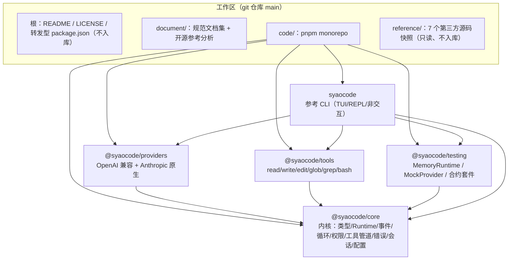
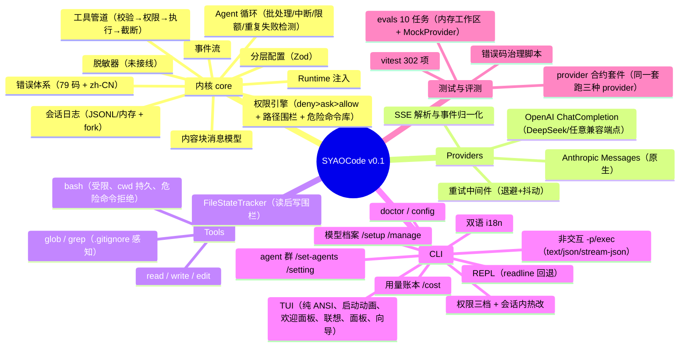
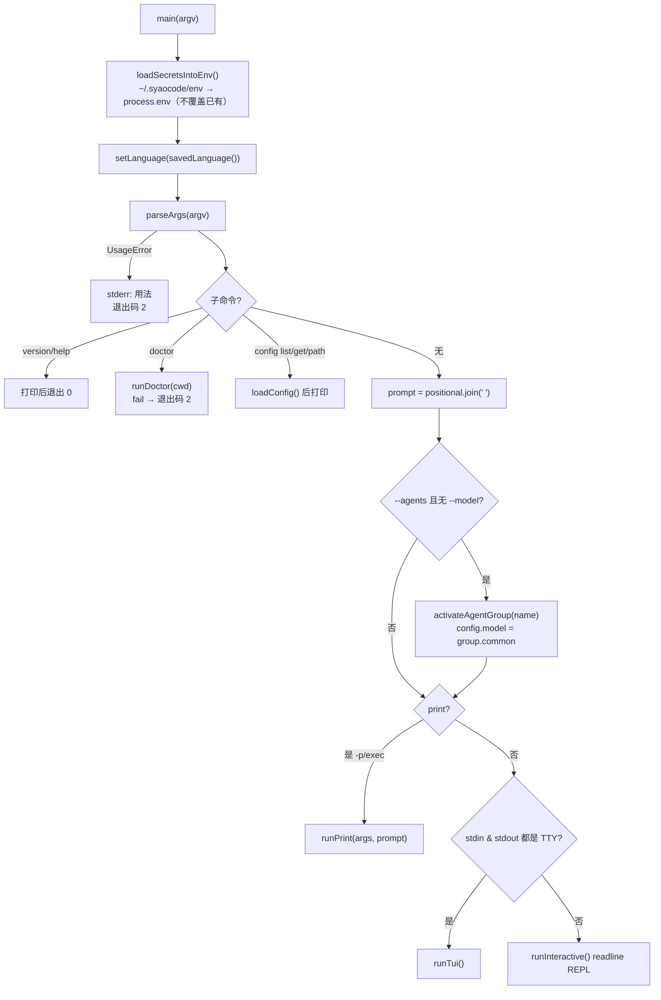
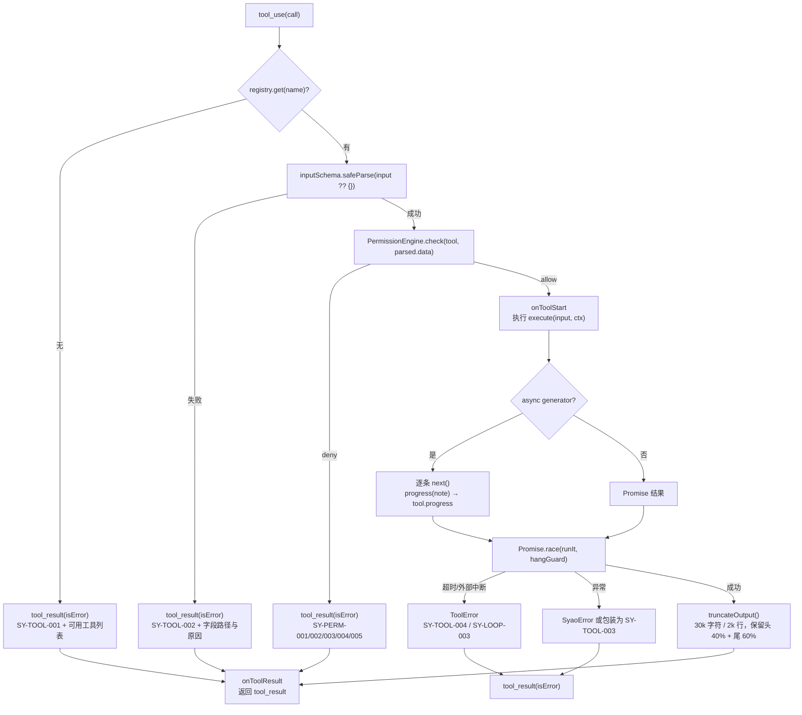
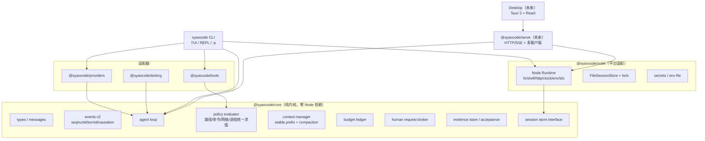

# SYAOCode 概览：架构、功能与实现流程

> **文档性质**：基于**当前仓库真实代码**（`code/` 五包 + `code/evals` + `code/scripts`）反向梳理的架构与实现说明，并在此基础上给出**差异化/创新点判断**与**架构优化建议**。
> **代码基线**：`main` @ `0a05341`（Narrow in-prompt hot settings to tiers and harden the approval loop），v0.1 内部版（WBS 的 M0+M1），**未发布 npm**。
> **实测基线（本机复核，2026-10-25）**：`typecheck` 全绿；`pnpm test` **302 项全过**（core 74 / providers 20 / tools 18 / testing 9 / cli 181）；`test:evals` **10/10**；`lint:registry` **79 个错误码**、zh-CN 齐全、retryable 14、fatal 3。
> **阅读约定**：本文区分三种状态 —— ✅**已实现且已接线**、🟡**已实现但未接线/部分生效**、⬜**仅规划（M2+）**。凡涉及"规划"的内容均以 `document/SYAOCode/` 规范文档为准，不与代码现状混淆。
> **本文结构**：§1 定位与现状 → §2 项目架构 → §3 功能架构 → §4 实现流程 → §5 代码实证的偏差 → §6 差异化与创新 → §7 架构优化 → 附录（源码索引/术语/复现/边界）。

> **2026-10-26 v0.2-dev 实施注记**：评估报告指出的 E1/E2/E3/E4、S1/S4/S5、L1/L2/L4、L3/L8（部分）已在代码中修复；新增 `@syaocode/node`、事件契约 v2、工具回执/自动验证/Claim Linter/verdict（Evidence MVP）、token 与墙钟硬预算、会话追加写与锁。当前测试基线为 **339 项**（core 104 / node 3 / providers 20 / tools 18 / testing 9 / cli 185）。未完成项（沙箱、检查点/rewind、真实评测集、上下文/缓存主线、TUI 拆分）见 `code/docs/V0.2-REPORT-ALIGNMENT.md`。本文其余内容仍反映 v0.1 基线，阅读偏差章节时请以该对照文档为准。

> **2026-10-28 补充：Agent RPC 治理底座设计**：`document/Agent-RPC/` 新增一份设计文档集，回答"MCP / A2A / ACP 如何统一"与"如何设计一套 Agent RPC 治理底座"。结论是**三协议不在同一层、不可合并**，统一发生在语义与治理层：Session→Task→Invocation 三层作用域 + Principal/Capability/Approval/Receipt/Event/Artifact 六类对象 + 十步治理流水线（身份→策略→审批→预算预留→幂等→派发→脱敏→结算→回执→审计）。外部协议事实已逐条核验并记录在 `document/Agent-RPC/04-外部事实核验记录.md`（MCP `2026-07-28` 为**无会话**修订、A2A `1.0.0` 以 Task 为中心、ACP `v1` 为双向协议）。该设计**尚未实现**，落地排期见 `document/Agent-RPC/03-工程实现与落地路线.md`（约 92 人天，建议先做 M0+M1）。

---

## 0. 结论速览（TL;DR）

1. **工程现状**：一个 5 包 pnpm monorepo（约 12.9k 行 `src` TS，93 个 `.ts` 文件含测试），内核 `@syaocode/core` 只依赖 `zod`，全 IO 走注入的 `Runtime`；`syaocode` CLI 提供纯 ANSI TUI + readline REPL + 非交互 `-p/exec` 三种形态。
2. **架构骨架已经立住**：内容块消息模型（ADR-01）、事件流（ADR-02）、Runtime 注入（ADR-03）、权限闸门（ADR-04）、追加式会话日志（ADR-05）、Zod 单一 schema（ADR-07）、仅 ESM（ADR-08）都有真实代码落点（见 §2.4 对照表）。
3. **但"可嵌入/可审计/安全"的承诺有 5 个实质性缺口**：① 内核主入口 `@syaocode/core` re-export 了 `nodeRuntime`，把 `node:fs/child_process` 拖进任何消费者；② `Redactor`（BR-023 脱敏）只有注册、**没有任何调用点**；③ `permission.request` 事件定义了却从未 emit，审批请求无法从事件流观察；④ **路径围栏只覆盖写操作**——`default`/`acceptEdits`/`plan` 下 `read`/`grep`/`glob` 与只读 `bash` 可读工作区外任意路径（实测 `read /etc/passwd` → allow）；⑤ 危险命令"仅用户级规则可放行"未实现——`matchingRule` 不校验 `rule.source`，project/plugin 来源的 allow 规则即可放行 `rm -rf /`（见 §5.1）。
4. **差异化不在"再造一个 CLI"**。与 7 个开源参考项目对比后（§6），普遍空白集中在四件事：**可机检的"决策—回执—验收"账本**、**缓存命中率进运行时闭环**、**跨工具的副作用单调求值**、**子 agent 成本进父预算**。SYAOCode 的独特机会是把它们做成**内核契约**而不是应用层补丁。
5. **建议收敛的 5 个创新点**（与 §6.4 一一对应）：验证优先内核（Evidence Ledger + 确定性验收）、缓存感知上下文管理器、统一人机请求协议（含已有的"审批挂起热改重评"语义）、L0 决策面作为"可插拔的收紧器"、成本-质量双目标的三角色路由。落地路线见 §7.4/§7.5。

---

## 1. 项目定位与现状

### 1.1 定位

SYAOCode 是一个 **TypeScript coding-agent harness 库 + 参考 CLI**：

- **库**：`@syaocode/core`（内核）/ `@syaocode/providers`（模型适配）/ `@syaocode/tools`（内置工具）/ `@syaocode/testing`（测试夹具与合约），可被第三方嵌入自己的产品；
- **参考 CLI**：`syaocode`（别名 `syao`），是内核的**第一个客户端**，用来验证内核能力，而不是内核本身（`document/SYAOCode/01-项目立项书.md` §1.6 的"库优先、CLI 验证"）。

一句话概括当前产品形态：**模型中立、可嵌入、可审计的 agent 内核，配一个零 UI 依赖的终端客户端**。

### 1.2 版本与交付状态

| 层面 | 状态 | 证据 |
| --- | --- | --- |
| 内核（循环/事件/权限/工具管道/错误/会话） | ✅ v0.1 | `code/packages/core/src/*` |
| Provider（OpenAI 兼容 + Anthropic 原生） | ✅ v0.1 | `code/packages/providers/src/*` |
| 内置工具 6 个（read/write/edit/glob/grep/bash） | ✅ v0.1 | `code/packages/tools/src/*` |
| 测试基建（MemoryRuntime/MockProvider/合约套件） | ✅ v0.1 | `code/packages/testing/src/*` |
| CLI：TUI + REPL + `-p`/`exec` + `doctor`/`config` | ✅ v0.1 | `code/packages/cli/src/*` |
| 权限三档 + 会话内切换 + 审批挂起热改 | ✅ v0.1 | `code/packages/cli/src/args.ts`、`slash.ts`、`core/src/permissions.ts` |
| 模型档案向导 `/setup`、`/manage`、agent 群 `/set-agents` | ✅ v0.1（群仅 common 生效） | `code/packages/cli/src/tui/setup-wizard.ts`、`agent-wizard.ts`、`model-config.ts` |
| 工作区级跨会话用量账本 | ✅ v0.1 | `code/packages/cli/src/usage-store.ts` |
| npm 打包链路（tsc dist + publishConfig） | ✅ 已就绪未发布 | 各 `packages/*/package.json` |
| 自动压缩（BR-013 80% 阈值） | ⬜ M2（当前只有手动 `/compact`） | `code/packages/core/src/context.ts` 注释 |
| MCP / 插件 / 钩子 / ACP | ⬜ M4+ | 仅错误码域预留（`SY-MCP`/`SY-PLG`/`SY-HOOK`/`SY-ACP`） |
| L0 决策面（JEV `DecisionProvider`） | ⬜ M3，**整体未实现** | 无对应源码 |
| 三角色编排 hyaki/sota/common | 🟡 数据层+向导已落地，编排未实现 | `model-config.ts` 的 `AgentGroup`；`/agents` 为 M3 占位 |
| Goal/Loop 自治（BR-050/BR-051） | ⬜ M3+ | 无对应源码 |
| serve / Desktop（Tauri 2） | ⬜ 第二阶段 | `document/路线建议.md` |

### 1.3 质量门禁

CI（`.github/workflows/ci.yml`）在 ubuntu + macos、Node 22 上跑：`lint:registry → typecheck → test → test:evals`。
`code/tsconfig.base.json` 开启了 `strict` + `exactOptionalPropertyTypes` + `noUncheckedIndexedAccess` + `verbatimModuleSyntax`，这是本项目"少踩类型坑"的隐性资产，也是外部贡献的门槛。

---

## 2. 项目架构

### 2.1 仓库与包结构



依赖方向严格单向：**core ← {providers, tools, testing} ← cli**。`core` 的 `dependencies` 只有 `zod`（`code/packages/core/package.json`），这是"内核可嵌入"的第一道保障。

构建分层（根 `code/package.json` 的 `build`）：`core → providers/tools/testing → cli`，每包 `tsc -p tsconfig.build.json` 产出 `dist/`。
**开发态/发布态双 exports**：`exports` 指向 `./src/*.ts`（workspace 内直用 TS 源，vitest/tsx 友好），`publishConfig.exports` 指向 `./dist/*.js`（含 `types` 条件），`workspace:*` 依赖发布时改写为真实版本号。CLI 的 `bin` 同时注册 `syaocode` 与 `syao`。

### 2.2 分层模型：L0 / L1 / L2 与 v0.1 的实际落点

规范文档（`07-概要设计说明书.md` §7.2.1）把系统分为三层，**确定性控制面是最终权威**：

| 层 | 职责 | v0.1 实际落点 |
| --- | --- | --- |
| **L2 动作面** | 工具执行、权限闸门、路径围栏、危险命令库 | ✅ `pipeline.ts` + `permissions.ts` + `tools/*` |
| **L1 生成面** | 单 agent 循环、Provider 流式、上下文装配 | ✅ `agent.ts` + `providers/*` + `context.ts`（三角色编排 ⬜ M3） |
| **L0 决策面** | JEV `DecisionProvider`，只产出建议、默认 off、不得授予权限 | ⬜ 未实现（ADR-09/10/11 仅为设计） |

**关键结论**：v0.1 是一个"L1+L2 完整、L0 空缺"的实现。任何关于"决策层差异化"的叙述目前都只是文档资产，不是代码事实。

### 2.3 核心接口与数据模型

**（1）消息模型（ADR-01）** `code/packages/core/src/types.ts`

```ts
type ContentBlock =
  | { type: 'text'; text: string }
  | { type: 'image'; source: ImageSource }
  | { type: 'thinking'; text: string; signature?: string; redacted?: boolean }
  | ToolUseBlock      // { type:'tool_use', id, name, input }
  | ToolResultBlock;  // { type:'tool_result', toolUseId, content[], isError?, trust? }
```

内核只认内容块，**设计上厂商私有字段应通过 `meta.providerData` 原样透传**（`types.ts:42` 的类型与注释）；wire 格式翻译完全由 provider 适配器负责。⚠️ 当前两个适配器都没有读写 `providerData`（`grep providerData` 只命中类型定义），因此"透传"尚未实现（§5.5）。`Usage` 除 input/output 外含 `cacheReadTokens`/`cacheWriteTokens`/`costUsd`（网关上报优先）。

**（2）Runtime 注入（ADR-03）** `code/packages/core/src/runtime/index.ts`

`Runtime = { fs, shell, http, clock, logger, env, ids }`。内核、工具、provider 的所有 IO 都从这里取；`code/packages/core/src/runtime/node.ts` 提供 `nodeRuntime()`，`code/packages/testing/src/memory-runtime.ts` 提供全内存实现（含确定性时钟、可注入的 shell 命令表、可 `pokeExternally` 模拟外部改动）。

**（3）Provider 抽象（DD-3）** `code/packages/core/src/provider.ts`

```ts
interface Provider {
  readonly id: string;
  capabilities(model: string): Capabilities;   // contextWindow / thinking / promptCache / pricing ...
  stream(req: ModelRequest, opts: { signal }): AsyncIterable<ModelStreamEvent>;
  countTokens?(req: ModelRequest): Promise<number>;
}
type ModelStreamEvent =
  | { type:'message_start'; messageId }
  | { type:'block_start'; index; block }
  | { type:'block_delta'; index; delta }
  | { type:'block_stop'; index }
  | { type:'usage'; usage }
  | { type:'message_stop'; stopReason; message };
```

`withRetry()` 是同层的重试中间件（指数退避 + 抖动 + 只重试 `retryable` 码）。

**（4）工具契约（DD-4）** `code/packages/core/src/tool.ts`

```ts
interface Tool<I> {
  name; description; inputSchema: z.ZodType<I, z.ZodTypeDef, unknown>;
  risk: 'read'|'write'|'exec'|'network'|'meta';
  readOnly; concurrencySafe; timeoutMs?;
  permissionSubject?(input): { path?; command?; url? };
  execute(input, ctx): Promise<ToolOutput> | AsyncGenerator<ToolProgress, ToolOutput>;
}
```

`ToolRegistry.definitions()` 用 `zodToJsonSchema()` 把 Zod 转成模型可见的 JSON Schema（ADR-07 的单一事实来源）。该转换器专门兼容 Zod v3/v4 的 `_def.typeName`/`_def.type` 与 v3.25+ 的 `_def.shape` 为函数两种形态——这是真实联调中发现并修复的 P0 缺陷（`code/docs/TEST-REPORT-v0.1.md` §11.2 第 1 条）。

**（5）Agent 与事件（DD-2 / ADR-02）** `code/packages/core/src/agent.ts`、`events.ts`

```ts
interface Agent {
  readonly sessionId; readonly history: Message[]; readonly registry; readonly engine;
  run(input, opts?): AsyncGenerator<AgentEvent, RunSummary>;
  runOnce(input, opts?): Promise<RunSummary>;
  close(): Promise<void>;
}
```

`AgentEvent` 覆盖 `session.start/turn.start/text.delta/thinking.delta/message.complete/tool.proposed/tool.start/tool.progress/tool.result/usage/budget.warning/error/turn.end/session.end/permission.request/permission.result`。
`EndReason = completed | aborted | max_turns | budget_exhausted | timeout | repeated_failure | fatal_error`。

**（6）会话存储（ADR-05 / DD-7）** `code/packages/core/src/session/index.ts`

`LogEntry = { v:1, id, ts, sessionId, parentId?, type: 'message'|'usage'|'compaction'|'meta'|'checkpoint'|'fork'|'permission', data }`；`SessionStore = { append, load, list, fork, delete }`，提供 `MemorySessionStore` 与 `FileSessionStore`（`~/.syaocode/sessions/<projectHash>/<sessionId>.jsonl`）。

### 2.4 ADR 与代码落点对照

| 决策 | 结论 | 代码落点 | 兑现度 |
| --- | --- | --- | --- |
| ADR-01 | 内容块消息模型 | `core/src/types.ts` | ✅ |
| ADR-02 | 事件流是唯一对外出口 | `core/src/events.ts` + `agent.ts` 的 `yield` | 🟡 `session.start/end`、`permission.*` 只发到内部 `EventBus`，未 `yield` 给 `run()` 消费者 |
| ADR-03 | 所有 IO 经 Runtime 注入 | `core/src/runtime/*` | 🟡 `core` 主入口 re-export `nodeRuntime`；`tools/bash.ts` 直接用 `process.platform/env` |
| ADR-04 | 权限闸门在工具管道内、执行之前 | `core/src/pipeline.ts` + `permissions.ts` | ✅ |
| ADR-05 | 追加式事件日志为事实来源 | `core/src/session/index.ts` | 🟡 append 为"读全文件+重写"；无锁（`SY-SES-004` 未实现） |
| ADR-06 | 插件双轨（进程内 + MCP 隔离） | — | ⬜ M4 |
| ADR-07 | Zod 单一 schema 来源 | `core/src/tool.ts` `zodToJsonSchema` + 各工具 | ✅ |
| ADR-08 | 仅发布 ESM | 各包 `"type":"module"` + `publishConfig.exports` | ✅ |
| ADR-09/10/11 | L0 决策层独立、非对称权限、可降级 | — | ⬜ M3 |
| ADR-12 | 三角色生成层拆分 | `cli/src/model-config.ts`（配置层） | 🟡 仅配置与向导 |
| ADR-13 | 内核可嵌入也可服务化 | `Runtime` 抽象 + CLI 进程内 | 🟡 serve ⬜ |
| ADR-14 | Desktop 为同协议客户端 | — | ⬜ |

### 2.5 运行约束

- **Node.js ≥ 22**（`engines`），ESM only，`moduleResolution: Bundler`；
- 源码相对 import 一律带 `.js` 后缀（Node ESM 标准），tsc 用 `rewriteRelativeImportExtensions` 兜底；
- pnpm ≥ 10 默认拦截 postinstall，仓库在 `code/pnpm-workspace.yaml` 显式放行 esbuild；
- **必须在 `code/` 目录内运行 `corepack pnpm`**（根目录转发层 `package.json` 只是本地便利，不入库）。

### 2.6 构建、发布与 CI

```bash
cd code
corepack pnpm install
corepack pnpm typecheck && corepack pnpm test && corepack pnpm test:evals
corepack pnpm build            # core → providers/tools/testing → cli
corepack pnpm lint:registry    # 错误码治理：唯一性/格式/zh-CN 覆盖/retryable-fatal 一致性
```

发布顺序必须是 `core → providers/tools/testing → cli`（逆序解析失败）；`@syaocode/testing` 是 CLI 的**运行时**依赖（`mock` provider 属于产品功能），其主入口不依赖 vitest，合约套件在 `./contract` 子路径。

---

## 3. 功能架构

### 3.1 能力地图



### 3.2 CLI 功能面

三种运行形态由 `code/packages/cli/src/main.ts` 分流：

| 形态 | 触发条件 | 实现 |
| --- | --- | --- |
| **TUI 常驻界面** | `stdin`+`stdout` 均为 TTY 且非 `-p` | `tui/tui.ts`（1833 行，纯 ANSI，零第三方 UI 依赖） |
| **readline REPL** | 非 TTY（管道）且非 `-p` | `interactive.ts` |
| **非交互** | `-p` / `exec` | `run.ts`（`text`/`json`/`stream-json`） |

子命令：`doctor`、`config list|get|path`、`--version`、`--help`。
全局参数：`-m/--model`、`--permission-mode`、`--si`/`--yao`、`--allowed-tools`/`--disallowed-tools`、`--max-turns`、`--max-budget-usd`、`--cwd`、`--no-boot`、`--agents`、`--output-format`、`--verbose`。

TUI 斜杠命令 17 条（v0.1 实现）+ 4 条占位（M2+/M3+/M4+）：`/help /model /permission /permissions /status /cost /tools /compact /clear /resume /doctor /setup /manage /set-agents /setting /language /exit`，占位 `/agents /mcp /goal /rewind`。

### 3.3 权限体系

**五种模式**（`core/src/events.ts`）：

| 模式 | 读 | 工作区内写 | 工作区外写 | 执行 |
| --- | --- | --- | --- | --- |
| `strict` | ask | ask | ask | ask |
| `default` | allow | ask | **deny** | ask（只读命令→allow） |
| `acceptEdits` | allow | allow | **deny** | ask |
| `plan` | allow | deny | deny | deny |
| `bypass` | allow | allow | allow | allow |

> ⚠️ **读不受路径围栏约束**：`default`/`acceptEdits`/`plan` 的"读 allow"发生在路径检查**之前**，因此 `read`/`glob`/`grep` 与 `bash` 的只读命令（`cat` 等）可以访问工作区外任意路径（`policyVerdict('read','read',{path:'/etc/passwd'})` 实测返回 `allow`）。路径围栏目前只对写生效，见 §5.1 S4。

**CLI 三档**（`cli/src/args.ts` `resolvePermissionTier`）：无参数→`default`（读免确认）、`--yao`→`default`、`--si`→`bypass`；优先级 `--permission-mode > 档位参数 > 用户配置 > default`。

> ⚠️ 内核 `configSchema.permissionMode` 的默认值是 `strict`，而 CLI 不读 `loadConfig()`、自己的默认是 `default`（yao）。库使用者与 CLI 用户看到的"默认档"不一致（§5.2 E2/E4）。

**规则求值顺序**（`core/src/permissions.ts` `policyVerdict`）：
1. 命令命中危险库且无 `allow` 规则 → `SY-PERM-004` **直接拒绝**（任何档位，含 `--si`）。⚠️ 代码未校验规则来源，任何 `source` 的 allow 规则都能放行危险命令（§5.1 S5）；
2. `deny → ask → allow` 首个匹配生效（glob 支持 `*`/`**`/`?`）；
3. 无规则时按模式默认；路径围栏先 `realpath` 再判定（**仅写操作**，读操作直接放行，§5.1 S4）。

**命令风险分类**（FR-043）：按 `&& || ; | $(` 切段，逐段判头命令；只读白名单（`ls/cat/grep/git status/...`）+ 前缀正则（`git log|diff|...`）→ `read`；含重定向/`tee` → `write`；危险库 → `dangerous`。

**审批交互**：`y` 本次允许 / `s` 本次会话允许（写入会话规则）/ 其他或回车拒绝；**审批挂起时可输入 `/permission si` 热改档位**，引擎按新策略**重新评估同一个待批请求**（`PermissionDecision = { recheck: true }`），升档即放行、不再追问；重评估轮次上限 `MAX_APPROVAL_ROUNDS = 8`。无 handler 时 `ask` 一律降级为拒绝（`SY-PERM-005`）。

### 3.4 内置工具

| 工具 | risk | 只读/并发安全 | 关键实现 |
| --- | --- | --- | --- |
| `read` | read | ✅/✅ | 行号输出、`offset/limit`、记录读取状态 |
| `write` | write | ❌/❌ | 已存在文件必须"读过"且未变更（BR-004） |
| `edit` | write | ❌/❌ | 唯一匹配（BR-005），多处命中报错并列出候选行号 |
| `glob` | read | ✅/✅ | `.gitignore` 子集语义、`ALWAYS_IGNORED`、深度 12、上限 200 |
| `grep` | read | ✅/✅ | 正则 + `include` glob + 上限 200 |
| `bash` | exec | ❌/❌ | `/bin/sh -c`、cwd 跨调用持久、输出 100k 截断、`detached` 进程组便于整树终止 |

`FileStateTracker` 记录 `{hash, mtimeMs}`：`SY-FS-001`（从未读过）、`SY-FS-002`（读后被外部修改）、`SY-FS-003`（多匹配）、`SY-FS-004`（找不到 `old_string`，附带"是否想改第 N 行"提示）。

### 3.5 Provider 与能力协商

| Provider | 协议 | 流式细节 | 能力声明 |
| --- | --- | --- | --- |
| `mock` | 内存剧本 | 文本按两半分片回放，无网络 | 200k 上下文、`structuredOutput` |
| `deepseek` | OpenAI ChatCompletion | SSE、`reasoning`/`reasoning_content` 双字段识别、`prompt_cache_hit_tokens`、`usage.cost`/`gateway_cost` | 128k、`promptCache: automatic` |
| `openai-compatible` | OpenAI ChatCompletion | 同上，可用 `OPENAI_BASE_URL`/`<PROVIDER>_BASE_URL` 覆盖 | 128k |
| `anthropic` | Messages 原生 | `content_block_start/delta/stop`、thinking+signature、`cache_read/creation_input_tokens` | 200k、`thinking: budget`（按模型名判定）、`promptCache: explicit` |
| `@<profile>` | `/setup` 自定义 | 四种协议中 `openai-chat`/`anthropic` 可用；`openai-responses`/`gemini` 抛 `SY-PRV-010`（M2） | 继承对应适配器 |

`code/packages/providers/src/sse.ts` 是共享 SSE 解析器（`data:` 行、CRLF、无 `body` 的内存 mock 回退）。
`code/packages/providers/test/contract.test.ts` 用 `@syaocode/testing` 的 `defineProviderContract` 对三种 provider 跑**同一套合约**（纯文本流、tool_use 往返、tool_result 历史合法、错误码映射、重试语义）。

### 3.6 配置与密钥

| 文件 | 内容 | 权限 |
| --- | --- | --- |
| `~/.syaocode/config.json` | 默认模型、权限模式、语言、`models`（档案）、`agentGroups` | 普通 |
| `~/.syaocode/env` | `KEY=VALUE` 密钥（`/setup` 与 `/model config` 写入） | `0600` |
| `~/.syaocode/sessions/<hash>/*.jsonl` | 会话日志 | 普通 |
| `~/.syaocode/usage/<hash>.json` | 工作区用量账本 | 普通 |
| `<项目>/.syaocode/config.json` | 项目级配置（**agent 运行时不消费；仅 `syao config` 读取**，见 §5.2 E2） | — |
| `~/.syaocode/AGENTS.md`、`<cwd>/AGENTS.md`（回退 `CLAUDE.md`） | 注入系统提示的项目指令 | 普通 |

模型解析顺序：`--model > SYAO_MODEL > ~/.syaocode/config.json > mock`（`cli/src/model-config.ts` `resolveDefaultModel`，交互与非交互同源）。
`loadSecretsIntoEnv()` 启动时把 env 文件合并进 `process.env`，**不覆盖已有变量**。密钥不写入 `config.json`；但"日志/会话/错误出口脱敏"目前只有 `Redactor` 类、没有接线（§5.1 S1），因此不能把"绝不进入日志/会话"当作已兑现的保证。

### 3.7 会话、用量与可观测性

- **会话**：每回合把用户消息、assistant 消息、tool_result 消息追加进 JSONL；`/resume` 列出最近 5 个会话并恢复历史（只恢复 `type === 'message'` 的条目）。
- **用量账本**：`cli/src/usage-store.ts` 按 `projectHashOf(cwd)` 分桶、桶内以**工作区绝对路径**为索引，累计请求数 / 输入输出 / 缓存读写 token / 费用，并按 `provider:model` 拆分；写入用 `tmp + rename` 原子替换；`/cost` 输出"当前工作区跨会话累计 + 按模型拆分 + 本次会话"。
- **状态栏指标**（`tui/status.ts`）：模型 / 上下文占用（最近一次请求的 input+output，不累加）/ 轮次:步数 / 实时 tok/s（流式期间）/ 缓存命中率 `cacheRead/(cacheRead+input)` / 累计 token。
- **阶段行**（`tui/phase.ts`）：由事件启发式推进 `Explore → Plan → Implement → Validate & Cleanup`，provider 重试时整行转红。
- **错误体系**：`core/src/errors/registry.ts` 79 码，格式 `SY-<domain>-<seq>`，每码含 severity/retryable/recovery；`SY-DEC-007` 是**刻意留空**的序号；`scripts/check-error-registry.ts` 在 CI 里守住唯一性、zh-CN 覆盖与 retryable/fatal 一致性。

### 3.8 国际化与 TUI 视觉系统

- i18n：`cli/src/i18n/{en,zh}.ts` 以 `en` 的键集合为准，`zh` 漏译即 typecheck 失败；`t()` 缺键回退英语再回退键名，绝不抛错；默认英语，`/language` 写入配置、下次启动生效。
- 视觉系统：`tui/boot.ts`（6.4s 粒子启动动画：天际线→蝴蝶→三层色艺术字，任意键跳过）、`tui/welcome.ts`（欢迎面板 + 黑白阴影艺术字）、`tui/flight.ts`（蝴蝶/天际线像素场景）、`tui/palette.ts`（指令联想 + 视窗滚动）、`tui/panel.ts`（圆角面板/表格/进度条/徽标）、`tui/width.ts`（CJK 感知列宽）、`tui/terminal.ts`（raw 模式守卫、括号粘贴、OSC 11 主题探测、ASCII 降级、极小终端）。

---

## 4. 具体功能实现流程

### 4.1 启动与运行形态选择

入口：`code/packages/cli/src/main.ts`。



关键实现细节：

- `loadSecretsIntoEnv()` 只补空位，不覆盖真实环境变量；密钥不写入 `config.json`。⚠️ "不进入会话/日志"依赖脱敏器，而脱敏器当前未接线（§5.1 S1）。
- `resolveDefaultModel()` 的顺序是 `--model > SYAO_MODEL > ~/.syaocode/config.json > mock`，**交互与非交互同源**（修复过 `-p` 忽略已保存模型的问题）。
- TTY 判定同时要求 `stdin.isTTY` 与 `stdout.isTTY`；管道输入走 REPL，REPL 在非 TTY 下把审批一律当拒绝（`SY-CLI-002`），避免无人值守阻塞。
- TUI 启动顺序：`playBoot()`（`--no-boot`/终端过小/ASCII 降级时跳过）→ 解析模型与档位 → `createAgent()` → `installTerminalGuards()` → 括号粘贴 → OSC 11 主题探测 → 欢迎面板 → 150ms 状态定时器 → 可选的首轮 prompt。

### 4.2 一次对话回合：`agent.run()`

实现：`code/packages/core/src/agent.ts`。这是整个系统的心脏，伪代码如下：

```text
run(input, opts):
  signal = opts.signal ?? new AbortController().signal
  provider = withRetry(config.provider, runtime, retryPolicy)
  capabilities = provider.capabilities(model)
  if opts.sessionId && sessionStore:  // 恢复
      history += sessionStore.load(id).filter(type === 'message')
  history += seedMessages(input)
  sessionStore.append(seedMessages)
  emit session.start

  for turns = 1, 2, 3, ...:
      // ① 限额检查（BR-010）
      if turns > maxTurns:        end = max_turns;        yield error(SY-LOOP-001); break
      if now - start > timeoutMs: end = timeout;          yield error(SY-LOOP-005); break
      if costUsd >= maxBudgetUsd: end = budget_exhausted; yield error(SY-LOOP-002); break

      yield turn.start
      // ② 模型调用（流式）
      request = { model, system: assembleSystemPrompt(context), messages: history, tools? }
      for await event of provider.stream(request, { signal }):
          block_start → 记录 blockKinds[index]（thinking / text）
          block_delta → thinking ? yield thinking.delta : yield text.delta
          usage       → 累加 token；按 provider 上报费用或本地价目表算 cost；yield usage
          message_stop→ assistant = event.message；stopReason
      if 出错:
          aborted → end=aborted；否则 fatal → end=fatal_error；break
      if assistant 缺失 → fatal_error；break

      history += assistant；sessionStore.append(assistant)
      yield message.complete
      if cost / maxBudget >= 0.8 → yield budget.warning（只警告一次）
      calls = toolCallsOf(assistant)
      if calls 为空: finalText = 文本块拼接；end=completed；break

      // ③ 工具批次（BR-008/009）
      for call of calls: yield tool.proposed
      batches = planBatches(calls, registry)   // 连续“只读且并发安全”的调用同批
      for batch of batches:
          results += await Promise.all(batch.map(executeToolCall))
          // 事件在 executeToolCall 内回调，按 callId 缓冲，批结束后按调用顺序 yield
      // 被中断未执行的 tool_use 必须回填 SY-LOOP-003（保证每条 tool_use 恰好一条 tool_result）
      // 连续失败检测（BR-011）：同 tool+规范化参数第 3 次附警告，第 5 次 end=repeated_failure
      history += tool_result message；sessionStore.append
      yield turn.end

  emit session.end
  return { sessionId, endReason, turns: turns-1, totalUsage, costUsd, finalText }
```

**行为要点**：

1. **流式路由**：`blockKinds` 由 `block_start` 学习，thinking delta 与正文 delta 分开；真实 provider 同时流两种内容（`TEST-REPORT` §11.2 第 3 条）。
2. **工具批处理**：`planBatches()` 只把**连续**的 `readOnly && concurrencySafe` 调用并批；遇到写/执行立即切批。`Promise.all` 保证结果顺序等于调用顺序，事件按 `callId` 缓冲后在批末按顺序吐出，消费者看到确定性事件流。
3. **终止条件**：无 tool_use → `completed`；`maxTurns` / `timeoutMs` / `maxBudgetUsd` / 同参数连续失败 5 次 / provider fatal / 用户 abort，各自映射 `EndReason`。
4. **预算**：`maxBudgetUsd` 依赖 `usage.costUsd` 或 `Capabilities.pricing`；两者都没有时 `costUsd` 恒为 0，**预算不会触发**（见 §5）。
5. **`turns` 语义**：返回 `turns - 1`，即"中间工具轮次"，不含最后一次模型调用；纯文本一轮对话会报 `turns: 0`（实测 `-p hello --output-format json`）。这一点在 §5 作为缺陷列出。
6. **会话写入**：每条用户/assistant/tool_result 消息都 `append`；进程崩溃时已产生的消息不会丢，但未完成的 tool_use 不会自动补回（下次恢复只读 `message` 条目）。

### 4.3 Provider 流式与重试

**（1）OpenAI ChatCompletion 适配器** `code/packages/providers/src/openai-compatible.ts`

- `toWire()`：system 单独一条；assistant 的 text 与 tool_calls 合并；user 的 text 与 tool_result 拆成 `role:'user'` 与多条 `role:'tool'`；`tools` 用 `{type:'function', function:{name,description,parameters}}`；`stream:true` + `stream_options.include_usage:true`。
- 解析：`delta.reasoning ?? delta.reasoning_content` → thinking block；`delta.content` → text block；`delta.tool_calls[index]` 按 index 累积 `name/arguments`；结束时 `JSON.parse(arguments)`，失败降级 `{_raw: args}` 交给 Zod 报 `SY-TOOL-002`。
- usage：`prompt_tokens/completion_tokens`、`prompt_cache_hit_tokens` 或 `prompt_tokens_details.cached_tokens`、`cost`/`gateway_cost`（网关直报费用优先）。
- 错误：`mapHttpStatus` 401/403→`SY-PRV-001`、429→`SY-PRV-002`、5xx→`SY-PRV-009`、其他→`SY-PRV-008`；网络异常→`SY-PRV-003`。

**（2）Anthropic Messages 适配器** `code/packages/providers/src/anthropic.ts`

- `toWire()`：内容块原样映射（text/thinking/tool_use/tool_result/image），`system` 独立字段，`tools` 用 `input_schema`。
- 解析：`content_block_start` 建块（thinking 带 signature、redacted_thinking 标记）；`text_delta`/`thinking_delta` 增量；`input_json_delta` 先累积到 `input.__args`，`content_block_stop` 时再 `JSON.parse`；`message_delta` 取 `stop_reason` 与 `cache_read_input_tokens`/`cache_creation_input_tokens`。

**（3）重试中间件** `code/packages/core/src/provider.ts` `withRetry()`

- 默认 `maxAttempts=5`、`baseDelayMs=1000`、`maxDelayMs=30000`；指数退避 + 0~30% 抖动。
- 只重试 `SyaoError.retryable === true` 的码；401/400 永不重试。
- `replayUnsafe = emittedDelta && committedToolUse`：一旦已经吐出正文 delta **且**已提交 tool_use，不再重放；否则重放整个请求。
- 每次重试前回调 `onRetry`，TUI 用它把阶段行转红并显示"网络拥塞/失效——重试中"。

> ⚠️ 当前 `replayUnsafe` 的条件是"与"，只吐了正文、尚未提交 tool_use 的流仍会被重放，UI 会看到重复文本、用量会重复累计（§5 详述）。

**（4）Provider 合约** `code/packages/providers/test/contract.test.ts` + `@syaocode/testing` 的 `defineProviderContract`

同一套用例跑 Mock / OpenAI / Anthropic：纯文本流 + usage、tool_use 往返、tool_result 历史合法、传输错误映射到 `SY-PRV-*`、`withRetry` 可重试码与最大次数。这是"换 provider 不换内核"的质量底线。

### 4.4 工具执行管道

实现：`code/packages/core/src/pipeline.ts` `executeToolCall()`。



**关键点**：

- **校验顺序不可变**：工具存在 → Zod 参数 → 权限 → 执行 → 截断。任何一步失败都转成**结构化 tool_result**，不向外抛异常（BR-025）。
- **超时与挂死防护**：`timeoutMs` 默认 120s；`Promise.race` 里的 `guard` 即使工具忽略 `AbortSignal` 也能让循环继续（NFR-007）。超时 → `SY-TOOL-004`；外部 abort → `SY-LOOP-003`。
- **截断策略**（BR-012）：超过 30,000 字符或 2,000 行时，保留头 40% + 尾 60%，中间插入"已截断，请用更窄范围重读"的提示；这是"模型能自我纠偏"的关键。
- **文件围栏**：`read` 记录 `{hash, mtimeMs}`；`write/edit` 调 `FileStateTracker.assertUnchanged()`，未读/已变/多匹配/找不到分别映射 `SY-FS-001..004`。

### 4.5 权限判定与审批（含"审批挂起热改"）

**判定顺序**（`core/src/permissions.ts` `policyVerdict()`）：

```text
1. 若 command 命中危险库:
     若存在 allow 规则（tool + matcher 匹配）→ 继续
     否则 → deny(SY-PERM-004)   // 任何档位、任何模型输出都不能放行
     // 注意：代码未校验 rule.source，任何来源的 allow 规则都能放行危险命令（§5.1 S5）
2. 按 deny → ask → allow 顺序找第一条匹配规则（tool 支持 glob；matcher 支持 path/command/url）
3. 无规则时按 mode 默认:
     strict      : 一切 ask（含 read）
     default     : read allow（不查路径）；write/exec ask；path 在工作区外 → deny(SY-PERM-003)
     acceptEdits : read allow（不查路径）；工作区内 write allow；区外 → deny；exec ask
     plan        : read allow（不查路径）；其余 deny
     bypass      : 全部 allow（危险库仍先拒绝）
4. ask → resolveAsk():
     handler == null → deny(SY-PERM-005)
     handler 返回 allow/deny/recheck
     recheck → 用新策略重新 policyVerdict 同一请求
     最多 8 轮（MAX_APPROVAL_ROUNDS），超过 → deny
```

**路径围栏**：`resolve()` 先 `realpath`；目标文件不存在时解析最深的已存在祖先，再拼回剩余路径（支持"写新文件"）；`insideWorkspace()` 对 workspace roots 做一次 realpath 缓存（macOS `/var → /private/var` 等）。**实际行为**：对**写**，`default`/`acceptEdits` 下工作区外是 **deny**（不是文档注释里写的"降 ask"）；对**读**，`policyVerdict` 在检查路径之前就 `return allow`，因此 `read`/`grep`/`glob`/只读 `bash` 可访问工作区外任意路径——**路径围栏只覆盖写**（§5.1 S4）。

**TUI 审批**（`tui/tui.ts` `tuiPermissionHandler`）：

- 审批问题显示在输入框标题，复用同一个 `LineEditor`；`y` 本次、`s` 本会话、其他/回车拒绝。
- 输入 `/permission si` 等设置指令时：`parsePermissionAnswer()` 识别为 `setting` → `applyInlinePermissionChange()` 立即 `engine.setMode()` → resolve `{recheck:true}` → 引擎重评估同一请求；升档即放行，不弹出第二次。
- 重评估期间 `mode = permissionWait`，后续输入进入 16 条缓冲，下一问就绪即消费，避免输入丢失或被当成聊天。
- 无法识别的 `/xxx` 不会被误判为拒绝，而是提示用法并重新提问。

**REPL 审批**：readline 提问，同样支持热改；非 TTY 直接返回 deny（`SY-CLI-002` 文案）。**非交互**：`runPrint` 注入 `headlessHandler`，一律 deny，模型会收到"请用 `--allowed-tools` 或升档"的提示。

**规则来源**：启动参数 `--allowed-tools`/`--disallowed-tools` → `PermissionRule[]`；`/permissions allow|deny` 加会话规则；`remember:'session'|'project'` 会生成带 path/command matcher 的规则。规则按 `source` 区分 user/project/plugin/code。

### 4.6 上下文装配与压缩

**系统提示**（`core/src/context.ts` `assembleSystemPrompt`）：

```text
[base instructions]  // 默认“你是 SYAOCode，在 workspace 中工作，用工具读写并验证……”
# Project instructions
<用户级 ~/.syaocode/AGENTS.md + 仓库根 AGENTS.md 或 CLAUDE.md>
# Environment
Working directory / Platform / Date / Harness / Model
```

`buildCliContext()`（`cli/src/context.ts`）负责读取指令文件：

- 用户级：`~/.syaocode/AGENTS.md`（候选 `AGENTS.md, CLAUDE.md`，可用 `SYAO_INSTRUCTION_FILES` 覆盖）；
- 项目级：`<cwd>/AGENTS.md`，缺失回退 `CLAUDE.md`；
- 单文件超过 32KB 截断并附提示；读取失败静默降级，不阻塞启动；
- `Model: provider:model (configured by the user; answer truthfully when asked)` 让模型能如实回答"你是什么模型"；
- 子目录指令的惰性加载 ⬜ M2。

**Token 估算**（`estimateTokens`）：CJK 按 1.5 字符/token、拉丁按 4 字符/token；`estimateMessagesTokens` 对 text/thinking、tool_use、tool_result、图片分别加权。**当前只用于 `/status`、`/compact` 和 TUI 状态栏，不参与循环的上下文预检**。

**压缩**：`trimOldToolResults(messages, keepLastN=6)` 把最近 6 条以外的 tool_result 内容替换为 `[old tool result dropped during compaction]`，保留消息骨架。只由 `/compact` 手动触发；**没有自动压缩**，`SY-PRV-004`（ContextTooLong）与 `SY-CTX-002`（ContextUnfittable）在代码中没有产生点。BR-013 的"80% 自动压缩"仍是 ⬜ M2。

### 4.7 会话持久化与恢复

**存储**：`FileSessionStore`（`core/src/session/index.ts`）路径 `~/.syaocode/sessions/<projectHash>/<safeSessionId>.jsonl`；`projectHashOf(cwd)` 是 31 进制滚动哈希（带符号位处理）。

**写入**：`append()` 先 `readFile` 整个文件，拼接新行，再 `writeFile`。每行一条 `LogEntry`（`v:1, id, ts, sessionId, type, data`）。**这是"读-改-写"，不是 `appendFile`**，长会话会 O(n²)，且没有锁文件。

**读取**：`load()` 逐行 `JSON.parse`，坏行计数并跳过；损坏比例超过默认 20% 抛 `SY-SES-002`；`v > 1` 抛 `SY-SES-003`。

**恢复**：`/resume` 列出最近 5 个会话；选定后 `createCurrentAgent(sessionId)` 设置 `pendingResume`，下一条消息 `agent.run(..., { sessionId })` 时只加载 `type === 'message'` 的条目进 `history`。`usage`/`permission`/`checkpoint` 等条目被忽略；`FileStateTracker` 不恢复，因此恢复后首次写仍需重新 `read`（安全但略啰嗦）。

**分叉**：`fork(sessionId, atEntryId?)` 复制到指定条目，重写 id/sessionId/parentId；当前 CLI 没有 `/rewind` 命令（M2+ 占位），所以 fork 只在库层可用。

### 4.8 TUI 渲染管线

实现：`code/packages/cli/src/tui/tui.ts`（1833 行）+ `editor.ts`/`panel.ts`/`status.ts`/`phase.ts`/`palette.ts`/`welcome.ts`/`boot.ts`/`flight.ts`/`width.ts`/`terminal.ts`。

**输入链路**：

```text
stdin raw 模式
  → processInput(chunk)
  → 括号粘贴清洗 / 未完成转义序列暂存（terminal.ts）
  → LineEditor.feed(text) → EditorEvent（update/submit/interrupt/eof/nav/escape/tab）
  → handleSubmit(text)
      ├─ mode = permission / permissionWait → 交给审批 Promise
      ├─ mode = prompt → 交给向导/问答
      ├─ guidedDepth>0 → 答案队列（最多 16）
      ├─ palette 激活 → 补全/执行
      ├─ busy → 热改设置立即生效；否则输入队列（最多 16）
      └─ 空闲 → dispatch(text)
  → parseSlash ? handleSlash : startsWith('!') ? runBangCommand : runTurn
```

**输出链路**：

- `printAbove(text)`：撤下 chrome（`eraseChromeSeq()`：从输入行上移到帧首 + `ESC[J`）→ 打印文本 → 重画 chrome。适用于工具行、面板、系统提示。
- `printStream(text)`：流式正文/思考直接写，**不强制换行**；`streamMidLine` 为真时暂停 chrome 重绘，避免覆盖半行；16ms 合批（`runTurn` 内 `streamBuf`）。
- `buildChromeFrame()`：从上到下组装「阶段行（busy 时）→ 欢迎面板（可选）→ 向导（可选）→ 输入框（3 行）→ 联想弹层（可选）→ 状态行」；计算 `aboveBox`（输入框上方行数）与光标列。
- `paintChromeFrame()`：
  - 内容与上一帧完全一致 → **零输出**；
  - 否则从输入行相对上移 `lastAboveBox+1` 行，帧变高先上移 growth 行（底部锚定），`\r` + `ESC[J` 清帧，逐行重写所有行，再把光标移回输入行对应列；
  - 整帧包在 `ESC[?2026h ... ESC[?2026l`（synchronized update）里，支持该私模的终端原子交换；
  - **注意**：实际是"变化帧全量重写 + 未变帧零输出"，不是 README 所称的"逐行差分只重写变化行"；防闪烁主要靠 DEC 2026 与相对锚点（§5 列入文档/实现偏差）。

**状态与阶段**：

- `StatusTracker` 消费事件：`turn.start(turn===1)` 累计用户轮次，`tool.start` 累计步数，`text/thinking.delta` 统计实时速度，`usage` 更新上下文占用（最近一次 input+output，不累加）、缓存命中率、总 token。
- `PhaseTracker` 启发式推进：初始 Explore；有工具后模型开始输出 → Plan；首次 write/edit → Implement；写后读/执行/回复 → Validate & Cleanup；`onRetry`/`SY-PRV-*` → 红色 + 重试文案。
- 150ms 定时器重绘（欢迎面板蝴蝶 + 状态栏实时速度）；内容未变时 `paintChromeFrame` 直接 return，因此空闲不产生输出。

**健壮性**：

- `installTerminalGuards()` 在 `uncaughtException`/`unhandledRejection`/`exit`/`SIGINT`/`SIGTERM`/`SIGHUP` 时恢复 raw、光标、括号粘贴、同步输出；等价于 Rust TUI 的 panic hook。
- 极小终端（<40 列或 <8 行）切无边框两行界面；`SYAO_TUI_ASCII=1` 把 BoxDrawing/半块字符替换为 ASCII；OSC 11 探测浅色主题。
- `Ctrl+C`：生成中取消本轮；审批中拒绝；空闲 2 秒内两次退出（130）。`Ctrl+D` 空行退出。
- 输入队列上限 16，超出丢弃（防内存膨胀）；退出命令也排队，忙碌时需两次 Ctrl+C 立即退。

### 4.9 模型配置、档案与 agent 群

**内置 Provider 目录**（`cli/src/model-config.ts` `PROVIDER_CATALOG`）：`mock`、`deepseek`、`openai-compatible`、`anthropic`。每个条目有 `apiKeyEnv`、`baseUrl`、推荐模型、是否需要 key。

**`/setup` 六步向导**（`tui/setup-wizard.ts` + `tui/tui.ts`）：

```text
model name → request url → api key（掩码）→ protocol（4 选 1）→ auth field（随协议收窄）→ profile name
→ 保存到 ~/.syaocode/config.json 的 models[profile]，key 写入 ~/.syaocode/env（0600）
→ 询问“设为当前模型? [Y/n]” → switchModel()
```

`openai-responses` / `gemini` 协议可保存，但实际调用抛 `SY-PRV-010`（适配器 M2）。
`/manage`：列出档案（协议/模型/密钥状态）→ 查看详情 → `e` 重跑向导（回车沿用现值，key 留空不变）→ `d` 二次确认删除（默认模型指向它时回退 mock）。

**agent 群**：`AgentGroup = { hyaki, sota, common }`，每个角色是 `provider:model` 或 `@profile`；`/set-agents` 新建/修改，`/setting` 改当前群，`/model use @群名` 切换，`--agents` 启动激活。
**当前激活语义**：只把 `group.common` 写入 `config.model` 作为主工作模型；`activeAgentGroup` 仅记录，`/agents` 是 M3 占位。也就是说**三角色目前只是配置数据，不是运行时编排**。

**密钥**：`saveProfile()` 写 env 文件并同步 `process.env`；`writeEnvFile()` 用 `mode: 0o600` 并 `chmod` 兜底；`maskKey()` 只露前 5 后 4；`doctor` 只报告"是否设置"，不打印值。

### 4.10 用量记账与成本

**数据源**：每次 provider 请求的 `usage` 事件（OpenAI/Anthropic 都在流末发一次；Mock 也发）。

**费用优先级**（`agent.ts` `costOf`）：

1. `usage.costUsd`（网关/OpenRouter 直报，含路由与折扣）→ 直接用；
2. 否则 `Capabilities.pricing` 的 input/output/cacheRead/cacheWrite 单价 → 本地计算；
3. 都没有 → `undefined`，`/cost` 标注 `(provider provides no pricing)`，预算无法触发。

**账本**（`cli/src/usage-store.ts`）：

```text
~/.syaocode/usage/<projectHash>.json
{
  v: 1,
  workspaces: {
    "/abs/path": {
      workspace, createdAt, updatedAt,
      totals: { requests, inputTokens, outputTokens, cacheReadTokens, cacheWriteTokens, costUsd },
      models: { "provider:model": { ...totals, provider, model, firstUsedAt, updatedAt } }
    }
  }
}
```

- 桶按路径哈希分，桶内再以**绝对路径**索引，哈希碰撞不串账；
- 写入 `tmp + rename` 原子替换；损坏按空账本处理；记账失败只警告一次，不改变运行退出码；
- `/cost` 面板 = 工作区跨会话累计 + 按模型拆分 + 本次会话；`totalTokens` 口径为 `input+output+cacheRead`（cacheWrite 单列，不计入合计）。

### 4.11 非交互协议与退出码

`runPrint()`（`cli/src/run.ts`）：

- 解析 provider（含 mock 剧本）、创建 6 个内置工具、解析权限档位、注入 headless 审批 handler（ask → deny）；
- `--allowed-tools` / `--disallowed-tools` 转成 user 规则；
- 消费 `agent.run()` 事件：`text` 模式只输出最终文本；`json` 输出单个版本化对象；`stream-json` 每行 `{schemaVersion, sessionId, ts, type, event}`；
- stdout 只放协议数据，诊断/错误走 stderr；SIGINT → abort；
- 结束后按 `summary.endReason` 映射退出码，并记一次账本。

**退出码**（BR-042 声明）：`0` 完成、`1` 一般错误、`2` 用法/配置、`3` 权限拒绝、`4` 轮次/预算/时长、`130` 中断。
**实际映射**（`exitCodeFor`）：`completed→0`；`max_turns|budget_exhausted|timeout→4`；`aborted→130`；`repeated_failure|fatal_error→1`；**没有分支返回 3**。`EXIT_PERM` 只在 catch 到 `SyaoError` 且 category 为 permission 时使用，而工具层的权限拒绝被封装成 `tool_result`，不会抛出。因此"模型所有写操作都被拒但最终回复完成"的运行会以 0 退出（§5）。

### 4.12 测试与评测

| 层 | 内容 | 规模 |
| --- | --- | --- |
| 单元测试 | core：循环/权限/错误/重试/工具 schema/会话配置；tools：6 工具与围栏；providers：适配器 + 合约；cli：args/slash/i18n/REPL/TUI 纯逻辑/向导/账本 | 302 项 |
| Provider 合约 | 同一套用例跑 Mock/OpenAI/Anthropic | 5 类 |
| 评测 | `code/evals/tasks.json` 10 个确定性任务：读、写、edit 唯一匹配、读后写围栏、glob、grep、bash、危险命令拒绝、多步流程、工具后报告 | 10/10 |
| 错误码治理 | `scripts/check-error-registry.ts`：唯一性/格式/zh-CN 覆盖/retryable-fatal 一致性 | 79 码 |
| 真实模型 | `code/docs/TEST-REPORT-v0.1.md` §11：DeepSeek-V4.1-Flash 网关，25 请求、32 张截图、C++ 计算器任务 | 已执行（非 CI） |
| PTY 冒烟 | `code/scripts/tui-drive.py` + pyte（仓库内脚本，不在 CI） | 手工 |

评测的关键设计：`MemoryRuntime` 提供完全内存的文件系统与可注入 shell 命令表，`MockProvider` 按剧本回放 assistant 消息；**跑的是真实 agent 循环 + 工具 + 权限引擎**，不是 mock 掉内核。这使"改内核不破坏行为"可被确定性验证。

### 4.13 构建与发布链路

```bash
# 开发
cd code && corepack pnpm start            # tsx 直接跑 src
# 质量门禁
corepack pnpm lint:registry && corepack pnpm typecheck && corepack pnpm test && corepack pnpm test:evals
# 构建（按依赖分层）
corepack pnpm build                      # core → providers/tools/testing → cli
# 发布（顺序不可逆）
for p in core providers tools testing cli; do (cd packages/$p && corepack pnpm publish --access public); done
```

- 开发态 `exports` 指 `./src/*.ts`，发布态 `publishConfig.exports` 指 `./dist/*.js`；`workspace:*` 在打包时改写。
- CLI `files` 只收 `dist/` + `LICENSE`，`bin` 两个名字，`publishConfig.access: public`。
- 离线发布验证：五包 `pnpm pack` → 干净目录 `file:` 安装 → 纯 Node 跑 `--version`/`doctor`/mock `-p`/管道 REPL/`import '@syaocode/core'`。

---

## 5. 代码实证的偏差与风险清单

> 方法：静态审阅 + 最小复现（`pnpm test`/`test:evals`/`-p` 实跑/权限引擎探针）。以下均为**当前代码事实**，不是规范要求。按影响排序，P0 最高。

### 5.1 安全与合规承诺

| # | 级别 | 发现 | 证据 | 影响 | 建议 |
| --- | --- | --- | --- | --- | --- |
| S1 | **P0** | **脱敏器没有接线**：`Redactor` 只有 `register()` 调用，`redact()` 仅在自身 `redactValue()` 与测试中被调用 | `cli/tui.ts:227,326-328`、`cli/interactive.ts:89,135-137`；全仓无 `redactor.redact(...)` | BR-023 声称"日志/事件/会话/错误写出前必须脱敏"，实际未执行；密钥若被模型回显或工具输出带出，会进入会话 JSONL | 在 `Runtime` 出口边界统一包一层 `RedactingLogger`/`RedactingSessionStore`；工具结果入历史前 `redactValue`；补测试 |
| S2 | P1 | `ToolResultBlock.trust` 只有类型定义，没有任何赋值/消费 | `core/src/types.ts:28-29`；`grep trust` 无其他使用 | BR-007"不受信内容不得影响权限"没有被强制执行；MCP/网页接进来后是空地 | 在 `pipeline` 给结果打 `trust`；权限引擎对 `untrusted` 的指令类内容拒绝升级；加 `SY-SEC-002` 检测 |
| S3 | P1 | 会话日志无锁、无原子追加；`SY-SES-004` 只在 registry 里 | `core/src/session/index.ts` 注释声明 lock file，代码无 | 同一工作区多开可能交错写坏 JSONL；长会话 O(n²) | 用 `appendFile` + `fsync`；加 `proper-lockfile` 或 `open(..., 'wx')` 锁；`fork` 用流式复制 |
| S4 | **P0** | **路径围栏只覆盖写**：`policyVerdict` 在 `effRisk === 'read'` 时直接 allow，早于 `insideWorkspace()`；`default`/`acceptEdits`/`plan` 下 `read`/`grep`/`glob` 及 `bash` 只读命令可读工作区外任意路径 | `permissions.ts:305-310`；实测 `policyVerdict('read','read',{path:'/etc/passwd'})` → `allow`；`grep('/etc')` → `allow` | 提示注入可让 agent 读取 `~/.ssh`、`~/.syaocode/env`、其他仓库源码并回传给模型（数据外泄）；BR-003 的"路径围栏"名义存在、实际只防写 | 在读路径也先 `insideWorkspace()`；工作区外 read → `ask`（strict 已 ask）；给 `bash` 只读命令加路径参数检查或统一走 `PolicyEvaluator` |
| S5 | **P0/P1** | **危险命令的"仅用户级规则可放行"未实现**：`matchingRule()` 不校验 `rule.source` | `permissions.ts:385-397`；实测 `rules:[{effect:'allow',tool:'bash',source:'project'}]` 时 `policyVerdict('bash','exec',{command:'rm -rf /'})` → `allow` | 一旦项目级/插件级规则被接线（或库调用方传入），可绕过 `SY-PERM-004`；与 BR-006 直接冲突 | `matchingRule` 增加 `source === 'user'` 过滤（或显式的 `trustedRule` 标记）；补回归测试 |

### 5.2 可嵌入性与配置一致性

| # | 级别 | 发现 | 证据 | 影响 | 建议 |
| --- | --- | --- | --- | --- | --- |
| E1 | **P0** | **内核主入口把 Node runtime 拖进来**：`core/src/index.ts` re-export `nodeRuntime`，而 `runtime/node.ts` 顶层 import `node:fs/promises`、`node:child_process`、`node:crypto` | `core/src/index.ts:20`、`runtime/node.ts:1-3` | 任何 `import '@syaocode/core'` 的浏览器/边缘/Workers 消费者都会被 Node 内置模块阻断，违背 ADR-03 的"可嵌入" | 拆 `@syaocode/core`（纯）与 `@syaocode/node`（Runtime 实现）；`core` 只导出接口；Node 实现走子路径 `@syaocode/node` |
| E2 | P1 | **项目级配置实际未生效**：`loadConfig()` 只在 `syao config` 子命令调用；agent 创建只用 `readUserConfig()`（用户级） | `cli/src/main.ts:46`；`cli/src/tui/tui.ts:329-343`、`interactive.ts:138-152` | 项目 `.syaocode/config.json` 的 permissionMode/rules/extraDirs 全被忽略；BR-002（项目不得开 bypass）/BR-024（项目不得放宽用户 deny）没有实际执行场景 | 启动时用 `loadConfig({userPath, projectPath, env, runtime})` 合并成 effective config，再 `rulesFromConfig()` 注入 agent |
| E3 | P1 | `/model config` 保存的 `config.model.baseUrl` 对内置 provider 不生效：`buildProvider()` 只读环境变量/目录默认值 | `cli/src/model-config.ts` 写 `config.model.baseUrl`；`cli/src/provider-select.ts:55-67` 未读 `readUserConfig().model.baseUrl` | 用户改 Base URL 后重启仍走默认端点；只有自定义档案（`@profile`）的 baseUrl 生效 | `buildProvider` 读 `readUserConfig().model` 的 baseUrl/apiKeyEnv 作为覆盖；或统一走 profile |
| E4 | P2 | `SYAO_PERMISSION_MODE` 只在 `loadConfig` 里读取；CLI 的 `resolvePermissionTier` 不读 | `core/src/config.ts:118-120`；`cli/src/args.ts:59-72` | 环境变量方式配置权限无效，文档承诺与行为不一致 | `resolvePermissionTier` 增加 env 层，顺序与模型一致 |

### 5.3 事件与循环契约

| # | 级别 | 发现 | 证据 | 影响 | 建议 |
| --- | --- | --- | --- | --- | --- |
| L1 | **P1** | `session.start`/`session.end`/`permission.request`/`permission.result` 只 `bus.emit`，不 `yield` 给 `run()` 消费者；`EventBus` 也没有暴露给外部 | `agent.ts:143,364`；`bus` 是局部变量；`permission.request` 无 emit 点 | ADR-02"事件流是唯一对外出口"未兑现；嵌入方无法只靠事件流渲染审批/会话生命周期，必须注入 handler | `run()` 首尾 `yield` 生命周期事件；审批请求作为事件 + 应答句柄（见 §6.4）；删除或暴露 `EventBus` |
| L2 | **P1** | `withRetry` 的 `replayUnsafe = emittedDelta && committedToolUse`，只吐正文未提交工具时仍重放 | `provider.ts:125-128` | 部分文本已显示后重试，UI 重复文本、usage 重复计费，历史里只有最后一份完整消息 | 改为 `emittedDelta \|\| committedToolUse`；或先缓冲事件到 `message_stop` 再统一提交（代价是首字延迟） |
| L3 | P1 | `maxBudgetUsd` 只在能算出 `costUsd` 时生效；既没有网关直报 `usage.costUsd`、也没有 `Capabilities.pricing` 的 provider，预算永远不触发 | `agent.ts:162`、`costOf()` | 用户设了预算但实际无上限，尤其自建/兼容网关 | 增加 token/时长预算；`Capabilities.pricing` 缺失时启动警告；预算事件覆盖 tokens/turns |
| L4 | P1 | `Capabilities` 基本未消费：`maxOutputTokens`/`thinking`/`contextWindow` 没传进 `ModelRequest`，循环也不做上下文预检 | `agent.ts:111,174-179`；`ModelRequest` 有字段但 request 只填 model/system/messages/tools | 无法按模型能力裁剪输出/思考预算；上下文溢出只能等 provider 报错；BR-013 自动压缩缺前置条件 | 用 `capabilities` 生成 request（maxOutputTokens/thinkingBudget）；循环前 `estimateMessagesTokens` 对比 `contextWindow`，超 80% 触发压缩事件 |
| L5 | P2 | `RunSummary.turns` 是 `turns-1`，纯文本完成报 0 | `agent.ts:371`；实测 `-p hello --output-format json` → `"turns":0` | 对外 JSON 语义错误；评测/报表统计偏差 | 改为实际模型调用次数；或明确改名 `toolRounds` |
| L6 | P2 | 退出码 3 不可达：`exitCodeFor` 没有 permission 分支；工具层权限拒绝是 tool_result | `run.ts:29-39`；`pipeline.ts` deny 返回 tool_result | 脚本无法区分"权限拒绝"与"正常完成" | 增加 `endReason: 'permission_denied'` 或统计本轮 deny 次数；`exitCodeFor` 返回 3 |
| L7 | P2 | `Retry-After` 未解析：`mapHttpStatus` 不读响应头，`ProviderError.retryAfterMs` 永远 undefined | `provider.ts:80-93,130`；registry 描述"honors Retry-After" | 429 时退避不符合服务端要求，可能持续被限流 | `mapHttpStatus` 接收 headers；解析秒数/HTTP-date；补测试 |
| L8 | P1 | **成本/缓存能力"名不副实"**：所有内置 provider 都未声明 `Capabilities.pricing`；Anthropic 适配器也未发送 `cache_control`，尽管 `promptCache: 'explicit'` | 全仓 `pricing` 仅在 `core/src/agent.ts` 与 `provider.ts` 类型定义；`grep cache_control` 无结果 | 官方 API 上 `/cost` 只能依赖网关直报，未直报时显示"无定价"且 `maxBudgetUsd` 永不触发；"explicit 缓存"实际未实现，缓存命中率不可控 | 给每个 provider 维护价目表（带版本/核验日期）；Anthropic 在 system/tools 上打 `cache_control`；`syao cache analyze` 校验 |

### 5.4 性能与体验真实性

| # | 级别 | 发现 | 证据 | 影响 | 建议 |
| --- | --- | --- | --- | --- | --- |
| P1 | P1 | `FileSessionStore.append` 每次读全文件再重写；无锁 | `session/index.ts:105-116` | 长会话写放大、并发风险 | 改 `appendFile`；按 session 维护内存缓冲；定期压缩 |
| P2 | P2 | `Agent.close()` 只 `bus.end()`，不 abort 正在跑的 run；同一 Agent 并发 `run()` 无保护 | `agent.ts:387-393` | 库使用者可能误用导致历史交错 | `close()` abort 内部 controller；`run()` 加 `running` 守卫 |
| P3 | P3 | README/注释称 chrome"逐行差分只重写变化行"，实际 `paintChromeFrame` 变化时清帧重写全部行 | `tui/tui.ts:561-598`；对比 `README.md` | 文档夸大实现；维护者误解 | 要么实现真正的行级 diff（记录每行偏移），要么修正文案为"未变零输出 + 变化帧原子全量重写" |
| P4 | P3 | `tools/bash.ts` 直接读 `process.platform`/`process.env.HOME`，绕过 Runtime | `bash.ts:34,74` | 内存 Runtime/远程 Runtime 下行为不一致（Windows 分支、`~` 展开） | 把 `platform`/`home` 放进 `Runtime.env` 或 ToolContext |

### 5.5 已实现但容易被误读为"已完成"的能力

- `/agents` 面板会列出三个角色，但**没有任何编排器**；`activeAgentGroup` 只影响主模型（common）。
- `/rewind`、`/mcp`、`/goal` 是占位提示，不是功能。
- `serve`、`Desktop`、`ACP`、插件、钩子、MCP 均未实现；`SY-MCP/PLG/HOOK/ACP` 错误码只是预留。
- `L0/JEV` 完全未实现，文档中的"决策层差异化"目前是设计资产。
- 自动压缩、自动 token 预算、上下文预检未实现；`/compact` 是手动且只清旧工具结果。
- `SY-PRV-004`（ContextTooLong）、`SY-CTX-002`（ContextUnfittable）、`SY-SEC-001`（RedactedSecret）、`SY-SES-004`（SessionLocked）四个错误码**没有任何产生点**，只在 registry 与 zh-CN 表里存在——它们描述的是尚未实现的机制（自动压缩/脱敏/会话锁）。
- `meta.providerData`（厂商私有字段透传）只有类型定义，适配器未使用；`Capabilities.promptCache: 'explicit'` 声明了但 Anthropic 适配器不发 `cache_control`；所有内置 provider 都不声明 `pricing`。
- 真实模型验证只覆盖 OpenAI ChatCompletion 网关；Anthropic 原生只有合约测试与 mock server，未做真实账号联调（`TEST-REPORT` 也注明）。

> 这些不是"否定项目"，而是**把 v0.1 的真实边界画清楚**。下一节的差异化建议，必须建立在"先补内核债、再做护城河"的顺序上。

---

## 6. 差异化与创新：SYAOCode 应该做什么，不该做什么

### 6.1 竞争格局（基于 `document/开源参考-01..07`）

| 项目 | 定位/架构 | 最值得借鉴 | 明显短板 |
| --- | --- | --- | --- |
| **OpenHands** | TS/React/Electron 的 Agent Canvas；loop 在 software-agent-sdk | 16 类事件 + `source` 归因 + `Action/Observation` 因果回指；`CondensationEvent(forgotten_event_ids)` 压缩只改模型视图 | 无规则引擎/路径围栏；WS 单点；loop 本体不在本仓 |
| **ZCode** | TS/Node 24；contracts→core→adapters→bootstrap；`app-server --stdio` 唯一事实源 | Protocol V4 command inbox（commandId + baseRevision CAS）；PermissionService/Broker（modify/escalate，fail-closed） | legacy 协议 4339 行并存；按模型名特判；service 6530 行 |
| **DeepSeek Harness** | TS/Node 22；一切皆插件 + 能力缝，约 58 包组 | goal 激活不持久化（resume 后 disarm）、`GoalRef` CAS、预算 reserve→admit、durable session 的 generation+flock+合成闭包 | 无独立验收器；预算只计轮数；Cordis 深绑 |
| **DeerFlow 2.0** | Python/LangGraph；单 Lead Agent + 20 层中间件 + task 委派 | goal 双刹车（max_continuations 8 / no_progress 2）；三层证据：tool receipts / 引用核验 / 确定性 acceptance checklist（UNVERIFIED fail-closed） | 75 万行；LangGraph 绑定；单 agent 巨型提示链 |
| **goose** | Rust；GDK 可重入状态机（Step/Operation/Applied） | 审批即消息（user_only）；权限五值 + blake3 参数哈希 + 三列表；CacheSemantics 四值声明 | session 5271 行拆分中；SQLite 迁移；LLM 判官成本 |
| **opencode V2** | TS + Effect 4 + Bun；Schema→Core→Protocol→Server；SDK=内存 server | 每步一次 `llm.stream`、步级 outcome、queue/steer、claim 恢复；Rule/glob + deny 一票否决 + reject feedback；实测锚定压缩 | Effect 复杂度；Bun 绑定；delta 全 durable 写放大 |
| **DSH 缓存分析器** | TS/Go 离线分析器 | 稳定/易变分离、code-unit 排序、tools 按名排序、append-only、逐字节确定序列化；真实日志命中率 6.42%/2.79% → 稳定前缀 100%、活端点 99.96% | 无许可证；样本单一；TTL/分片盲区；离线改写 |

**结论**：CLI、TUI、权限三档、Provider 适配、MCP、子 agent、会话恢复都已是**行业标配**，不能作为核心差异化。真正稀缺的是**可验证的完成标准**、**缓存/成本的运行时闭环**、**统一的人机协作协议**。

### 6.2 七个项目共同没有很好解决的空白

1. **没有可机检的"决策—回执—验收"账本**：只有 DeerFlow 把 tool receipt、引用核验、acceptance verdict 串起来，且绑在 Python 中间件与研究场景；dsh 明确 goal 无独立验收器；其余只有事件日志。
2. **缓存命中率没进运行时闭环**：只有离线分析器量化了 6.42%/2.79% 的破坏；goose 只声明 CacheSemantics 方言；dsh/opencode 的 compaction 未约束摘要调用路由与恢复后请求包络一致。
3. **权限停在工具级/命令级，缺统一副作用求值**：opencode 有 tree-sitter 子命令前缀、ZCode 有 sideEffectScope、goose 有参数哈希，但没人把路径围栏、网络域、进程树合成为一个**单调求值器**；dsh 无 allow-list；OpenHands 仅会话开关。
4. **子 agent 成本不进父预算**：DeerFlow 有 delegations 台账、OpenHands 有 usageId 分账、goose 有 usage_ledger，但都没把子 agent 的 token/费用/时长做成父级硬预算；dsh 自认预算只计 round 数。
5. **权限/澄清/计划确认/升级四类人机请求各用一套通道**：只有 ZCode 用 commandId + baseRevision 明确"多客户端单一应答者"；其余各自为政，无法统一审计与重放。

### 6.3 SYAOCode 今天**真实拥有**的差异点

先分清"工程手艺"与"产品护城河"：

| 现有能力 | 真实程度 | 竞争价值 |
| --- | --- | --- |
| 纯 TS、零 UI 依赖、`Runtime` 全注入的内核 | ✅ 代码成立（但入口有 E1 缺陷） | **中**：可嵌入是稀缺定位，但需先修入口 |
| 纯 ANSI TUI（启动动画/欢迎面板/联想/面板/向导，零第三方 UI 依赖） | ✅ 代码成立 | **弱-中**：体验好，但易被模仿，不是护城河 |
| 确定性权限引擎 + 危险命令库 + 路径围栏 | 🟡 主体成立，但路径围栏只防写、危险命令未校验规则来源（S4/S5） | **中**：设计比多数 harness 完整，当前实现有洞 |
| **审批挂起热改 + 同一请求重评估** | ✅ 代码成立（`recheck`） | **强**：极少见，且是"人在回路"体验的关键差异化 |
| 工作区级跨会话用量账本 + 缓存命中率状态栏 | ✅ 代码成立 | **中**：成本可视化是刚需，但门槛不高 |
| ContentBlock 内核 + Provider 合约套件 | ✅ 代码成立 | **中**：换模型不改内核，适合做库 |
| 双语 CLI + 配置/模型向导 | ✅ 代码成立 | **弱**：本地化体验，不是技术壁垒 |
| 三角色 agent 群配置 | 🟡 仅配置 | **潜在强**，但编排未实现 |
| L0/JEV 决策面 | ⬜ 文档 | **潜在强**，但未实现 |
| Evidence Ledger / Goal 验收 | ⬜ 文档 | **最强潜在**，但未实现 |
| 缓存感知上下文管理 | ⬜ 文档（仅有 usage 字段） | **最强潜在**，但未实现 |

### 6.4 建议押注的 5 个创新方向

> 排序原则：**先做别人难复制、且能形成可验证机制的**；不做"更多功能"，做"更可信的完成"。

#### 方向 1（首选）：Verified Goal + Evidence Ledger（验证优先内核）

**是什么**：把"完成"从模型自述变成**可机检的证据链**：

```ts
interface ToolReceipt {
  callId; tool; inputHash; outputHash;
  diff?: { path; beforeHash; afterHash; patch };
  command?: { argv; exitCode; stdoutHash; stderrHash; durationMs };
  policy: { decision: 'allow'|'ask'|'deny'; ruleSource; decidedBy };
  ts;
}
interface EvidenceReceipt {
  goalId; runId;
  files: { path; beforeHash; afterHash }[];
  checks: { id; kind: 'file'|'test'|'command'|'diff'; spec; status: 'pass'|'fail'|'unverified'; evidenceRef }[];
  verdict: 'verified'|'unverified'|'failed';
}
interface GoalSpec { id; statement; acceptance: AcceptanceCheck[]; budget; }
interface GoalReport { goalId; verdict; receipts; unresolved; cost; }
```

**内核契约**：`EvidenceStore` 作为 `SessionStore` 的兄弟端口；`agent.run()` 结束时若存在 `GoalSpec` 且 `verdict !== 'verified'`，`endReason` 不得为 `completed`（可以是 `unverified` 或 `failed`）；模型不能写入 `verdict`，只有确定性执行器能。

**为什么现有项目难复制**：DeerFlow 把 acceptance 做在 LangGraph 中间件，dsh 的 goal 没有验收器，opencode/goose 只有事件日志；要复制得同时改 loop、工具管道、事件契约与持久化。SYAOCode 的内核小、契约集中，反而适合把这件事做成"库级原语"。

**第一步（2-3 周）**：
- `@syaocode/core` 增加 `evidence.ts`（类型 + 纯函数 `evaluateAcceptance()`）；
- `pipeline` 产出 `ToolReceipt`；`FileStateTracker` 已有 hash，可直接复用；
- `agent.run` 增加 `goal?: GoalSpec`，结束前跑 `acceptance`，产出 `GoalReport`；
- CLI 增加 `syao verify` / `/goal`（先只支持 file/test/command 三类检查）；
- 评测集增加"模型声称完成但实际未改文件/测试失败"的对抗任务，验证不会误判 `verified`。

**风险**：验收规则表达能力；测试环境差异；需要防止"模型伪造测试输出"（只信进程退出码 + 内核捕获的 stdout hash，不信模型粘贴的文本）。

#### 方向 2：Cache-aware Context Manager（缓存感知上下文）

**是什么**：把"稳定前缀"作为上下文管理的一等目标：

- **稳定段**：base instructions、项目指令、工具定义（按 name 排序、逐字节确定序列化）；
- **易变段**：日期、cwd、当前模型身份、`<total_tokens>` 倒计时等移到末尾或独立 system 段；
- **append-only 历史**：永不重写旧消息；压缩用 `CondensationEvent(forgotten_event_ids)` 只改"模型视图"，原始日志不动；
- **缓存断点**：Anthropic 显式 `cache_control`；OpenAI 兼容端点依赖自动缓存，但序列化必须稳定；
- **摘要同路由**：压缩摘要用同一 provider/model，且逐字节重放同前缀（DSH 分析器的关键结论）；
- **运行时指标**：每次请求的 `cacheReadTokens / (cacheRead + input)` 进 `usage` 事件、状态栏、`/cost`、评测报告；
- **静态判据**：`syao cache analyze` 对当前会话/提示模板做"稳定前缀占比、首个分歧字节、工具顺序漂移"检查，可进 CI。

**为什么现有项目难复制**：只有离线分析器量化了问题；goose 只声明方言；dsh/opencode 的压缩不约束摘要路由与恢复包络。把"缓存命中率"变成内核 KPI，需要重写提示装配、序列化、压缩与事件，而不是加一个开关。

**第一步（2 周）**：
- `core/src/context.ts` 拆 `StablePrefix`/`VolatileSuffix` 两段，提供 `serializeCanonical()`；
- `agent.run` 每次请求记录 `cacheReadTokens`，TUI 已显示，补 `/cost` 分模型缓存命中率；
- `trimOldToolResults` 改为 `buildCompactedView()`（不原地改 history），发 `compaction` 事件；
- 加 3 个确定性评测：同前缀重复请求的字节一致、工具顺序稳定、压缩后前缀不变。

**风险**：不同 provider 的缓存语义差异（`automatic` vs `explicit`）；过度稳定会牺牲提示灵活性；需要真实网关数据校准。

#### 方向 3：Unified Human Request Protocol（统一人机请求）

**是什么**：把 permission / clarification / plan approval / escalation 统一成一个可审计的请求协议：

```ts
type HumanRequest =
  | { id; kind:'permission'; call; subject; risk; options:['allow','allow_session','deny']; }
  | { id; kind:'clarification'; question; schema?; }
  | { id; kind:'plan_approval'; plan; }
  | { id; kind:'escalation'; from: PermissionMode; to: PermissionMode; reason; };

type HumanResponse =
  | { id; action:'allow'|'allow_session'|'deny'; feedback?; }
  | { id; action:'modify'; patch; }       // 改参数后重试
  | { id; action:'recheck'; }              // 已有能力的泛化
  | { id; action:'answer'; value; };
```

- 每个请求有 `id`、`expiresAt`、`responder`（谁答的）、`revision`（CAS，防多客户端重复回答）；
- 事件流里发 `human.request` / `human.response`，可回放、可审计；
- 审批挂起热改泛化为 `recheck`：改的是策略/参数，不是"允许这一次"；
- 非交互/多客户端统一 fail-closed。

**为什么现有项目难复制**：七家各有一套；只有 ZCode 用 CAS 解决多客户端；把四类请求统一要动事件契约、所有客户端、恢复逻辑。SYAOCode 的 `recheck` 已经是这个方向的雏形，改造成本最低。

**第一步（1-2 周）**：把 `PermissionRequest/Decision` 提升为 `HumanRequest/Response`；`agent.run` yield `human.request`；TUI/REPL 实现同一个 broker；保留 `y`/`s`/`n` 快捷键；补多客户端乱序/重复应答测试。

#### 方向 4：L0 决策面作为"可插拔的收紧器"

**是什么**：`DecisionProvider` 只在少量决策点（如"是否继续重试""是否升级权限""是否判定完成"）给出**类型受限**的建议；默认 `off`，`shadow` 只记录，`enforce` 必须通过评测；**只能收紧**（allow→ask、ask→deny），不能放宽；超时/失败一律不阻断主流程。

**为什么现有项目难复制**：大多数 harness 把"判断"直接塞进 LLM 提示；dsh 的 goal 无独立验收器；ZCode 的 PermissionBroker 仍是规则+人。把"判断题"与"生成题"分离成库契约，是 SYAOCode 文档里已有的独特主张（ADR-09/10/11），只差实现。

**第一步（3-4 周，M3）**：先做 1 个决策点（`permission.escalate`）的 off/shadow；用评测集比较 shadow 建议与确定性引擎的一致率；达标后再谈 enforce。**不要**在 v1.0 把 L0 放进关键路径（OI-03 未决）。

#### 方向 5：Cost-quality Tri-role Routing（成本-质量双目标）

**是什么**：hyaki（低成本摘要）/ sota（高能力规划评审）/ common（均衡执行）三角色，**结构化交接物**（Brief/Plan/Result/EvidenceReceipt），每个角色独立预算与上下文，父预算硬约束子角色；提供 economy/balanced/max 三档，用同一批任务对比成功率、总成本、延迟、重规划次数。

**为什么现有项目难复制**：多 agent 产品很多，但"角色预算 + 证据账本 + 可对比成本"三件套很少；DeerFlow 有 delegations 台账但无硬预算，dsh 预算只计轮数。SYAOCode 已有配置层与 common 激活雏形，补齐编排即可。

**第一步（M3）**：先做"双角色"（sota 规划一次 → common 执行），不要一上来三角色；用 `EvidenceReceipt` 验收；在 10 个评测任务上对比单模型基线。

### 6.5 不建议作为核心差异化的点

| 方向 | 原因 |
| --- | --- |
| 更炫的 TUI/启动动画 | 体验加分，但可复制、与内核价值无关；别让它吃掉内核预算 |
| 支持更多 Provider | 适配器是商品化能力；`openai-compatible` 已覆盖大多数网关 |
| "多 Agent"泛化 | 没有结构化交接与预算的多 agent 只是并行聊天，容易互相踩文件 |
| MCP/插件市场 | 是生态门槛不是差异化；先有稳定内核与协议，再谈生态 |
| 逐项兼容 Claude Code/Codex | 追随者定位，且会拖慢内核演进；参考行为即可，不承诺兼容 |
| 纯离线缓存分析器 | 有价值，但应作为内核的"诊断工具"，不是独立产品 |

### 6.6 一句话定位建议

> **SYAOCode = 一个"先证据、再宣称完成"的可嵌入 TypeScript Agent 内核；CLI 是它的参考实现，不是它的边界。**

对外三句话：
1. **可嵌入**：五包、零 UI 依赖、全 IO 注入，任何产品都能把 agent 内核装进去；
2. **可验证**：每个"完成"都有工具回执、diff、测试退出码与验收结论，模型不能自证；
3. **可负担**：缓存感知上下文 + 三角色成本路由 + 硬预算，把 token 花在刀刃上。

---

## 7. 架构优化建议

### 7.1 目标架构（v0.2 建议）



**依赖规则（必须写进 CI）**：
- `core` 不得 import 任何 `node:*`、`@syaocode/*`；只依赖 `zod`；
- `@syaocode/node` 提供 `Runtime` 与文件/密钥实现；
- `cli` 只能通过公开入口使用内核，不得 import `core/src/*` 内部文件；
- 未来 `serve` 与 `Desktop` 只依赖 `core` + `node` + 协议，不复制内核。

### 7.2 内核契约（建议新增/强化）

| 端口 | 职责 | 关键不变量 |
| --- | --- | --- |
| `PolicyEvaluator` | 对 `EffectRequest{fs?, command?, network?, process?}` 做单调求值 | deny 不可被模型/插件/决策层提升；所有 allow 必须经过它 |
| `ContextManager` | 组装稳定前缀、预算、压缩视图 | 原始历史不可变；压缩只发事件；摘要同 provider/model |
| `BudgetLedger` | run/turn/role/subagent 的 token/费用/时长 | reserve→admit；超限停止新模型调用；子预算不得超过父 |
| `HumanRequestBroker` | 统一四类人机请求 | 单次应答、CAS、超时 fail-closed、事件可回放 |
| `EvidenceStore` | 工具回执、diff、测试、验收 | 只有确定性执行器能写 verdict；模型不能自证完成 |
| `SessionStore` | 追加日志、恢复、fork | 单写者锁、坏行隔离、schema 版本 |
| `SecretProvider` | 密钥读取与脱敏 | 密钥只在内存；所有出口经 redactor |

### 7.3 事件契约 v2 建议

当前 `AgentEvent` 已有良好基础，但缺少"因果/序号/请求-应答"三件事。建议：

```ts
interface EventEnvelope<T> {
  v: 2;
  seq: number;             // 单会话单调递增，用于重放/去重
  sessionId: string;
  runId: string;
  turnId?: string;
  ts: number;
  causationId?: string;    // 哪条事件/请求导致
  type: T['type'];
  data: T;
}
```

事件类型补齐：
- `run.start` / `run.end`（替代只发 bus 的 `session.start/end`）；
- `human.request` / `human.response`；
- `context.compaction`（含 `forgottenEventIds`）；
- `budget.reserve` / `budget.admit` / `budget.exceeded`；
- `tool.receipt`（与 `tool.result` 并存，receipt 面向审计，result 面向模型）；
- `evidence.recorded` / `goal.verdict`。

**兼容策略**：v0.1 未发布，是改 schema 的最佳窗口；一旦发布 npm，再改事件契约就要背兼容包袱。

### 7.4 分阶段重构路线

| 阶段 | 时间 | 内容 | 验收 |
| --- | --- | --- | --- |
| **P0 内核债** | 1-2 周 | 拆 `core`/`node` 入口；接线 Redactor；启动用 `loadConfig` 合并项目配置；`run()` yield 生命周期事件；修 `withRetry` 重放；`appendFile`+锁；修 `turns`/退出码 3；`baseUrl` 生效 | 现有 302 测试全绿 + 新增 15 项回归；`import '@syaocode/core'` 在纯 Node 无 `node:fs` 副作用；密钥回显测试被脱敏 |
| **P1 上下文与预算** | 2-4 周 | `ContextManager` 稳定前缀/预算/压缩视图；`Capabilities` 进 request；token/费用/时长三预算；`/cost` 缓存命中率；`syao cache analyze` | 同前缀请求字节一致；80% 上下文自动压缩事件；预算超限退出码 4；缓存命中率进评测报告 |
| **P1 人机协议** | 2-3 周 | `HumanRequestBroker` 统一四类请求；TUI/REPL 迁移；多客户端 CAS；热改 `recheck` 泛化 | 审批/澄清/计划确认共用一套事件；重复应答只生效一次；非交互 fail-closed |
| **P2 证据与 Goal** | 3-5 周 | `EvidenceStore`、`ToolReceipt`、`AcceptanceCheck`、`GoalSpec/Report`；`/goal` + `syao verify`；对抗评测 | "模型声称完成但文件未改/测试失败"被判定 `unverified`；验收报告可复现 |
| **P2 三角色** | 4-6 周 | sota 规划 → common 执行（先双角色）；角色预算；结构化交接；economy/balanced/max | 同批任务成功率不低于单模型基线，总成本下降；无文件冲突 |
| **P3 服务化/生态** | 6-12 周 | `serve`（HTTP/SSE + 回环令牌 + 单写者）；MCP；插件；Desktop | 多客户端一致；MCP 工具经同一权限闸门；协议文档与 SDK |

### 7.5 如果只做三件事

1. **先把"可信完成"做成内核原语**（Evidence Ledger + Goal 验收）——这是最强的差异化，且与所有竞品的应用层实现形成结构差。
2. **把缓存命中率做成运行时 KPI**（稳定前缀 + 压缩视图 + 同路由摘要 + `syao cache analyze`）——可量化、可对比、可写进营销（"同样任务，token 减半"）。
3. **把"审批挂起热改"升级为统一人机协议**（已有 `recheck` 雏形，改造成本最低）——这是体验与审计的双重差异点。

其余（TUI 动画、更多 provider、MCP 市场）都应排在后面。

### 7.6 关键指标（建议进评测/CI）

| 指标 | 定义 | 目标 |
| --- | --- | --- |
| 任务成功率 | 评测集 `verified` 比例 | 不低于基线，逐版本提升 |
| 验证覆盖率 | 有 EvidenceReceipt 的完成任务比例 | 100%（声称完成必须有证据） |
| 缓存命中率 | `cacheRead/(cacheRead+input)` | 稳定前缀场景 ≥ 80% |
| 单位任务成本 | 总费用/完成任务数 | 逐版本下降 |
| 审批延迟 | `human.request` → `human.response` p95 | < 30s（交互） |
| 回放一致性 | 同事件日志重放后的消息/工具结果 hash | 100% |
| 上下文溢出率 | `SY-PRV-004`/请求数 | < 0.5% |
| 子 agent 成本占比 | 子角色费用/总费用 | 可解释、可预算 |

### 7.7 需要先拍板的三个问题

1. **事件契约 v2 是否现在做？** 未发布是唯一低成本窗口；一旦 npm 发布，破坏性改动要背一年。
2. **Evidence Ledger 是否进 v1.0 必选？** 它会改工具管道、事件、会话与 CLI；如果不进，差异化会弱很多。
3. **三角色是默认还是可选？** 默认会提高成本与复杂度；建议默认单 agent，三角色作为 `--agents`/`/agents` 的显式模式。

---

## 附录 A：源码索引

| 路径 | 职责 | 关键导出/函数 |
| --- | --- | --- |
| `code/packages/core/src/types.ts` | 内容块消息模型 | `ContentBlock`、`Message`、`Usage`、`toolCallsOf` |
| `code/packages/core/src/runtime/index.ts` | Runtime 端口 | `Runtime`、`FileSystem`、`Shell`、`HttpClient`、`Clock` |
| `code/packages/core/src/runtime/node.ts` | Node 实现 | `nodeRuntime()`、`contentHash()` |
| `code/packages/core/src/events.ts` | 事件与权限模式 | `AgentEvent`、`EndReason`、`EventBus` |
| `code/packages/core/src/provider.ts` | Provider 契约与重试 | `Provider`、`withRetry`、`DEFAULT_RETRY_POLICY` |
| `code/packages/core/src/tool.ts` | 工具契约与 schema 转换 | `Tool`、`ToolRegistry`、`zodToJsonSchema` |
| `code/packages/core/src/permissions.ts` | 权限引擎 | `PermissionEngine`、`policyVerdict`、`classifyCommand`、`globMatch` |
| `code/packages/core/src/pipeline.ts` | 工具执行管道 | `executeToolCall`、`truncateOutput` |
| `code/packages/core/src/agent.ts` | Agent 循环 | `createAgent`、`planBatches`、`run` |
| `code/packages/core/src/context.ts` | 系统提示与估算 | `assembleSystemPrompt`、`estimateMessagesTokens`、`trimOldToolResults` |
| `code/packages/core/src/config.ts` | 分层配置 | `loadConfig`、`configSchema`、`rulesFromConfig` |
| `code/packages/core/src/session/index.ts` | 会话存储 | `MemorySessionStore`、`FileSessionStore`、`projectHashOf` |
| `code/packages/core/src/errors/registry.ts` | 79 码错误表 | `ERROR_REGISTRY`、`ALL_ERROR_CODES` |
| `code/packages/core/src/redact.ts` | 脱敏器 | `Redactor`（**未接线**） |
| `code/packages/providers/src/openai-compatible.ts` | OpenAI 兼容适配器 | `createOpenAICompatibleProvider` |
| `code/packages/providers/src/anthropic.ts` | Anthropic 适配器 | `createAnthropicProvider` |
| `code/packages/providers/src/sse.ts` | SSE 解析 | `sseEvents` |
| `code/packages/tools/src/fs-tools.ts` | read/write/edit | `createReadTool`、`createWriteTool`、`createEditTool` |
| `code/packages/tools/src/search-tools.ts` | glob/grep | `createGlobTool`、`createGrepTool`、`isIgnored` |
| `code/packages/tools/src/bash.ts` | bash | `createBashTool` |
| `code/packages/tools/src/file-state.ts` | 读后写围栏 | `FileStateTracker` |
| `code/packages/testing/src/memory-runtime.ts` | 全内存 Runtime | `MemoryRuntime`、`FakeClock` |
| `code/packages/testing/src/mock-provider.ts` | 剧本 Provider | `MockProvider`、`mockToolUse`、`mockText` |
| `code/packages/testing/src/contract.ts` | Provider 合约 | `defineProviderContract` |
| `code/packages/cli/src/main.ts` | 入口与分流 | `main`、`VERSION` |
| `code/packages/cli/src/args.ts` | 参数与三档 | `parseArgs`、`resolvePermissionTier` |
| `code/packages/cli/src/run.ts` | 非交互 | `runPrint`、`exitCodeFor` |
| `code/packages/cli/src/interactive.ts` | REPL | `runInteractive` |
| `code/packages/cli/src/tui/tui.ts` | TUI 主循环 | `runTui`、`paintChromeFrame`、`runTurn` |
| `code/packages/cli/src/slash.ts` | 斜杠命令与热改解析 | `parseSlash`、`parsePermissionAnswer`、`parseInlinePermissionSetting` |
| `code/packages/cli/src/model-config.ts` | 模型/档案/agent 群 | `PROVIDER_CATALOG`、`saveProfile`、`AgentGroup` |
| `code/packages/cli/src/usage-store.ts` | 用量账本 | `recordUsage`、`readWorkspaceUsage` |
| `code/packages/cli/src/views.ts` | 信息面板 | `statusPanel`、`costPanel`、`permissionsPanel` |
| `code/packages/cli/src/i18n/*` | 双语 | `t()`、`setLanguage` |
| `code/packages/cli/src/tui/*` | TUI 子系统 | boot/welcome/palette/panel/status/phase/editor/width/terminal |
| `code/evals/run-eval.ts` | 确定性评测 | 10 任务，MemoryRuntime |
| `code/scripts/check-error-registry.ts` | 错误码治理 | CI 门禁 |

## 附录 B：术语表

| 术语 | 含义 |
| --- | --- |
| **harness** | 承载 LLM 的运行时脚手架：循环、工具、权限、上下文、会话、错误处理 |
| **L0/L1/L2** | 决策面（判断题）/ 生成面（LLM 生成）/ 动作面（工具与权限） |
| **JEV** | 决策层 `DecisionProvider` 的代号；只给建议、默认 off、不得授权 |
| **hyaki / sota / common** | 三角色：低成本摘要 / 高能力规划评审 / 均衡执行 |
| **BR-xxx** | 业务规则编号（`document/SYAOCode/05-业务规则文档.md`） |
| **ADR-xxx** | 架构决策记录（`07-概要设计说明书.md` §7.6） |
| **DD-xxx** | 详细设计编号（`08-详细设计说明书.md`） |
| **EvidenceReceipt** | 一组工具回执 + diff + 验收结论，用于证明"确实完成了" |
| **Stable Prefix** | 多次请求中逐字节不变的前缀，是 prompt cache 命中的前提 |
| **recheck** | 审批挂起时修改策略后，引擎按新策略重新评估同一请求的机制 |

## 附录 C：复现与验证命令

```bash
cd code
corepack pnpm install
corepack pnpm lint:registry        # 79 codes, zh-CN complete
corepack pnpm typecheck            # strict + exactOptionalPropertyTypes
corepack pnpm test                 # 302 passed
corepack pnpm test:evals           # 10/10
corepack pnpm start --no-boot      # TUI（TTY）
corepack pnpm start -- -p "hello" --output-format json
```

## 附录 D：文档溯源与边界

- **规范文档**：`document/SYAOCode/01`（立项/差异化七条）、`04`（SRS）、`05`（BR）、`07`（ADR/L0-L2）、`08`（DD-1..19）、`09`（错误体系）、`13`（待决事项）、`14`（外部核验）。
- **实现文档**：`code/README.md`、`code/docs/COMMANDS.md`、`code/docs/TEST-REPORT-v0.1.md`。
- **参考分析**：`document/开源参考-01..07`；`reference/` 是只读快照，不是本项目代码。
- **本文边界**：不是安全审计，也不是性能基准；发现基于静态审阅、现有测试与最小复现。真实 Anthropic 账号、MCP、Desktop、serve 未验证。外部技术事实（SDK 版本、价格、延迟）以 `14-附录B` 的核验流程为准，本文不凭记忆断言。

---

*本文基于 `main` @ `0a05341` 生成；代码变更后请同步更新 §2.4、§5 与附录 A。*

